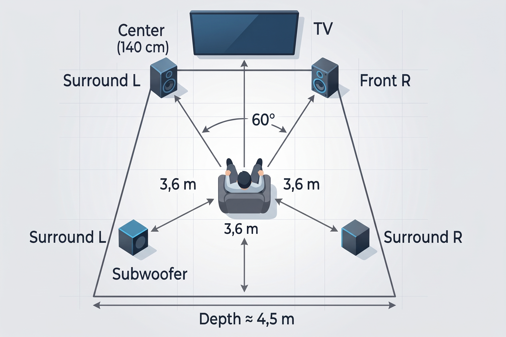
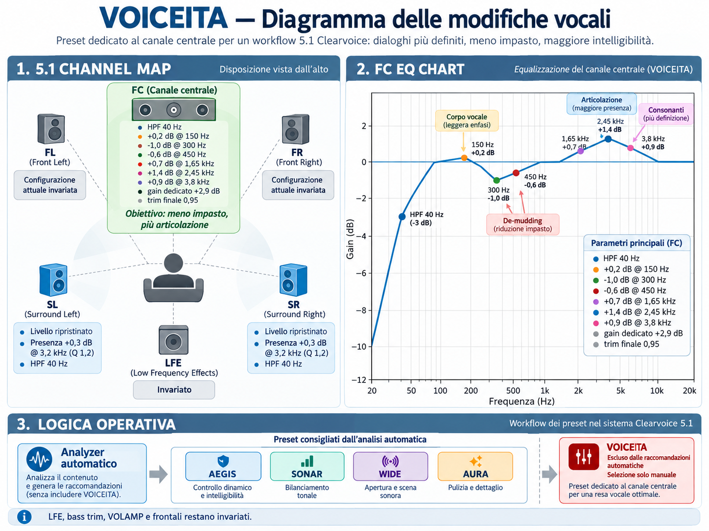
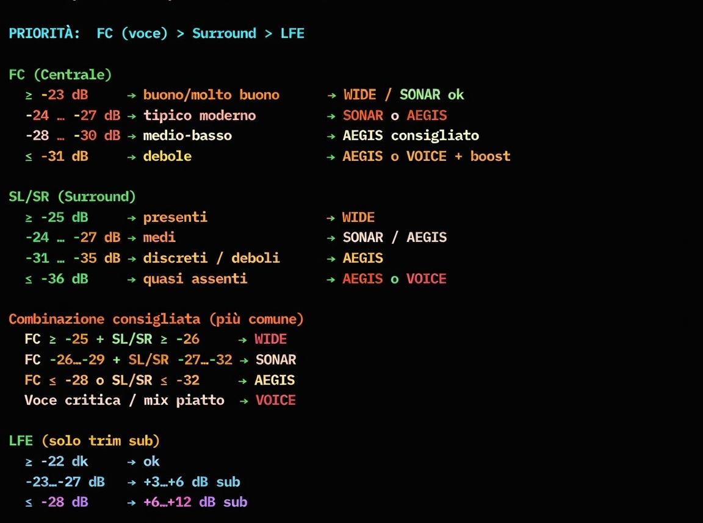

<p align="left">
  
</p>

[Italiano](README.md) | **English**

# 🎧 Psychoacoustic Suite — November 2026

A collection of **Bash/awk + FFmpeg** scripts for offline, repeatable analysis, normalization, correction and conversion of stereo, 5.1 and EAC3 Atmos/JOC audio.

> Not all heroes wear capes. Some wield `ffmpeg` and rewrite the laws of sound. In the multiverse of sonic chaos, every voice deserves to be heard.

## Contents

- [Reference setup](#reference-setup)
- [Requirements](#requirements)
- [Installation](#installation)
- [Included scripts](#included-scripts)
- [Output checks](#output-checks)
- [Quick start](#quick-start)
- [1. Analyzer](#1-analyzer)
- [2. Aegis / Sonar / Wide / Aura / Voiceita](#2-aegis--sonar--wide--aura--voiceita)
- [3. Stereo to 5.1 upmix](#3-stereo-to-51-upmix)
- [4. ASMR / VR](#4-asmr--vr)
- [5. Atmos to EAC3 5.1](#5-atmos-to-eac3-51)
- [Recommended workflows](#recommended-workflows)
- [Processing cost](#processing-cost)
- [Troubleshooting](#troubleshooting)
- [Limitations](#limitations)
- [License and author](#license-and-author)

The principle is **measure first, process second**. The analyzer measures the full-band scene, center prominence, voice-band masking and surround width. It selects a preset for each file and can generate a repeatable processing batch. The other scripts handle stereo upmixing, Atmos/EAC3 preparation and headphone processing.

## Reference setup

The 5.1 tuning targets home listening at low to moderate levels, compact speakers configured as **Small**, a shared AVR crossover around **110 Hz**, and one or two active subwoofers managed by the AVR. Dialogue intelligibility is a priority, particularly for Italian dialogue. Language preference in stream selection remains Italian even when reading this English guide.

Reference equipment: **Yamaha RX-V4A**, **Harman Kardon three-way** front speakers, **JBL SCS200** center/surrounds and two **Kenwood ST40** subwoofers. The tower fronts are also configured as Small: they provide greater dynamic capacity and mid/high-frequency capability, while the AVR handles bass below the crossover.

<p align="left">
  
</p>

The goals are clear dialogue without a megaphone effect, present but unobtrusive surrounds, controlled bass, selective processing and consistent gain staging. SONAR is not applied indiscriminately. Original Atmos playback remains a separate path when retained.

The Atmos preparer, analyzer and 5.1 processor disable **Dolby metadata DRC** when decoding AC3/EAC3, using the input option `-drc_scale:<stream_index> 0` before `-i`. This applies to the selected stream; other codecs keep their own decoding behavior. AVR DRC is independent and cannot undo compression already baked into a previous render. Stream-copied original tracks retain their data and metadata. This does not disable dynaudnorm, limiters or the suite's other DSP.

## Requirements

- **FFmpeg 8.x** and matching **ffprobe**; the suite is developed and validated with **8.1.2**.
- **Bash 4.x or later**, awk and mktemp.
- GNU coreutils for the analyzer, including `sha256sum`, `stat -c`, `realpath` and `mv -T`.
- FFmpeg built with **libsoxr** for upmixing and **libbs2b** for ASMR.

The audio scripts do not require Python. FFmpeg 7.x and earlier are outside the supported range. Do not use major version 9 or later until revalidated: astats/ebur128 output, filter options and channel-layout semantics can change. Use ffmpeg and ffprobe from the same build.

Supported platforms are Linux, macOS with Bash 4+ and GNU coreutils on `PATH`, and Windows through MSYS2, Git Bash or WSL2. The macOS system utilities alone do not meet analyzer requirements. AC3/EAC3 encoding runs on the CPU; video is normally copied without re-encoding.

```bash
ffmpeg -version
ffprobe -version
ffmpeg -hide_banner -filters 2>/dev/null | grep -w bs2b
ffmpeg -hide_banner -h filter=aresample 2>&1 | grep -i soxr
```

The upmixer requires SOXR and has no automatic fallback. ASMR exits with an explicit error if BS2B is unavailable.

## Installation

```bash
git clone https://github.com/Damocle77/Psicoacustics.git
cd Psicoacustics
chmod +x *.sh
```

Extract ZIP downloads completely. The active distribution consists of the five root-level scripts and the README. Old `.rar` archives, if present, are historical copies: do not extract them over the active scripts without comparing versions.

Run commands in Bash, including on Windows, and quote paths containing spaces. In Git Bash, `cd /e/Download` opens `E:\Download`. Scripts can also be invoked as `bash script_name.sh`.

```bash
for f in *.sh; do
  bash -n "$f" || exit 1
done
```

## Included scripts

| Script | Purpose |
|---|---|
| `audio_analyzer_volamp_psycho.sh` | 5.1 classifier; surround/center balance, voice band, masking, width, −21 LUFS reference, automatic 2.0–3.0 dB volamp and optional batch |
| `aegis_sonar_wide_aura_voice_volamp_psycho.sh` | Existing 5.1 processing with aegis, sonar, wide, aura and voiceita presets, center EQ, surround DSP, LFE control and Atmos bed compensation |
| `stereo251_upmix_psycho.sh` | V10 stereo-to-5.1 matrix upmix, center assist, adaptive rear bed, minimal synthetic LFE and music-oriented quad mode |
| `asmr_vr_intimate_psycho.sh` | Stereo headphone/ASMR/VR processing, BS2B, optional ITD/LFO, post-DSP loudnorm and verified output |
| `atmos_to_51_dynaudnorm_psicho.sh` | MKV with normalized primary EAC3 5.1 and stream-copied original Atmos/EAC3 as the secondary track |

The Atmos script deliberately retains the historical spelling **`psicho`**. Use the actual filename shown above.

## Output checks

| Processor | Retained check | Automatic correction |
|---|---|---|
| Aegis / Sonar / Wide / Aura / Voiceita | Primary audio format with ffprobe | None |
| Atmos preparer | Primary audio format with ffprobe | None |
| TO51 / QUAD upmix | Full-track post-codec True Peak, ceiling −0.1 dBTP | One retry with up to 3 dB attenuation |
| ASMR | Full-track post-codec True Peak, preset-specific ceiling | One retry with up to 3 dB attenuation |

The four processors no longer perform full source/output comparisons of RMS, sample peaks and sample count. FFmpeg errors, preflight checks and temporary-file publication remain. The analyzer retains the measurements needed for its decisions.

A final “track format verified” or “True Peak verified” message does **not** mean the output was fully compared with its source.

## Quick start

Command tokens remain unchanged: **`si` means yes**, `no` means no. Do not translate them to `yes` in commands. Filenames, preset names and metadata markers also remain unchanged.

```bash
# Analyze without generating a batch
./audio_analyzer_volamp_psycho.sh eac3 no 768k no "film.mkv"

# Process with SONAR and 2 dB volamp
./aegis_sonar_wide_aura_voice_volamp_psycho.sh eac3 si 768k sonar 2.0 "film.mkv"

# Process compatible files in the current directory
./aegis_sonar_wide_aura_voice_volamp_psycho.sh eac3 si 768k sonar 2.0 ""
```

SONAR/AEGIS use increased height contribution by default. Recognized Atmos sources enable bed compensation. Direct commands above leave analyzer-derived LFE gain and Bass trim at zero; use the generated batch to apply those corrections.

## 1. Analyzer

`audio_analyzer_volamp_psycho.sh` analyzes existing **5.1** tracks without modifying audio.

```text
DeltaSur   = RMS(SL/SR) - RMS(FL/FR/FC)
DeltaFC    = RMS(FC) - RMS(FL/FR)
VoiceDelta = RMS 250–5000 Hz(FC) - RMS 250–5000 Hz(FL/FR)
VoiceMask  = RMS 250–5000 Hz(SL/SR) - RMS 250–5000 Hz(FC)
Width MS   = RMS(SIDE) - RMS(MID)
```

VoiceDelta estimates center prominence in the voice band; VoiceMask increases when rear energy may mask the center. These are **energy measurements, not speech recognition**. Music or effects in the center can produce favorable values while obscuring words. `CENTER_FULL_SAFETY_GATE` checks full-band balance; none of these metrics separates dialogue from effects within a channel. Whole-track averages can hide problematic scenes. Recommendations indicate balance, not certified intelligibility.

VOICEITA is therefore **manual only**. The analyzer never selects it as a preset, alternative or fallback, and excludes its processed outputs from analysis and generated batches.

### Syntax and parameters

```bash
./audio_analyzer_volamp_psycho.sh <codec> <keep> <bitrate> <run> <file|directory|"">
./audio_analyzer_volamp_psycho.sh --files <codec> <keep> <bitrate> [run] <file1> [file2 ...]
```

The legacy order `<file|directory|""> [codec] [keep] [bitrate] [run]` remains accepted.

| Parameter | Values | Default |
|---|---|---|
| `codec` | `eac3`, `ac3`; written to batch | `eac3` |
| `keep` | `si`, `no`; retain selected source audio during processing | `no` |
| `bitrate` | AC3 256k–640k; EAC3 256k–768k, in 64k steps | AC3 640k; EAC3 768k |
| `run` | `si`: create/update batch; `no`: leave batch untouched | `si` |
| Input | File, directory or `""` for current directory | Required |

A bare bitrate number is accepted. Out-of-range or off-step values are rejected. In `--files` mode, the token after bitrate is a run flag only when exactly `si` or `no`; otherwise it is the first filename.

Stream selection favors suitable 5.1 tracks, Italian language and default disposition; it does not compare track duration against container duration. A single full-duration decode measures integrated loudness, LRA, sample peak, full-band and voice-band RMS, surround width and LFE/bass windows.

### Preset selection

| Priority | Condition | Preset | Interpretation |
|---:|---|---|---|
| 1 | `DeltaSur < -13 dB` | `sonar` | Very recessed surrounds; stronger Atmos-like treatment |
| 2 | `Width MS < -7 dB` | `wide` | Narrow/collapsed surrounds; lateral expansion |
| 3 | `DeltaSur < -7 dB` | `aura` | Moderately recessed surrounds; gentler rear treatment |
| 4 | Otherwise | `aegis` | Balanced scene; balanced DTS:X-like treatment |

If SONAR is selected and width is also below −7 dB, SONAR remains selected, WIDE is shown as the diagnostic alternative and confidence is low. This alternative takes precedence over borderline AURA; no combined preset is applied.

Virtually silent surrounds (RMS below −65 dBFS or either channel at −inf), a silent center (−inf), or SL/SR imbalance of at least 10 dB block batch publication and require manual inspection. Metrics remain visible, but no CHECK command is generated. Voice weakness/masking remain diagnostic; an empty voice band is reported as N/A.

Atmos detection uses the official FFprobe E-AC-3 profile or a trusted original-track marker. For a measured AURA preset:

| Condition | Result |
|---|---|
| `DeltaSur < -10.0 dB` and `Width MS >= -7 dB` | Promote to SONAR; low confidence, AURA alternative |
| No promotion and `DeltaSur < -8.5 dB` | Keep AURA; low confidence, SONAR alternative |
| Otherwise | Keep AURA |
| Measured AEGIS | Keep AEGIS; SONAR as a listening alternative |

WIDE or a WIDE alternative prevents Atmos overrides. Preset bias is independent of processor FC/LFE compensation: `bias preset=no` does not disable those offsets. Reports distinguish selected audio layout from verified/unverified Atmos status; `OutputAudio=5.1(side)` in batch comments describes the output layout.

The season summary uses the modal preset with at least **two-thirds agreement**; otherwise it reports MIXED. A DeltaSur spread above 4 dB also produces MIXED. Console colors are SONAR red, AEGIS orange, WIDE green and AURA purple/magenta.

| Width MS | Interpretation |
|---|---|
| `< -12 dB` | Collapsed |
| `-12 .. < -7 dB` | Narrow |
| `-7 .. < -3 dB` | Medium |
| `>= -3 dB` | Wide |

### Automatic volamp

The internal loudness reference is **−21 LUFS**. Volamp is total nominal per-channel gain before dedicated limiters and the final join.

| Loudness deficit | Volamp |
|---|---:|
| `< 1.8 dB` | 2.0 dB |
| `1.8 .. < 3.0 dB` | 2.5 dB |
| `>= 3.0 dB` | 3.0 dB |

Missing/invalid loudness uses 2.0 dB. For **LRA ≥ 18 LU**, volamp is capped at the 2.0 dB base: low integrated loudness with large dynamics can be intentional. These are total gains, not increments to add to the base. Regenerate older batches to adopt this policy. If needed, adjust the AVR input Volume Trim by approximately +1.5–2 dB after listening rather than pushing the DSP harder into its limiters.

### Automatic LFE balance

A fixed per-file LFE gain within **±2 dB** is passed to the processor. It is not AGC, does not alter preset selection/volamp and does not change limiter settings. Measurement shares the existing decode: an analysis-only **20–120 Hz** branch splits all six channels into aligned **0.5-second** windows, without padding the final window.

- **Active RMS:** sample-weighted LFE energy average for windows above the greater of −60 dBFS and maximum window RMS minus 30 dB.
- **P95:** sample-weighted 95th percentile of those active windows, using 0.1 dB histogram resolution.
- **Peak:** maximum full-band LFE sample peak, including energy outside the analysis band; this is not True Peak.
- **Bass mains:** summed FL/FR/FC/SL/SR energies over the same active LFE windows, averaged over time. This is not signal summation or an AVR/acoustic simulation.
- **Delta:** Active RMS minus Bass mains. Zero is not assumed to represent acoustic balance.

| Original LFE − bass mains delta | Class |
|---|---|
| `< -18 dB` | VERY_WEAK |
| `-18 .. < -14 dB` | WEAK |
| `-14 .. -6 dB` | BALANCED |
| `> -6 .. -2 dB` | HOT |
| `> -2 dB` | VERY_HOT |

Cuts require at least **30 seconds** of active LFE and average mains above −60 dBFS; they do not require 5% whole-file activity. Persistence is the sample-weighted fraction of active LFE time exceeding a window-delta threshold. Windows without mains above −60 dBFS do not confirm excess but remain in the denominator; partial windows count only actual samples.

| After applicable Atmos compensation | Candidate LFE gain |
|---|---:|
| Mean delta > −2 dB and at least 50% active time above −2 dB | −2 dB |
| Otherwise mean delta > −6 dB and at least 25% active time above −6 dB | −1 dB |
| Occasional excess or already compensated | 0 dB |

Delta comparisons are strict (`>`); duration/persistence thresholds are inclusive (`>=`). A failed −2 dB condition still allows evaluation of −1 dB. Gain is fixed over the whole file.

```bash
LFE_CUT_MIN_ACTIVE_SECONDS=30.0
LFE_HOT_MIN_PERSISTENCE=0.25
LFE_VERY_HOT_MIN_PERSISTENCE=0.50
LFE_ATMOS_COMPENSATION_DB=-0.5
```

These are script constants, not CLI flags. Verified Atmos uses the processor's existing −0.5 dB LFE offset when evaluating cuts; other sources use zero. Thus an original VERY_HOT class can still yield −1 or 0 dB. Reports include original/compensated delta, offset, persistence (`0.43` means 43%), activity, class, gain and reason. Bass trim coordination may reduce the cut further.

Boosts require **10 active seconds**, **5% of file samples**, and mains above −60 dBFS. VERY_WEAK proposes +2 dB and WEAK +1 dB. Considering volamp, Atmos offset and proposed gain, P95 must remain ≤ −18 dBFS and full-band sample peak ≤ −2 dBFS. Boost can be reduced in 0.5 dB steps or canceled.

Absent LFE, uncertain layout, insufficient data or a 5.1 safety override produce INSUFFICIENT_DATA and 0 dB. Initial probing may extend to 20 MB / 20 seconds to confirm layout. Thresholds are experimental listening heuristics; no new absolute RMS/P95 cut threshold was introduced. Dolby playback gain is not added to the file. The physical subwoofer also receives redirected main-channel bass; zero LFE gain does not imply unchanged overall bass. Peak margins are not a post-codec True Peak check.

### Automatic Bass trim

Bass trim addresses bass-heavy mixes including main-channel bass. It applies a fixed **100 Hz low shelf, Q 0.707, from 0 to −3 dB on all six channels**, before limiters. It never boosts bass or changes preset/volamp.

The analyzer reuses aligned 20–120 Hz windows and adds a synchronized 250–5000 Hz reference:

- Bass energy = summed energies of five mains plus LFE energy weighted by 10 (+10 dB **only in the calculation**).
- Reference = summed mid/high energies of the five mains in the same windows.
- Valid windows exceed the greater of −60 dBFS and maximum reference RMS minus 30 dB.
- Bass Delta is the dB ratio of sample-weighted average bass/reference energies.
- Persistence is the fraction of valid samples in windows whose ratio exceeds +6 dB; P95 Delta is diagnostic, with 0.1 dB resolution.

This is an energy estimate, not a physical subwoofer reconstruction: phase, crossover, calibration, room modes and speaker response are excluded. Absolute level alone does not decide trim. Analysis filters do not modify audio.

At least 10 valid seconds, 5% of the file and a reliable layout without a safety override are required. Otherwise trim is zero with INSUFFICIENT_DATA. Persistence below 25% also leaves zero trim despite isolated peaks.

| Bass Delta | Class | Trim |
|---|---|---:|
| ≤ +6 dB | BALANCED | 0 dB |
| > +6 .. +9 dB | HOT | −1 dB |
| > +9 .. +12 dB | VERY_HOT | −2 dB |
| > +12 dB | EXTREME | −3 dB |

`BASS_*` thresholds are initial heuristics, not a mastering standard. Reports show reference, delta, P95, persistence, valid duration, class, trim and reason.

When Bass trim is negative, any automatic LFE boost is canceled. If LFE gain plus Bass trim would fall below −3 dB, the LFE cut is reduced. This budget excludes volamp and Atmos compensation. The shelf is transitional around 100 Hz, so the sum is not flat gain across the band. Manual values remain authoritative; the processor does not override them with this analyzer policy.

```bash
./aegis_sonar_wide_aura_voice_volamp_psycho.sh eac3 no 768k sonar 2.0 --lfe-gain 0 --bass-trim -2 "film.mkv"
./aegis_sonar_wide_aura_voice_volamp_psycho.sh --files eac3 no 768k sonar 2.0 --bass-trim -1 -- "ep 1.mkv" "ep 2.mkv"
```

`--bass-trim` accepts decimal-point values from −3 to 0, default zero/no added filter. Invalid, positive, missing, duplicated or out-of-range options are rejected. Order: **preset → per-channel bass shelf → volamp/LFE/Atmos gains → channel limiters → join → master limiter**.

### Cache, progress and batches

Validated measurements are stored in `.clearvoice_analyzer_cache`. The key includes canonical path, size, modification time, stream index and algorithm version. Schema **`classifier-rms-voiceband-ebur-lfe-bass-v6-no-dolby-drc`** has 38 fields, including LFE/Bass measurements, four LFE persistence fractions, activity and latest decisions. Earlier schemas, including measurements with Dolby DRC enabled, are invalidated.

Measurement windows/gates, LFE HOT/VERY_HOT thresholds, Atmos offset and Bass HOT threshold affect the key. Cut-duration and decision-persistence requirements are reevaluated on cache hits. Changing decision-only thresholds can reuse audio measurements. Regenerate batches after tuning: existing batches retain explicit gains.

```bash
ANALYZER_CACHE=0 ./audio_analyzer_volamp_psycho.sh eac3 no 768k si ""
ANALYZER_PROGRESS_INTERVAL=5 ./audio_analyzer_volamp_psycho.sh eac3 no 768k si ""
ANALYZER_CACHE_DIR=/path/to/cache ./audio_analyzer_volamp_psycho.sh eac3 no 768k si ""
```

Default progress interval is 10 seconds. Delete the cache directory to force a complete rescan. `run=no` never overwrites or deletes an existing batch.

```bash
# One file with batch generation
./audio_analyzer_volamp_psycho.sh eac3 no 768k si "film.mkv"
# Analysis only
./audio_analyzer_volamp_psycho.sh eac3 si 768k no "film.mkv"
# Explicit files, no batch
./audio_analyzer_volamp_psycho.sh --files eac3 si 768k no "ep01.mkv" "ep02.mkv"
# Legacy-compatible list: run=si is implicit
./audio_analyzer_volamp_psycho.sh --files eac3 si 768k "ep01.mkv" "ep02.mkv"
```

Generated commands pass per-file volamp, `--lfe-gain` and `--bass-trim`, followed by `--` and the path. They count failures in `BATCH_FAILURES`. Example:

```bash
"$PROC" "$CODEC" "$KEEP" "$BITRATE" sonar 2.0 --lfe-gain 0.0 --bass-trim 0.0 -- film.mkv || BATCH_FAILURES=$((BATCH_FAILURES + 1))
```

The processor path defaults to:

```bash
PROC="${PROC:-./aegis_sonar_wide_aura_voice_volamp_psycho.sh}"
```

Execute the batch from its generation directory with the processor present, or override `PROC` with an absolute executable path. A failed analysis does not publish a partial batch. To prevent running an older batch after failure:

```bash
./audio_analyzer_volamp_psycho.sh eac3 no 768k si . && ./run_processing.sh
```

## 2. Aegis / Sonar / Wide / Aura / Voiceita

`aegis_sonar_wide_aura_voice_volamp_psycho.sh` processes **existing 5.1**. AEGIS, SONAR, WIDE and AURA combine center EQ with different spatial treatments. VOICEITA is a manual dialogue-oriented alternative without surround expansion.

```bash
./aegis_sonar_wide_aura_voice_volamp_psycho.sh <ac3|eac3> <si|no> <bitrate> <preset> <volamp> <file|"">
./aegis_sonar_wide_aura_voice_volamp_psycho.sh --files <ac3|eac3> <si|no> <bitrate> <preset> <volamp> <file1> [file2 ...]
```

Legacy order `<codec> <keep> <file|""> [bitrate] [preset] [volamp]` remains accepted. Its parser treats the last numeric value from 0 to 5.0 as volamp; a number ≥32 can be a bitrate without suffix.

| Parameter | Values/default |
|---|---|
| `codec`, `keep` | Required: `ac3`/`eac3`, `si`/`no` |
| `bitrate` | AC3 256k–640k (default 640k); EAC3 256k–768k (default 768k); 64k steps |
| `preset` | `aegis`, `sonar` (default), `wide`, `aura`, `voiceita` |
| `volamp` | 0–5.0 dB; default 2.0 dB when omitted; explicit values take precedence |
| Input | File or `""`/omitted for current directory |
| `--lfe-gain` | −2.0 to +2.0 dB, default 0.0 |
| `--bass-trim` | −3.0 to 0.0 dB, default 0.0 |

Above 2.0 dB volamp, the script warns about possible audible limiting. All five main channels use a **20 Hz, Q 0.707** safety high-pass; dedicated LFE filtering is left to hardware. This does not replace AVR bass management at about 110 Hz. `FRONT_EQ` is −0.4 dB at 320 Hz, +0.4 dB at 5 kHz and a +0.4 dB high shelf at 11 kHz, without front widening.

### Direct surround definition

The direct SL/SR branches use a 20 Hz high-pass. A final **3200 Hz bell, Q 1.2** is applied once to SL_final/SR_final: **+0.1 dB** for AEGIS/SONAR/WIDE/AURA, **+0.2 dB** for VOICEITA.

Order: preset surround block → final decorrelation/ambience (bypassed in VOICEITA) → SL/SR presence bell → bass trim/volamp → join, high shelf and limiters. The bell does not retune the spatial algorithms or raise overall surround gain. Direct delays remain 0 ms for AEGIS/SONAR and 1 ms for WIDE/AURA; presence, height, late-reflection and ambience branches retain their tuning. Such small boosts require level-matched listening to establish a perceptual benefit.

### VOICEITA

<p align="left"></p>
<p align="left"></p>

VOICEITA aims to improve Italian dialogue clarity at low/moderate listening levels. It reduces low-mid congestion and adds moderate vocal presence. It acts on the **entire center channel**, including music/effects; it neither isolates speech nor recognizes language. Compare presets at matched perceived loudness on actual dialogue.

The current script uses `volume=4.2dB` followed by `volume=0.95`, approximately **+3.75 dB excluding EQ and shared gains**, 0.5 dB above the earlier 3.7 dB setting. This static center gain is separate from common VOLAMP and can increase limiter activity on peaks.

The dedicated FC chain does not also apply `VOICE_EQ_BASE`:

| Filter | Frequency | Gain | Q |
|---|---:|---:|---:|
| High-pass | 20 Hz | — | 0.707 |
| Bell | 150 Hz | +0.2 dB | 1.1 |
| Bell | 300 Hz | −1.0 dB | 1.0 |
| Bell | 450 Hz | −0.6 dB | 1.2 |
| Bell | 1650 Hz | +0.7 dB | 1.6 |
| Bell | 2450 Hz | +1.4 dB | 1.3 |
| Bell | 3800 Hz | +0.9 dB | 2.0 |

The cuts target muddy/boomy speech; the boosts target consonant presence. No extra 1100, 5200, 6800 or 7200 Hz filters are added to this chain. Surrounds retain their overall gain, with 20 Hz high-pass and the final +0.2 dB presence bell, without `volume=0.88`. `DECORR_GAIN_VOICEITA=0`: no added expansion, delays, all-pass or decorrelation. Shared volamp, bass trim, limiters and applicable Atmos offsets remain active. To try VOICEITA on an analyzer-generated command, change only its preset while preserving the calculated gains.

### Height and decorrelation

`HEIGHT_MODE` affects only SONAR/AEGIS vertical branches SLh/SRh before summation, for Atmos and non-Atmos sources. The analyzer does not select it.

| Mode | Multiplier |
|---|---:|
| `reduced` | 0.75 |
| `normal` | 1.00; no extra filter |
| `increased` | 1.15; default |

```bash
HEIGHT_MODE=normal ./aegis_sonar_wide_aura_voice_volamp_psycho.sh eac3 si 768k sonar 2.0 "film.mkv"
HEIGHT_MODE=reduced ./run_processing.sh
```

Batches inherit the environment or use the processor default. Old batches calling the updated processor also use its new default; regenerate them to update calculated gains. Output names do not encode HEIGHT_MODE: use different input/output names to preserve A/B variants.

| Preset | `DECORR_GAIN` |
|---|---:|
| sonar | 0.055 |
| aura | 0.048 |
| wide | 0.042 |
| aegis | 0.034 |
| voiceita | 0 |

Delayed/decorrelated surrounds can change timbre when folded into stereo. Synthetic coherent signals show marked attenuation at 500 Hz with WIDE/AURA, partly from their 1 ms direct surround delay. This is not a decoder error or a prediction for every real mix. Check stereo downmixes with level-matched listening; VOICEITA adds neither these delays nor decorrelation.

### Gain staging and Atmos compensation

The common chain is:

```text
5.1 split → front/center EQ and surround DSP → optional six-channel bass shelf
→ individual main-channel volamp
→ FC: optional Atmos +0.5 dB → FC limiter
→ LFE: volamp → --lfe-gain → optional Atmos −0.5 dB → LFE limiter
→ 5.1(side) join → +0.4 dB high shelf at 12 kHz on non-LFE channels
→ master limiter → 48 kHz / fltp → AC3/EAC3 encoding and mux
```

| Limiter | Limit | Attack | Release | Auto-level | Latency compensation |
|---|---:|---:|---:|---|---|
| FC | 0.89 | 1.5 ms | 80 ms | Off | On |
| LFE | 0.94 | 2 ms | 120 ms | Off | On |
| Master | 0.89 | 2.5 ms | 80 ms | Off | On |

All use `level=0`. FC/master ceiling 0.89 is approximately −1.01 dBFS. Sample headroom does not guarantee a post-codec True Peak ceiling: lossy encoding can create new peaks. Moving the high-pass from 40 to 20 Hz reduces its influence around the AVR crossover but does not eliminate phase rotation or guarantee subwoofer alignment. Measure and listen on the actual system.

`--lfe-gain` is static gain, not EQ or AGC; zero adds no gain filter. Duplicate/incomplete/out-of-range options are rejected. `--` ends option parsing to protect filenames. Example nominal gain: `+4.0 -1.5 -0.5 = +2.0 dB` before the LFE limiter. The shelf remains frequency dependent; actual peak gain may be lower because of limiting.

Atmos compensation is a project-specific bed tuning choice, not a universal property of Dolby Atmos. It adds **FC +0.5 dB / LFE −0.5 dB** after volamp and before dedicated limiters for every preset when an EAC3 Atmos profile exists in the container or an exact trusted audio-track title is found:

| Evidence | Compensation |
|---|---|
| FFprobe EAC3 Atmos profile | Enabled, takes precedence |
| `EAC3 Atmos Original` | Enabled |
| `EAC3 Atmos (Original)` (legacy) | Enabled |
| Only `EAC3 Original`, without Atmos profile | Disabled |
| Generic filename/title containing Atmos | Insufficient |

Title matching uses the full title, case-insensitively, and handles Windows FFprobe CRLF. A marker on the secondary original track can enable compensation while processing the normalized primary track. Detection is reset for each file, never inherited from the previous one.

```bash
ATMOS_FC_GAIN_DB="0.5"
ATMOS_LFE_GAIN_DB="-0.5"
```

These are script constants, not CLI/environment overrides. If changing the LFE offset, keep analyzer `LFE_ATMOS_COMPENSATION_DB` aligned. Offsets apply even with volamp zero. With volamp 2.0 and zero LFE/Bass correction, nominal final FC/LFE volume stages are +2.5/+1.5 dB before EQ/preset gains and limiting.

Analyzer, processor and preparer report verified/unverified Atmos. The positive message does not identify stream number or evidence type. Analyzer/processor can use a profile or trusted marker; the preparer verifies the profile. Unverified means no recognized evidence was found, not a guarantee that the source is not Atmos.

Pass the **complete intermediate MKV** to the processor: extracting only the bed can remove the secondary-track evidence and disable compensation. The Atmos preparer itself does not apply these offsets. Output remains 5.1 with one LFE; a 5.2 AVR routes that single channel to two subwoofers.

### Encoding and publication

DSP, encoding and mux run in one FFmpeg process with fatal errors (`-xerror`), writing `mux.mkv` under a unique `.<output_name>.partial.<random>/` created beside the final output. The first non-attached video stream, subtitles, attachments, metadata and chapters are copied; `keep=si` also retains the selected original audio.

The primary track must have the requested AC3/EAC3 codec, six channels, `5.1(side)`, 48 kHz and default disposition. Probe examines up to 20 MB / 20 seconds, not the whole track. Only successful encode/mux and format validation replace the final file. Failures preserve `mux.mkv` and `filter_complex.txt` for debugging; successful publication removes temporary files. INT/TERM exit with 130/143.

There is **no post-codec True Peak check or retry** here. Without full source/output comparison, silence, lost channel content or abnormal duration can escape a structural format check. Final counters report failures and return nonzero if any file fails.

```text
<name>_EAC3_Sonar.mkv
<name>_EAC3_Aegis.mkv
<name>_EAC3_Wide.mkv
<name>_EAC3_Aura.mkv
<name>_EAC3_Voiceita.mkv
<name>_AC3_Voiceita.mkv
```

## 3. Stereo to 5.1 upmix

`stereo251_upmix_psycho.sh` creates a plausible multichannel scene from **two-channel stereo**, without claiming to recover discrete information absent from the source.

```bash
./stereo251_upmix_psycho.sh <ac3|eac3> <si|no> [file|""] [bitrate] [to51|quad]
```

Codec and keep are required. Input defaults to the current directory; bitrate defaults to 448k, accepting AC3 256k–640k or EAC3 up to 768k in 64k steps. `448`, `448K`, decimal leading zeros (`0448K`) and supported M suffixes are normalized to kbps. Invalid values are rejected before encoding.

Stream scores are stereo +1000, Italian +300 and default +200. Key/value ffprobe parsing avoids positional field dependencies. Read/probe failure counts as failure and returns 1; valid containers without stereo are skipped. AC3/EAC3 decode and encoded-candidate True Peak measurement use `drc_scale=0`; other decoders do not receive this private option.

### Presets and tuning

**TO51** is the normal choice for films, series, anime and cartoons. Fronts remain full-band with preventive headroom; center is an L+R assist, not a full phantom-center replacement. Surrounds mainly use L−R/R−L plus a quiet filtered mono rear bed. Synthetic LFE is minimal because bass management belongs to the AVR. Asymmetric delays/all-pass filters add light decorrelation.

**QUAD** feeds FL to SL and FR to SR with limited bandwidth and Haas delay. It is intended for music/concerts and can pull dialogue into the rear; it is not the default fiction preset.

| Setting | TO51 | QUAD |
|---|---|---|
| `FRONT_VOL` | 0.96 | 0.96 |
| `FC_MIX` / `FC_VOL` | 0.28 / 0.86 | 0.28 / 0.78 |
| `FC_HP` / `FC_LP` | 60 / 6500 Hz | 60 / 5200 Hz |
| `LFE_VOL` | 0.035 | 0.03 |
| Side / rear gain | `SUR_PAN=0.50`, `SUR_VOL=0.86` | `QUAD_VOL=0.58` |
| Rear bed | `SUR_BED_VOL=0.06`, `SUR_ADAPTIVE=1` | Air layer 0.035 |
| Delays L/R | Side 14/20 ms, bed 24/33 ms | Rear 16/19 ms |
| Bandwidth | Side 170–8500 Hz, bed 320–5600 Hz | Rear 250–8000 Hz |

The center high-pass is 60 Hz rather than the earlier 102 Hz to avoid excessive attenuation alongside an AVR crossover near 110 Hz. V10 lowers TO51 FC_MIX from 0.32 to 0.28 (about −1.16 dB), keeping FC_VOL 0.86; QUAD retains its own tuning.

Adaptive bed correlation is `r = E[L·R] / sqrt(E[L²]·E[R²])`, with approximately 80 ms exponential averages and division-by-zero protection. Additional bed gain is `0.35 + 0.65*clip(1-r, 0, 1)`. Identical L/R reduce the bed by about 9.1 dB; zero/negative correlation retains the configured level. Calculation and application occur in one filter, without a preliminary scan or added delay. The side matrix is unchanged. `SUR_ADAPTIVE=0` restores a fixed bed, only in TO51.

Duplicated mono cancels the side component and reduces the bed; quiet surrounds are expected. True single-channel inputs are skipped. L=−R cancels center/synthetic LFE while surrounds remain. A left-only sound also contributes to center and surrounds: the matrix does not isolate dialogue or only shared content. Stereo folding of filtered/delayed channels can change timbre and balance; retain the original stereo with `keep=si` and compare at matched volume.

### Processing and checks

```text
Stereo selection → SOXR 48 kHz / precision 28 if needed → FL/FR split
→ L+R center assist, minimal LFE, matrix/decorrelated surrounds
→ 5.1(side) join → SOXR 192 kHz / precision 28
→ alimiter limit=0.97:attack=3:release=60:level=0:latency=1
→ SOXR 48 kHz / precision 28 / cutoff 0.91
→ AC3/EAC3, dialnorm −31
```

SOXR, encoder and required filters are checked first. Full comparative source/output scans are removed. A complete **post-codec True Peak** measurement remains, ceiling **−0.1 dBTP**. Only exceeding this ceiling triggers one retry from the source, with final attenuation `min(measured_TP - (-0.1) + 0.2, 3.0) dB` after returning to 48 kHz. The retry must pass again. Missing/inconclusive measurements or other errors block publication without retry.

`audio.mka`, optional `audio.retry.mka` and `mux.mkv` live in a unique hidden partial directory. After verification, one complete mux copies the encoded audio and preserves source timestamps. Only successful mux replaces the final file. Errors/interruption preserve temporary files; INT/TERM return 130/143. Full candidate decode catches decode errors, but does not compare duration, RMS or channel identity against the source.

```text
<name>_UPMIX_5.1_V10_TO51.mkv
<name>_UPMIX_5.1_V10_QUAD.mkv
```

Language propagates to processed audio and retained stereo. Recognized processed suffixes, including V10, are excluded from folder batches. V10 names distinguish earlier V9 outputs. Counters are OK/FAILED/SKIPPED; any probe/encode/check/mux/publication failure returns 1. If all files are skipped without errors, exit is 0 with “no file processed.”

```bash
./stereo251_upmix_psycho.sh eac3 si "episode.mkv" 448k to51
./stereo251_upmix_psycho.sh eac3 si "concert.mkv" 640k quad
./stereo251_upmix_psycho.sh ac3 no "" 448k to51
./stereo251_upmix_psycho.sh eac3 no

# Reduce center assist
FC_VOL=0.82 FC_MIX=0.26 ./stereo251_upmix_psycho.sh eac3 no "film.mkv" 448k to51
# Raise side surrounds before raising the mono bed
SUR_VOL=0.92 ./stereo251_upmix_psycho.sh eac3 no "film.mkv" 448k to51
# Reduce QUAD rear level
QUAD_VOL=0.50 ./stereo251_upmix_psycho.sh eac3 no "concert.mkv" 448k quad
# Compare fixed versus adaptive bed; preserve variants under different names
SUR_ADAPTIVE=0 ./stereo251_upmix_psycho.sh eac3 no "film.mkv" 448k to51
```

Other environment controls are `SUR_DELAY_L/R`, `BED_DELAY_L/R`, `QUAD_DELAY_L/R`, `QUAD_HP/LP` and `QUAD_AIR_VOL`, alongside the table's gain/bandwidth controls. Check routing, A/V sync, both presets and stereo downmix on real material. The distribution has no dedicated automated upmix regression suite; `bash -n stereo251_upmix_psycho.sh` checks syntax, and the script itself performs the documented True Peak verification.

## 4. ASMR / VR

`asmr_vr_intimate_psycho.sh` processes stereo for headphones, ASMR, VR and close sources. Features include score-based stereo selection, key/value probing, encoder preflight, preset-specific two-pole high/low-pass, **BS2B J. Meier** crossfeed, Mid/Side adjustment, controlled crosstalk, sample-delay ITD, proximity EQ, optional tremolo/flanger LFO and post-DSP loudnorm.

```bash
./asmr_vr_intimate_psycho.sh [options] <file1> [file2 ...]
```

| Option | Meaning |
|---|---|
| `-o <dir>` | Output directory; created if absent, creation failure is fatal |
| `-d <mode>` | `whisper` (default), `near`, `center` |
| `-k` | Retain original stereo track |
| `-l` | Enable Breathing LFO |
| `-t` | Disable ITD; useful for already binaural audio |
| `-c <codec>` | `aac` (default), `opus` through libopus, or `flac` |
| `-b <rate>` | Default 320k; ignored for FLAC |
| `-f` | Force overwrite |
| `-h` | Help |

| Preset | Loudnorm target | Distance | Final limiter: limit / attack / release |
|---|---|---|---|
| whisper | −20 LUFS, TP −2.0, LRA 13 | 20–30 cm | 0.96 / 2 ms / 40 ms |
| near | −19 LUFS, TP −1.8, LRA 12 | 30–50 cm | 0.97 / 2.5 ms / 45 ms |
| center | −18 LUFS, TP −1.5, LRA 11 | Front | 0.97 / 3 ms / 50 ms |

All final limiters use `level=0:latency=1` and follow ITD/LFO. The chain is band-pass → 48 kHz → BS2B → Mid/Side → crosstalk → EQ → ITD → optional LFO → loudnorm → 48 kHz → final limiter → optional retry trim → audio-only encode → full post-codec True Peak → one complete mux with audio copy.

BS2B is mandatory. On existing binaural material, BS2B/crosstalk can alter the original interaural cues; `-t` avoids the additional ITD but does not remove those other stages. Compare by listening.

Full comparative RMS/sample-count scans are removed. Complete candidate decode with `ebur128=peak=true` remains. The ceiling equals the preset TP for **all three codecs**: −2.0, −1.8 or −1.5 dBTP. Decode errors or missing/inconclusive measurements block publication. Only ceiling exceedance triggers one final retry from the source with `min(measured_TP - ceiling + 0.2, 3.0) dB` attenuation after loudnorm, resampling and limiting. DSP settings remain unchanged; trim can lower achieved loudness below target. The retry must pass verification.

Temporary files and atomic publication follow the upmixer's audio-only candidate/one-mux model. The partial directory is beside the output, including with `-o`. Timestamps are preserved; errors/interruption retain temporary files; INT/TERM return 130/143. True Peak does not compare source/output duration, RMS or channel presence.

```bash
./asmr_vr_intimate_psycho.sh -d whisper -c aac -b 320k "asmr.mkv"
./asmr_vr_intimate_psycho.sh -d near -k -l -o output "clip01.mkv" "clip02.mkv"
./asmr_vr_intimate_psycho.sh -d center -c flac "voice.wav"
```

Output suffixes are `_INTIMATE_WHISPER.mkv`, `_INTIMATE_NEAR.mkv` and `_INTIMATE_CENTER.mkv`, optionally followed before `.mkv` by `_NOITD`, `_LFO` or `_NOITD_LFO`. Counters and exit codes reflect actual failures.

## 5. Atmos to EAC3 5.1

`atmos_to_51_dynaudnorm_psicho.sh` prepares **EAC3 Atmos/JOC** material as two separate paths in the same MKV:

1. Normalized **EAC3 5.1**, primary/default, for analysis and optional psychoacoustic processing.
2. Original **Atmos/EAC3**, bit-perfect stream copy as a secondary/non-default track.

FFmpeg decodes the available multichannel bed; it does **not render Atmos objects like an AVR**. Select the second track for original Atmos playback. For DSP, pass the complete intermediate MKV to the analyzer/processor so original-track evidence remains available. The script does not automatically reinsert original Atmos into later Aegis outputs.

```bash
./atmos_to_51_dynaudnorm_psicho.sh [bitrate] <file|directory|"">
./atmos_to_51_dynaudnorm_psicho.sh --files <bitrate> <file1> [file2 ...]
```

Legacy `<file|directory|""> [bitrate]` is accepted. Input is required; `""` selects current directory. Bitrate is 256k–768k in 64k steps, default 640k.

### Selection and normalization

Only EAC3 streams with **exactly six channels** are eligible, preventing channel loss in positional `c0..c5` mapping. FFprobe's official `Dolby Digital Plus + Dolby Atmos` profile identifies Atmos. One key/value probe reads index, profile, channels, layout, language and default disposition. Eligible Atmos candidates score Italian +300/default +200. If no Atmos candidate is identifiable, the best six-channel EAC3 is used as fallback with a warning on stderr.

Original-track titles are **`EAC3 Atmos Original`** for verified Atmos and **`EAC3 Original`** for fallback. The latter alone does not enable downstream Atmos offsets. Primary audio title is **`EAC3 5.1 Normalized`**, default, with dialnorm −31. Language/main metadata are propagated.

```text
Input bed decode with Dolby DRC disabled → aformat 48 kHz/fltp
→ positional 5.1(side) mapping → optional high-pass
→ dynaudnorm → limiter → primary EAC3 5.1
Original audio → stream copy → secondary non-default audio
```

The original normalization parameters remain **`peak=0.92` and `maxgain=4`**; there are no measurements justifying their retuning. The appended limiter is a separate stage.

```text
dynaudnorm=framelen=500:gausssize=31:peak=0.92:maxgain=4:targetrms=0:compress=0:coupling=1:altboundary=0,
alimiter=level_in=1:level_out=1:limit=0.89:attack=10:level=0:latency=1
```

Frame length is 500 ms with 31-frame Gaussian smoothing. Peak 0.92 is the normalizer's target; maxgain 4 is a **linear factor**, about **+12.04 dB**, not 4 dB. RMS targeting and additional internal compression are disabled; coupling preserves channel balance and altboundary uses standard behavior. The appended limiter has a 10 ms lookahead (`attack`, not a `lookahead` option), default 50 ms release, no auto-level and compensated latency. Its 0.89 sample ceiling is about −1.01 dBFS, without a guaranteed post-codec True Peak bound.

There is no preparer high-pass by default. `ATMOS_HIGHPASS_HZ=20` prepends a 20 Hz, Q 0.707 high-pass to **all channels including LFE**; only 0/default and 20 are accepted. This also attenuates useful energy near 20 Hz and adds to the later processor's main-channel 20 Hz filters. AVR bass management cannot restore removed frequencies. Original stream-copied audio is never filtered.

```bash
./atmos_to_51_dynaudnorm_psicho.sh 640k "film.mkv"
ATMOS_HIGHPASS_HZ=20 ./atmos_to_51_dynaudnorm_psicho.sh 640k "film.mkv"
./atmos_to_51_dynaudnorm_psicho.sh "film.mkv" 768k
./atmos_to_51_dynaudnorm_psicho.sh /path/to/folder
./atmos_to_51_dynaudnorm_psicho.sh "" 768k
```

This stage applies no dedicated LFE processing or FC/LFE compensation. The downstream processor handles applicable +0.5/−0.5 dB offsets. In the upmixer, the 20 Hz high-pass remains confined to synthetic LFE; ASMR retains its preset-specific vocal high-pass at 60/70/80 Hz. Analyzer filters measure rather than modify audio.

### Encoding and output

EAC3 encoder availability is checked first. One FFmpeg process with `-xerror` performs decode, filtering, encoding and mux with video, subtitles, attachments and both audio tracks. There is no intermediate MKA and no forced `copyts` or `avoid_negative_ts`.

Primary format is verified as EAC3, six channels, `5.1(side)`, 48 kHz, default, using up to 20 MB / 20 seconds of initial probe. No complete comparative scan, post-codec True Peak or retry is performed. The temporary `mux.mkv` is created in `.<output_name>.partial.<random>/`; it replaces the final **`<name>-0.mkv`** only after successful encoding/mux and verification. Errors/interruption preserve the candidate; INT/TERM return 130/143. Structural checks alone cannot detect every silent signal, lost channel or abnormal duration. Counters report OK/FAILED/SKIPPED; any failed file returns 1.

## Recommended workflows

| Source / destination | Workflow |
|---|---|
| Existing usable AC3/EAC3 5.1 | Analyzer → generated batch → per-file AEGIS/SONAR/WIDE/AURA; VOICEITA manual |
| Atmos/JOC | Atmos preparer → dual-track MKV → analyzer → optional bed DSP; original Atmos remains separately playable |
| Stereo for 5.1 | TO51 upmix; QUAD mainly for music/concerts |
| Stereo for headphones | ASMR → AAC/Opus/FLAC |

An upmix is already a final product. Do not add Aegis by default: it can further boost synthetic surrounds/decorrelation. Use analyzer/Aegis only after measurement and level-matched A/B comparisons, without unjustified extra boosts.

## Processing cost

| Script | Relative cost | Main work |
|---|---|---|
| Analyzer | Medium/high | One full decode feeding loudness, RMS, voice, width and bass branches; cached later runs |
| Upmix | Medium/high | Matrix, SOXR, complete True Peak check and possible retry; one mux |
| ASMR | Medium/high | Loudnorm, BS2B, complete True Peak check and possible retry; one mux |
| Atmos preparer | Medium | Dynaudnorm and one mux; quick structural check |
| 5.1 processor | Medium/high | DSP, audio encoding and mux in one process; quick structural check |

Actual time depends on duration, source codec, CPU, storage and FFmpeg build.

## Troubleshooting

**Analyzer failures and stale batches.** Unsuitable tracks are skipped; probe/analysis errors are failures. Analyzer returns 1 if any file fails or no valid result is obtained. A mixed list of valid/unsuitable files can succeed, but a list with errors never publishes a partial batch. `run=si` writes a same-directory temporary batch and publishes only after successful write/chmod; failure preserves the previous batch with a warning. Do not execute that old batch as a result of the failed run. `run=no` always leaves it intact. INT/TERM stop the decoder, remove temporary files and return 130/143. Analyzer/Aegis use `-xerror`.

**Scripts do not start.** Check Bash, executable permission, syntax and tool versions. On Windows use `which bash`, `which ffmpeg`, `which ffprobe`, `which awk`. Use Bash, not a different shell. These scripts run directly: no application compilation or GitLab CI configuration is required. Analyzer/Aegis CSV parser consistency and additional preflight checks remain maintenance opportunities.

```bash
chmod +x *.sh
bash -n script_name.sh
ffmpeg -version
ffprobe -version
```

**Missing SOXR/BS2B.** Run the checks in Requirements. Use an FFmpeg build compiled with the required library; ASMR fails before encoding if BS2B is missing.

**No batch wanted / selected episodes only.**

```bash
./audio_analyzer_volamp_psycho.sh eac3 no 768k no .
./audio_analyzer_volamp_psycho.sh --files eac3 no 768k si "ep01.mkv" "ep04.mkv" "ep08.mkv"
grep -n '^PROC=' run_processing.sh
```

The batch processor path must resolve from its working directory; override `PROC` when needed.

**Stereo input / Atmos input.** Use the upmixer for stereo, not the existing-5.1 processor. For Atmos, prepare the dual-track file and retain the complete container for downstream detection; choose its second track for untouched Atmos playback.

**Automatic processing blocked.** A warning about virtually silent surrounds means manual mix inspection is required. The batch is not updated; do not run a previous batch for this failed analysis.

**Volamp sounds high.** Processor default is 2.0 dB, allowed manual range 0–5.0. Analyzer uses 2.0/2.5/3.0 dB for its four automatic presets; VOICEITA is manual. The warning above 2.0 dB indicates potentially stronger limiting. Nominal gain is not necessarily the final LUFS increase because EQ/limiting affect the result.

**Upmix center dominates.** Reduce `FC_MIX` first, then `FC_VOL`, for example `FC_MIX=0.26 FC_VOL=0.82`.

**TO51 surrounds too quiet.** Raise `SUR_VOL` first (for example 0.92), then only if needed consider `SUR_BED_VOL=0.08`. Large bed levels increase dialogue leakage; adaptive correlation attenuation still operates. Near-silent surrounds on duplicated mono are expected. Keep TO51 for mono/narrow fiction; one-channel sources are skipped.

**Dialogue in the rear.** Prefer TO51 over QUAD and try `SUR_BED_VOL=0.03`. **QUAD too strong behind:** try `QUAD_VOL=0.50`. Use these environment assignments before the upmix command, and compare at matched volume.

**Output already exists.** Interactive prompts use **`[s/n/t]`**, unchanged in the English documentation: `s` overwrites one file, `n` skips, `t` overwrites all subsequent files. Noninteractive sessions normally skip existing outputs. The Atmos prompt reads a single terminal key without Enter.

## Limitations

The suite does not create real Atmos from non-Atmos material, render objects as an AVR does, replace calibration/distances/levels/bass management, recover absent source information or guarantee the same result across rooms/speakers/listening levels. It uses neither AI nor opaque DSP. Controlled A/B listening is still needed.

## License and author

MIT License.

**Sandro (D@mocle77) Sabbioni**

> Restoring order to the Sonic Force takes just one Bash script. This is the way!
