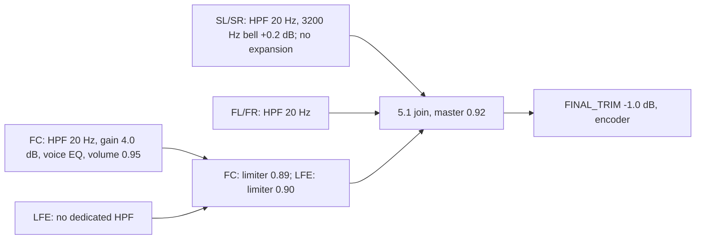

<p align="left">
  
</p>

[Italiano](README.md) | [**English**](README.en.md)

# 🎧 Psychoacoustic Suite - (Stable) November 2026

A suite of **Bash, AWK and FFmpeg** scripts for analyzing, correcting and transforming stereo, 5.1 and EAC3 Atmos/JOC audio offline, with repeatable and controlled processing.

> Not all heroes wear capes. Some wield `ffmpeg` and rewrite the laws of sound. **Because in the multiverse of sonic chaos, every voice deserves to be heard**.

## Contents

- [Reference setup](#reference-setup)
- [Requirements](#requirements)
- [Installation](#installation)
- [Included scripts](#included-scripts)
- [Post-processing checks](#post-processing-checks)
- [Quick start](#quick-start-manual-commands)
- [1. Analyzer: 5.1 analysis and classification](#1-audio_analyzer_psychosh)
- [2. Aegis / Sonar / Wide / Aura / Voiceita: 5.1 processing](#2-aegis_sonar_wide_aura_voice_psychosh)
- [3. Stereo → 5.1 upmix](#3-stereo251_upmix_psychosh)
- [4. ASMR / VR: headphone processing](#4-asmr_vr_intimate_psychosh)
- [5. Atmos: EAC3 5.1 preparation](#5-atmos_to_51_dynaudnorm_psichosh)
- [Suggested workflows](#suggested-workflows)
- [Approximate processing cost](#approximate-processing-cost)
- [Troubleshooting](#troubleshooting)
- [What the suite does not do](#what-the-suite-does-not-do)
- [License](#license)
- [Author](#author)

The approach is simple: **measure first, process second**. The analyzer measures the full-band scene, vocal prominence, masking and surround width, then chooses a preset for each file and can generate a repeatable batch. The other scripts handle stereo upmixing, optional Atmos/EAC3 preparation and headphone processing.

The 5.1 tuning targets a domestic system with front, center and compact surround speakers all configured as **Small**, a single AVR crossover around **110 Hz**, one or two active subwoofers managed by the AVR, moderate or low listening levels, and a focus on speech intelligibility, especially Italian dialogue.

The 5.1 pipeline disables **Dolby metadata DRC** when decoding AC3/EAC3. The Atmos preparer, analyzer and Aegis/Sonar/Wide/Aura/Voiceita processor place the input option `-drc_scale:<stream_index> 0` before `-i` in the FFmpeg command. It applies to the selected stream; other codecs retain their own decoding behavior. AVR DRC is independent and cannot undo compression already baked into a previous render. Original tracks retained through stream copy keep their original data and metadata.

Reference system: **Yamaha RX-V4A**, **Harman Kardon 3-way** front speakers, **JBL SCS200** center/surround speakers, **2× Kenwood ST40** subwoofers, AVR bass management at **110 Hz**.

The floorstanding front speakers are also configured as **Small**. Their main benefits are dynamic capacity and mid/high-frequency reproduction; content below the crossover is handled by the AVR's bass management.

## Reference setup

<p align="left">
  
</p>

Main goals:

- intelligible dialogue without a megaphone effect;
- audible surrounds that do not overwhelm the scene;
- controlled bass, mainly managed by the AVR and subwoofers;
- selective processing: SONAR is not applied indiscriminately;
- no automatic loudness normalization in the analyzer/5.1 processor path;
- listening volume controlled on the AVR;
- repeatable batches for films, episodes and entire folders;
- a separate original Atmos playback path when required.

## Requirements

### Software

- **FFmpeg 8.x**, required and supported;
- **ffprobe**;
- **Bash 4.x+**;
- **awk** for audio analysis and checks;
- **mktemp** for temporary files in all five scripts;
- **GNU coreutils** for the analyzer (`sha256sum`, `stat -c`, `realpath`, `mv -T`), plus standard shell utilities;
- an FFmpeg build with **libsoxr** for `stereo251_upmix_psycho.sh`;
- an FFmpeg build with **libbs2b** for `asmr_vr_intimate_psycho.sh`.

The audio scripts do not require Python.

The suite is developed and verified with **FFmpeg/ffprobe 8.1.2**. Releases above major version 8 (`9.x` and later) require renewed validation: `astats`/`ebur128` text output, filter options and channel-layout semantics may change. FFmpeg 7.x and earlier are also outside the supported scope. Use `ffmpeg` and `ffprobe` from the same build.

The upmixer requires `resampler=soxr` and checks SOXR at startup, without an automatic fallback. The ASMR script checks `bs2b` and exits with an explicit error if it is unavailable.

Useful checks:

```bash
ffmpeg -version
ffprobe -version
ffmpeg -hide_banner -filters 2>/dev/null | grep -w bs2b
ffmpeg -hide_banner -h filter=aresample 2>&1 | grep -i soxr
```

### Operating systems

- Linux;
- macOS with Bash 4+ and GNU coreutils in `PATH` (the system tools alone are insufficient for the analyzer);
- Windows through MSYS2, Git Bash or WSL2.

AC3/EAC3 encoding runs on the CPU. Hardware acceleration usually concerns video, which this suite copies without re-encoding.

## Installation

```bash
git clone https://github.com/Damocle77/Psicoacustics.git
cd Psicoacustics
chmod +x *.sh
```

If downloading a ZIP, extract it completely before running the scripts.

The active distribution consists of the five main `.sh` scripts and documentation in the repository root. The `.rar` archives are older snapshots: they are not updated with the active files and should not be extracted over them without comparison.

Run the commands in this guide in Bash (Git Bash, MSYS2 or WSL on Windows). For example, `cd /e/Download` in Git Bash opens `E:\Download`. Use `bash script_name.sh` or `./script_name.sh`, and quote paths containing spaces.

**CLI values remain `si` and `no` in English examples.** `si` means yes; do not replace it with `yes`. Preset names, option names, environment variables and metadata markers also remain unchanged.

Quick syntax check:

```bash
for f in *.sh; do
  bash -n "$f" || exit 1
done
```

## Included scripts

| Script | Purpose |
|---|---|
|  | Audio-metric 5.1 classifier; diagnostic loudness and LFE/bass measurements, optional batch generation |
|  | Existing-5.1 processor with `aegis`, `sonar`, `wide`, `aura` and `voiceita`; preserved voice EQ and psychoacoustics, no automatic common gain or Atmos compensation |
|  | V10 stereo → 5.1 upmix: L−R matrix, center assist, adaptive rear bed in `to51`, minimal LFE, verified output and a music-oriented `quad` preset |
|  | Stereo headphone/ASMR/VR processing with BS2B, optional ITD, post-DSP loudnorm, LFO and verified output |
|  | Optional preparer: default EAC3 5.1 `preserve`, optional limiter and copied original; `normalized` retains legacy DSP |

The Atmos script retains the historical spelling `psicho`; this guide uses its actual filename.

## Post-processing checks

| Processor | Retained check | Possible automatic correction |
|---|---|---|
| Aegis / Sonar / Wide / Aura / Voiceita | Primary-track format through ffprobe | None |
| Atmos preparer | Primary-track format through ffprobe | None |
| TO51 / QUAD upmix | Full-duration post-codec True Peak, −0.1 dBTP ceiling | One retry with up to 3 dB attenuation |
| ASMR | Full-duration post-codec True Peak, preset ceiling | One retry with up to 3 dB attenuation |

The four processing scripts no longer perform full-duration source/output comparisons for RMS, sample peak and sample count. FFmpeg error handling, preflight checks and temporary-file publication remain. The analyzer retains the measurements needed for its decisions.

Final messages distinguish **“track format verified”** (`formato traccia verificato`) from **“True Peak verified”** (`True Peak verificato`). Neither indicates a complete comparison with the source signal. Upmix V10 is documented below.

## Quick start: manual commands

Analyze a file without generating a batch:

```bash
./audio_analyzer_psycho.sh eac3 no 768k no "film.mkv"
```

Process a file with a chosen preset (SONAR here):

```bash
./aegis_sonar_wide_aura_voice_psycho.sh eac3 si 768k sonar "film.mkv"
```

Process all compatible files in the current folder:

```bash
./aegis_sonar_wide_aura_voice_psycho.sh eac3 si 768k sonar ""
```

The increased vertical contribution is the default for SONAR and AEGIS. Atmos detection is informational only. LFE/bass measurements remain diagnostic in both direct use and generated batches.

---

<a name="1-audio_analyzer_psychosh"></a>

# 1. 

An analyzer for **5.1** tracks. It does not modify the audio files.

The classifier separates the full-band scene from the useful voice band:

```text
DeltaSur   = RMS(SL/SR) - RMS(FL/FR/FC)
DeltaFC    = RMS(FC) - RMS(FL/FR)
VoiceDelta = RMS 250-5000 Hz(FC) - RMS 250-5000 Hz(FL/FR)
VoiceMask  = RMS 250-5000 Hz(SL/SR) - RMS 250-5000 Hz(FC)
```

`VoiceDelta` measures center prominence in the speech band. `VoiceMask` increases when rear effects and ambience may mask it. Full-band metrics guide the spatial treatment.

**Voice-band limitation:** these metrics measure energy between 250 and 5000 Hz; they do not recognize speech. Music, engines or effects in the center can make `VoiceDelta` and `VoiceMask` look favorable while covering dialogue. `CENTER_FULL_SAFETY_GATE` checks full-band balance. None of these thresholds separates speech from effects within the same channel, and whole-track averages can hide individual problem scenes. A suggested preset is a balance recommendation, not a certified intelligibility measurement.

**VOICEITA** prioritizes Italian dialogue through dedicated center tuning and surrounds without spatial expansion. It is a manual choice for muddy or recessed speech. The analyzer measures channel balance, not word comprehension, so it never selects VOICEITA automatically. Choose it by listening to the film and considering personal preferences.

## Features

- scored 5.1 selection using Italian language and the default flag, without comparing track duration to container duration;
- AC3/EAC3 decoding with Dolby DRC disabled, matching the processor;
- one full-duration decode measuring `I(full)`, `LRA`, sample peak, full-band RMS, voice-band RMS, `Width MS` and LFE/bass windows;
- progress reporting during the full scan;
- persistent metric cache, invalidated when the file, selected stream or analysis schema changes;
- informational Atmos detection through the official E-AC-3 profile reported by FFprobe, with a stable preparer marker as fallback;
- integrated loudness and LRA for information only, without a target or normalization;
- fake-5.1 safety gate: virtually silent surrounds, a silent center or unbalanced SL/SR prevent batch publication;
- center weakness and masking remain diagnostic; automatic presets are AEGIS, SONAR, WIDE and AURA only;
- `sonar` for severely recessed surrounds, `aura` for moderately recessed surrounds;
- `wide` for narrow/collapsed SL/SR, `aegis` for balanced mixes;
- a modal season verdict requiring at least **2/3 agreement**, otherwise `MIXED`;
- `MIXED` also when the `DeltaSur` spread exceeds **4 dB**;
- optional `run_processing.sh` through `run=si|no`;
- console colors: SONAR red, AEGIS orange, WIDE green, AURA purple/magenta.

## Syntax

```bash
./audio_analyzer_psycho.sh <codec> <keep> <bitrate> <run> <file|directory|"">
./audio_analyzer_psycho.sh --files <codec> <keep> <bitrate> [run] <file1> [file2 ...]
```

The legacy order `<file|directory|""> [codec] [keep] [bitrate] [run]` is also accepted.

## Parameters

| Parameter | Values | Default | Notes |
|---|---|---:|---|
| `codec` | `eac3`, `ac3` | `eac3` | Codec written into the batch |
| `keep` | `si`, `no` | `no` | Whether the processor retains the selected source track |
| `bitrate` | `256k–640k` AC3; `256k–768k` EAC3, in `64k` steps | `640k` AC3, `768k` EAC3 | A number without a suffix is accepted; out-of-range and off-step values are rejected |
| `run` | `si`, `no` | `si` | Generate/update, or leave `run_processing.sh` untouched |
| `file|directory|""` | File, directory or empty string | Required | `""` means the current folder |

## LFE and bass diagnostics

LFE and bass measurements are informational. The analyzer selects a preset and generates batch commands without static LFE gain or a 100 Hz bass shelf.

The same full-track decode measures **20–120 Hz** energy in synchronized **0.5-second windows**. LFE diagnostics include active RMS, P95, full-band sample peak, the summed bass energy of the five mains, their delta, active duration and persistence above the descriptive −6/−2 dB delta thresholds.

Overall bass diagnostics compare the five mains' bass energy plus LFE energy weighted by 10 (+10 dB only in the measurement) with the five mains' **250–5000 Hz** energy. The report shows RMS, delta, P95, persistence above +6 dB and valid duration. These energy estimates do not model phase, AVR crossover, calibration or room acoustics and do not modify the published audio.

The cache schema is **`classifier-rms-voiceband-ebur-lfe-bass-v8-diagnostics-only`**, with **32 measurement fields** and no correction decisions. Older records are automatically invalidated. Regenerate existing `run_processing.sh` files with `run=si` before using the updated processor: older batches may contain removed options.

## Cache and progress

The first analysis covers the full track. Validated metrics are stored in `.clearvoice_analyzer_cache`; later analysis of the same file can reuse them without another decode. The key includes canonical path, size, modification time, stream index and algorithm version.

```bash
ANALYZER_CACHE=0 ./audio_analyzer_psycho.sh eac3 no 768k si ""
ANALYZER_PROGRESS_INTERVAL=5 ./audio_analyzer_psycho.sh eac3 no 768k si ""
ANALYZER_CACHE_DIR=/path/to/cache ./audio_analyzer_psycho.sh eac3 no 768k si ""
```

`ANALYZER_CACHE=0` disables caching. The default progress interval is 10 seconds. Deleting `.clearvoice_analyzer_cache` forces a full recalculation.

After this update, regenerate `run_processing.sh` with `run=si`: older batches contain removed names and arguments. The current schema invalidates old metrics; subsequent changes limited to decision thresholds can reuse the measurements.

With `run=no`, an existing `run_processing.sh` is **neither overwritten nor deleted**.

In `--files` mode, the token after bitrate is treated as `run` only if it is exactly `si` or `no`; otherwise it is the first filename, retaining the older syntax.

## Examples

```bash
# Single file, EAC3 768k, batch enabled
./audio_analyzer_psycho.sh eac3 no 768k si "film.mkv"

# Analysis only
./audio_analyzer_psycho.sh eac3 si 768k no "film.mkv"

# Current folder and batch
./audio_analyzer_psycho.sh eac3 no 768k si ""

# Explicit list, no batch
./audio_analyzer_psycho.sh --files eac3 si 768k no \
  "ep01.mkv" "ep02.mkv" "ep03.mkv"

# Compatible syntax: implicit run=si
./audio_analyzer_psycho.sh --files eac3 si 768k \
  "ep01.mkv" "ep02.mkv"
```

## Decision → preset

| Priority | Main condition | Preset | Interpretation |
|---:|---|---|---|
| 1 | `DeltaSur < -13 dB` | `sonar` | Severely recessed surrounds; stronger Atmos-like treatment |
| 2 | `Width MS < -7 dB` | `wide` | Narrow/collapsed surrounds; lateral expansion |
| 3 | `DeltaSur < -7 dB` | `aura` | Moderately recessed surrounds; gentle rear treatment |
| 4 | Otherwise | `aegis` | Balanced scene; balanced DTS:X-like treatment |

In the SONAR branch, `DeltaSur < -13 dB` still selects SONAR. If `Width MS < -7 dB` too, WIDE is reported as a diagnostic alternative with low confidence and a reason describing severely recessed and narrow/collapsed surrounds. This alternative takes precedence over AURA for borderline SONAR; no combined processing is applied.

Virtually silent surrounds (RMS < −65 dBFS or either surround at −inf), a silent center (−inf) or SL/SR imbalance ≥ 10 dB block the batch and require manual inspection. Metrics remain in the report; no CHECK command is generated. Voice thresholds remain diagnostic, including near boundaries; an empty voice band is reported as N/A.

Atmos is detected through the FFprobe EAC3 profile or the exact markers `EAC3 Atmos Original` / `EAC3 Atmos (Original)`. Provenance is informational only: it changes neither preset, alternative, confidence or the filtergraph. Classification relies exclusively on audio metrics and safety gates.

The preset summary separates `Audio` (the selected track's layout, such as `5.1(side)`) from `Atmos` (verified or unverified). In batch comments, `OutputAudio=5.1(side)` describes the processor's output layout.

## Width MS

```text
Width MS = RMS(SIDE) - RMS(MID)
```

| Width MS | Diagnosis |
|---:|---|
| `< -12 dB` | Collapsed |
| `-12 / -7 dB` | Narrow |
| `-7 / -3 dB` | Medium |
| `>= -3 dB` | Wide |

## Listening level

**No VOLAMP is applied to the signal, and no automatic loudness normalization is performed in the analyzer/5.1 processor path.** `I(full)` and LRA remain diagnostic measurements. Set listening volume on the **AVR**. Voice EQ, psychoacoustics and limiters retain their respective functions.

## `run_processing.sh`

With `run=si`, the batch contains lines such as:

```bash
"$PROC" "$CODEC" "$KEEP" "$BITRATE" sonar -- film.mkv || BATCH_FAILURES=$((BATCH_FAILURES + 1))  # DeltaSur=-14.2 dB | DeltaFC=1.0 dB | VoiceDelta=2.3 dB | VoiceMask=-12.0 dB | Width=-4.1 dB | I=-21.9 LUFS
```

The preset is followed by `--` and the file path. There is no common-gain argument. `BATCH_FAILURES` counts failed commands. Comments include layout, Atmos provenance and metrics.

```bash
# DEFAULT_PROCESSOR contains the absolute path to the processor beside the analyzer.
PROC="${PROC:-$DEFAULT_PROCESSOR}"
```

Paths containing spaces are protected. An exported `PROC` can override the default. The processor checks Atmos profiles/markers for each file for logging only, without adding offsets to the filtergraph. Atmos and mapping messages during batch execution come from the processor selected by `PROC`; log-text updates alone do not require regenerating the batch.

The batch always uses each file's preset, derived from `DeltaSur` and `Width MS`, with `DeltaFC`, `VoiceDelta`, `VoiceMask` diagnostics and balance safety checks. P25 `DeltaSur` is diagnostic only. A season verdict requires at least 2/3 agreement and never replaces individual batch presets.

---

<a name="2-aegis_sonar_wide_aura_voice_psychosh"></a>

# 2. 

The main processing engine for **existing 5.1 tracks**.

## Features

- 5.1 input, AC3/EAC3 `5.1(side)` output;
- Dolby DRC disabled in the AC3/EAC3 decoder before filters; no Dolby-specific option for other codecs;
- `aegis`, `sonar`, `wide`, `aura`, `voiceita` presets; VOICEITA is manual only;
- scored selection among six-channel streams only: Italian `+300`, default flag `+200`, without container duration in the score;
- `5.1`, `5.1(back)` and `5.1(side)` layouts;
- six channels with an absent/unknown layout use positional mapping (`FC=c2`, `SL=c4`, `SR=c5`), shown as `5.1(side)` in the log without changing source metadata; the analyzer and Atmos preparer use the same convention;
- dedicated voice EQ for each preset;
- center limiter after EQ, without auto-level;
- preset-specific surround processing and a controlled air/decorrelation layer;
- final SL/SR-only presence bell: 3200 Hz, Q 1.2, +0.1 dB in spatial presets and +0.2 dB in VOICEITA;
- dedicated LFE limiter; dedicated LFE filtering remains the hardware's responsibility;
- no Atmos compensation; detection is informational only;
- speakers remain Small, with bass management and the roughly 110 Hz crossover handled by the AVR; mains retain a 20 Hz safety high-pass;
- FL/FR retain the high-pass without additional tonal EQ; final limiting is handled by the master;
- no automatic common gain; listening volume is controlled on the AVR;
- video, subtitles, chapters and attachments copied; optional retention of the selected source 5.1 track;
- DSP, audio encoding and mux in one FFmpeg process into a temporary MKV;
- no full-duration comparative source/output scans after DSP;
- primary-track verification: requested codec, six channels, `5.1(side)`, 48 kHz and default flag;
- final publication only after successful encode/mux and format verification;
- no post-codec True Peak scan or retry;
- final counters and a nonzero exit code if any file fails.

## Direct surround definition

| Preset | Channels | Filter | Frequency | Gain | Q |
|---|---|---|---:|---:|---:|
| AEGIS, SONAR, WIDE, AURA | SL and SR | Bell (peaking EQ) | 3200 Hz | +0.1 dB | 1.2 |
| VOICEITA | SL and SR | Bell (peaking EQ) | 3200 Hz | +0.2 dB | 1.2 |

AEGIS, SONAR, WIDE and AURA keep the **20 Hz, Q 0.707** high-pass on their direct `SLd_in` and `SRd_in` branches. The historical-Q **3200 Hz, Q 1.2** presence bell is applied once to `SL_final` and `SR_final`, after all preset processing and decorrelation.

Order: **preset surround block → final decorrelation/ambience (bypassed in VOICEITA) → SL/SR presence bell → 5.1 join → master limiter → final trim**. The bell does not change the spatial algorithms' inputs or parameters, or raise overall surround gain. The manual roughly 1 dB surround reduction on the reference system remains listening context, not an added filter. A perceptual benefit from such small increments requires a controlled comparison.

WIDE retains its separate **3500 Hz high shelf, +0.1 dB, Q 0.8** after the SL/SR `amix` stages. Vertical cues still depend on HEIGHT branches, and width on delays, all-pass filters and decorrelated branches.

Direct delays remain **0 ms** in AEGIS/SONAR and **1 ms** in WIDE/AURA. Presence, HEIGHT, late-reflection, decorrelation and ambience branches retain their existing gains, filters and parameters. Voice EQ and limiters are also part of the DSP chain.

Nominal FC gain is now **+3.0 dB** across AEGIS, SONAR, WIDE and AURA; VOICEITA is reduced from **+4.2 to +4.0 dB**. This makes vocal presence more consistent across the cinema presets while keeping VOICEITA dedicated to dialogue. Equalization and limiters remain unchanged.

### VOICEITA — Italian dialogue priority



**VOICEITA is a manual preset intended to improve the clarity of Italian dialogue.** It reduces some center low-mid energy and adds moderate vocal presence while retaining body. Surrounds receive the 20 Hz high-pass and final +0.2 dB bell at 3200 Hz, without added spatial expansion.

Compare it with other presets when dialogue sounds muddy or recessed, especially at moderate/low domestic listening levels. AEGIS, SONAR, WIDE and AURA combine center EQ with different spatial surround treatments; VOICEITA focuses on speech and preserves overall surround gain apart from the small presence bell.

The fixed tuning acts on the **whole center channel**, including music and effects. It does not separate speech or recognize the language/dubbing. Evaluate actual dialogue with perceived loudness matched between presets; improvement is not guaranteed on every mix.

**Center level:** `volume=4.0dB` followed by `volume=0.95`, about **+3.55 dB net excluding EQ and before shared processing**. The existing tuning, including the +0.2 dB bell at 150 Hz, is preserved. This static correction does not selectively recover quiet lines and can increase limiter action on peaks. Shared limiters and final trim remain active, without Atmos offsets.

**Center EQ (FC):** a standalone chain, without adding `VOICE_EQ_BASE`:

| Filter | Frequency | Gain | Q |
|---|---:|---:|---:|
| High-pass | 20 Hz | — | 0.707 |
| Bell | 150 Hz | +0.2 dB | 1.1 |
| Bell | 300 Hz | −1.0 dB | 1.0 |
| Bell | 450 Hz | −0.6 dB | 1.2 |
| Bell | 1650 Hz | +0.7 dB | 1.6 |
| Bell | 2450 Hz | +1.4 dB | 1.3 |
| Bell | 3800 Hz | +0.9 dB | 2.0 |

Cuts at **300 and 450 Hz** target thick/muddy speech. Boosts at **1650, 2450 and 3800 Hz** support articulation and consonant presence. This dedicated chain adds no filters at 1100, 5200, 6800 or 7200 Hz.

**Surrounds:** 20 Hz high-pass, Q 0.707, and the final 3200 Hz bell at +0.2 dB, Q 1.2, without a general level change (no `volume=0.88`). `DECORR_GAIN_VOICEITA="0"`: no additional expansion, delays, all-pass filters or decorrelation. Shared final processing still applies.

**Manual selection:** choose `voiceita` in the processor, or replace only the preset name in a generated batch line. The analyzer selects only AEGIS, SONAR, WIDE or AURA because its metrics do not directly measure word comprehension. `_AC3_Voiceita.mkv` and `_EAC3_Voiceita.mkv` outputs are recognized for automatic skipping.

## SONAR / AEGIS vertical contribution

**`HEIGHT_MODE=increased` is the default**. It multiplies only the `SLh` and `SRh` vertical branches by **1.15**, before their sum with the other surround branches. It applies throughout processing to Atmos and non-Atmos sources; the analyzer does not choose it from measurements.

| Environment variable | Vertical-branch multiplier |
|---|---|
| `HEIGHT_MODE=reduced` | 0.75 |
| `HEIGHT_MODE=normal` | 1.00; no added filter, previous level |
| `HEIGHT_MODE=increased` | **1.15; default** |

This affects **SONAR and AEGIS only**. WIDE, AURA and VOICEITA keep their own processing. Delays, EQ and ambience branches are not adjusted by this variable. Output remains 5.1; the factor is neither a percentage of perceived height nor a gain increase for the whole surround signal.

```bash
# Uses increased unless HEIGHT_MODE is already exported
./aegis_sonar_wide_aura_voice_psycho.sh eac3 si 768k sonar "film.mkv"

# Restore the previous vertical contribution for this run
HEIGHT_MODE=normal ./aegis_sonar_wide_aura_voice_psycho.sh eac3 si 768k sonar "film.mkv"

# Pass the setting to processes launched by the batch
HEIGHT_MODE=reduced ./run_processing.sh
```

The batch does not store per-file HEIGHT_MODE values: it inherits the environment or uses the processor default. Regenerate old batches to adopt the current CLI. Output names do not include HEIGHT_MODE, so retain variants under different names for comparison.

## Syntax

```bash
./aegis_sonar_wide_aura_voice_psycho.sh \
  <ac3|eac3> <si|no> <bitrate> <preset> <file|"">
./aegis_sonar_wide_aura_voice_psycho.sh --files \
  <ac3|eac3> <si|no> <bitrate> <preset> <file1> [file2 ...]
```

The order `<codec> <keep> <file|""> [bitrate] [preset]` is also accepted, without a gain argument. The old common-gain CLI is rejected: regenerate batches with the new analyzer.

## Parameters

| Parameter | Values | Default | Notes |
|---|---|---:|---|
| `codec` | `ac3`, `eac3` | Required | Output codec |
| `keep` | `si`, `no` | Required | Retain the selected source track |
| `bitrate` | `256k–640k` AC3; `256k–768k` EAC3, in `64k` steps | `640k` AC3, `768k` EAC3 | Out-of-range values are rejected before encoding |
| `preset` | `aegis`, `sonar`, `wide`, `aura`, `voiceita` | `sonar` | DSP mode; VOICEITA is manual only |
| `file` | File or empty string | Current folder | `""` means the current folder |

## 5.1 processor configuration

The 5.1 processor disables Dolby DRC in decoding, applies **no VOLAMP**, performs **no loudness normalization**, and has **no Atmos compensation**. Voice EQ, presets, decorrelation, filters and their parameters are preserved. Limiter thresholds remain **FC 0.89, LFE 0.90, master 0.92**; default FINAL_TRIM is **−1.0 dB**. FL/FR retain the 20 Hz high-pass; the shared 12 kHz shelf remains disabled.

Limiter attack/release times remain **FC 1.5 / 80 ms**, **LFE 2 / 120 ms** and **master 2.5 / 80 ms**. The main processor and Atmos preparer check primary-track format without post-codec True Peak scans or retries. Output naming remains unchanged, for example `film_EAC3_Sonar.mkv` and `film-0.mkv`. Upmix and ASMR retain their own True Peak checks and retries, documented below.

## Final chain

```text
input → Dolby DRC off (AC3/EAC3) → positional 5.1 mapping → split
→ voice EQ and surround preset → decorrelation → surround presence bell
→ FC: limiter 0.89 (attack 1.5 / release 80 ms)
→ LFE: limiter 0.90 (attack 2.0 / release 120 ms)
→ join 5.1(side) → master 0.92 (attack 2.5 / release 80 ms)
→ FINAL_TRIM −1.0 dB → AC3/EAC3 encoder → format check
```

All limiters retain `level=0:latency=1`, without auto-level. Thresholds are linear amplitudes. No common gain is added before the limiters, and no Atmos offsets are present. The master acts on the recombined 5.1 signal. Format verification does not measure post-codec True Peak.

## Final headroom before encoding

By default the processor applies **−1.0 dB to all six channels after the master limiter**, before AC3/EAC3 encoding. This static trim increases codec headroom without adding scans or retries. It does not guarantee a True Peak ceiling on every source, and the quick format check does not measure True Peak.

```text
DSP → FC/LFE limiters → join
    → master limiter → final −1 dB trim → encoder
```

The trim preserves nominal interchannel ratios, lowers overall level and does not undo prior limiting. It does not automatically recover loudness: set listening volume on the AVR.

`FINAL_TRIM_DB` accepts **−3 to 0 dB**, using a decimal point or comma. Default: `-1.0`. Zero removes the additional filter entirely:

```bash
# Default: −1 dB after the master, with batches regenerated for the new CLI
./run_processing.sh

# Disable final trim
FINAL_TRIM_DB=0 ./run_processing.sh

# Manual trial at −0.7 dB
FINAL_TRIM_DB=-0.7 ./run_processing.sh
```

The batch inherits this variable; changing only trim does not require regeneration, provided the updated processor is used. Output names do not change, so save comparison variants separately. Stream-copied original audio is unaffected. A separate post-codec True Peak measurement is required if every file must meet a verified ceiling.

Sample headroom reduces overshoot risk but does not guarantee a True Peak limit after lossy encoding. The 20 Hz high-pass has less effect near the crossover than a 40 Hz filter, but does not eliminate phase rotation or guarantee alignment with the subwoofer/AVR. Measurements and listening on the actual system are needed.

## Informational Atmos detection

The EAC3 Atmos profile takes priority over the exact markers `EAC3 Atmos Original` and `EAC3 Atmos (Original)`, searched across audio tracks in the complete container. A filename or generic title is not evidence. Detection is repeated for every file and handles CRLF. Provenance is logged without changing presets, FC, LFE or the filtergraph. **Atmos compensation has been completely removed.**

## Encoding and publication

DSP, AC3/EAC3 encoding and mux run in one FFmpeg process, writing `mux.mkv` into a unique `.<output_name>.partial.<random>/` directory reserved beside the output with `mktemp`. The first non-attached video stream, subtitles, attachments, metadata and chapters are copied, plus the selected original track when `keep=si`.

The two full-duration comparative source/output scans for RMS, sample peak and sample count have been removed. The primary track must have the **requested codec (`ac3` or `eac3`), six channels, `5.1(side)`, 48 kHz and the default flag**. The initial probe uses up to 20 MB / 20 seconds and does not traverse the full track.

Only successful encoding/mux and format verification allow the candidate to replace the final file. FFmpeg errors are fatal (`-xerror`). Errors/interruption preserve `mux.mkv` and `filter_complex.txt` for debugging; successful publication removes temporary files. `INT` and `TERM` exit with `130` and `143`.

FC, LFE and master limiters are unchanged. There is no post-codec True Peak measurement or retry. Without a full audio comparison, a formally correct container with silence, lost channels or anomalous duration could pass the format check.

## Decorrelation

**Stereo downmix:** delays and decorrelated branches can change timbre when surrounds are summed into the front channels. Synthetic coherent-signal tests show pronounced attenuation at 500 Hz for `wide` and `aura`, partly due to the 1 ms direct-surround delay. This does not describe every real mix or imply a decoding error, but warrants a dedicated check if the output is mainly intended for stereo listening. VOICEITA adds neither these delays nor decorrelation.

The 3200 Hz presence bell follows this block on `SL_final` and `SR_final`, without changing decorrelation parameters. Evaluate real excerpts at matched loudness, including stereo downmixes.

| Preset | `DECORR_GAIN` |
|---|---:|
| `sonar` | `0.055` |
| `aura` | `0.048` |
| `wide` | `0.042` |
| `aegis` | `0.034` |
| `voiceita` | `0` |

## Examples

```bash
./aegis_sonar_wide_aura_voice_psycho.sh \
  eac3 no 768k sonar "film.mkv"

./aegis_sonar_wide_aura_voice_psycho.sh \
  eac3 no 768k wide "film.mkv"

./aegis_sonar_wide_aura_voice_psycho.sh \
  ac3 si 640k voiceita "film.mkv"

# Batch in the current folder
./aegis_sonar_wide_aura_voice_psycho.sh eac3 no 768k sonar ""
```

## Output

```text
<name>_EAC3_Sonar.mkv
<name>_EAC3_Aegis.mkv
<name>_EAC3_Wide.mkv
<name>_EAC3_Aura.mkv
<name>_EAC3_Voiceita.mkv
<name>_AC3_Voiceita.mkv
```

---

<a name="3-stereo251_upmix_psychosh"></a>

# 3. 

Offline **stereo 2.0 → 5.1** upmixing, designed to produce a plausible multichannel scene without claiming to recover discrete information absent from the source.

The main preset is `to51`:

- FL/FR remain full-band and carry the main scene, with `FRONT_VOL=0.96` for headroom;
- the center is an `L+R` assist, not a complete replacement for the phantom center;
- surrounds derive mainly from the `L-R` side component;
- the mono rear bed is heavily attenuated and filtered in the voice band; V10 lowers it further when L/R are correlated;
- synthesized LFE is minimal because bass management remains the AVR's responsibility;
- asymmetric delays and all-pass filters provide gentle decorrelation without constant artificial rear activity.

For two-channel audio with identical L/R (duplicated mono), or very similar channels, nearly silent surrounds are expected: the `L-R` matrix cancels or becomes small, and the adaptive bed is attenuated. A true single-channel track is skipped because this script accepts two-channel input only.

`quad` copies FL toward SL and FR toward SR, with band limiting and Haas delays. It is mainly for **music and concerts**, rather than films, series, anime or cartoons, where it can pull dialogue into the rear speakers.

## Syntax

```bash
./stereo251_upmix_psycho.sh \
  <ac3|eac3> <si|no> [file|""] [bitrate] [to51|quad]
```

## Parameters

| Parameter | Values | Default | Notes |
|---|---|---:|---|
| `codec` | `ac3`, `eac3` | Required | Output codec; encoder availability is checked before processing |
| `keep` | `si`, `no` | Required | Retain the original stereo track as secondary audio |
| `file` | File or `""` | Current folder | Batch mode when omitted or empty |
| `bitrate` | `256k–640k` AC3; up to `768k` EAC3 | `448k` | Increments of `64k` |
| `preset` | `to51`, `quad` | `to51` | Upmix type |

The parser also accepts `448`, `448K` and values with an `M` suffix, then normalizes to kbps. Leading zeros are decimal: `0448K` equals `448k`. Out-of-range or off-step values are rejected before encoding.

Track selection is scored:

```text
stereo:   +1000
Italian:  +300
default:  +200
```

The `ffprobe` parser uses key/value pairs and does not depend on positional field order. Read errors count as failures and produce exit code `1`; valid containers without stereo audio are skipped.

For AC3/EAC3 input, `drc_scale=0` preserves dynamics without applying Dolby metadata compression. Candidate True Peak measurement also uses `drc_scale=0`. This decoder-specific option is not passed for other codecs.

## Presets

| Preset | Approach | Typical use |
|---|---|---|
| `to51` | `L-R` side matrix, center assist and a barely audible mono rear bed | Stereo films, series, anime, cartoons and fiction |
| `quad` | FL→SL and FR→SR with Haas delays and band limiting | Stereo music and concerts |

Main values:

```text
SHARED:
  FRONT_VOL=0.96

TO51:
  FC_MIX=0.28
  FC_VOL=0.86
  FC_HP=60 Hz
  FC_LP=6500 Hz
  LFE_VOL=0.035

  SUR_PAN=0.50
  SUR_VOL=0.86
  SUR_BED_VOL=0.06
  SUR_ADAPTIVE=1

  side delay L/R=14/20 ms
  bed delay  L/R=24/33 ms
  side band=170–8500 Hz
  bed band=320–5600 Hz
  strong bed attenuation in the voice band

QUAD:
  FC_MIX=0.28
  FC_VOL=0.78
  FC_HP=60 Hz
  FC_LP=5200 Hz
  LFE_VOL=0.03

  QUAD_VOL=0.58
  delay L/R=16/19 ms
  rear band=250–8000 Hz
  air layer=0.035
```

The center high-pass starts at **60 Hz**, rather than the previous **102 Hz**, to avoid excessive attenuation when the AVR already applies a roughly **110 Hz** global crossover.

In V10, `to51` center `FC_MIX` changed from `0.32` to `0.28` (about −1.16 dB), while `FC_VOL` remains `0.86`. QUAD retains its own tuning.

With `SUR_ADAPTIVE=1`, the bed uses full-band correlation `r = E[L·R] / sqrt(E[L²]·E[R²])`, with approximately 80 ms exponential averages and division-by-zero protection. Additional gain is `0.35 + 0.65·clip(1-r, 0, 1)`: identical L/R lower the bed by about 9.1 dB; zero or negative correlation leaves it at the `SUR_BED_VOL` level. Calculation and application occur within the same filter, without a preliminary scan or added delays. The side matrix is unchanged. This does not recognize dialogue or create independent rear channels. `SUR_ADAPTIVE=0` restores a fixed bed; the option affects `to51` only.

## Final chain

```text
scored stereo selection
→ SOXR 48 kHz / precision 28 (if input resampling is needed)
→ FL/FR split
→ L+R center assist
→ minimal synthesized LFE
→ matrix/decorrelated surrounds
→ join 5.1(side)
→ SOXR 192 kHz / precision 28
→ alimiter limit=0.97, attack=3 ms, release=60 ms, level=0, latency=1
→ SOXR 48 kHz / precision 28 / cutoff 0.91
→ AC3/EAC3 with dialnorm -31
```

The limiter is final peak protection, without auto-level (`level=0`).

SOXR, the chosen encoder and filters required by the selected path are checked before processing. Full-duration comparative stereo/5.1 source/candidate scans have been removed.

**Full-duration post-codec True Peak measurement** remains, with a **−0.1 dBTP** ceiling. If exceeded, one retry is performed from the source, with final attenuation `min(TP - (-0.1) + 0.2, 3.0) dB` after returning to 48 kHz. The second candidate must pass True Peak verification. Inconclusive measurements and other errors block publication without triggering a retry. The 4× limiter and True Peak ceiling are unchanged.

`audio.mka`, optional `audio.retry.mka` and `mux.mkv` are reserved with `mktemp` inside a hidden `.<output_name>.partial.<random>/` directory. After True Peak verification, one complete mux copies audio and preserves source timestamps. Only a successful mux replaces the final file. Errors/interruption retain temporary files; `INT`/`TERM` exit with `130`/`143`.

True Peak checking decodes the entire candidate and catches decoding errors, but does not compare duration, RMS or channel presence against the source.

## Output

```text
<name>_UPMIX_5.1_V10_TO51.mkv
<name>_UPMIX_5.1_V10_QUAD.mkv
```

Language metadata is propagated to the processed track and, with `keep=si`, the original stereo track. V10 suffixes distinguish these outputs from V9; recognized output suffixes, including V10, are excluded from batch processing.

Counters are `OK/FALLITI/SALTATI` (successful/failed/skipped). Any probe, encode, verification, mux or publication failure produces exit code `1`. If every file is skipped without errors, the script exits `0` with `Nessun file elaborato` (“No files processed”).

## Examples

```bash
# Films, series, anime or cartoons: recommended preset
./stereo251_upmix_psycho.sh eac3 si "episodio.mkv" 448k to51

# Music or concert
./stereo251_upmix_psycho.sh eac3 si "concerto.mkv" 640k quad

# Batch in the current folder
./stereo251_upmix_psycho.sh ac3 no "" 448k to51

# Defaults: EAC3, 448k, TO51
./stereo251_upmix_psycho.sh eac3 no
```

## Matrix limitations and stereo downmix

TO51 uses an `L+R` center matrix, `L-R` and `R-L` surrounds, and an adaptive mono bed. It neither recognizes dialogue nor isolates only content common to both channels. A left-only sound also contributes to the center and both surrounds. With dual mono, the side component cancels and the small rear bed is further attenuated; with `L=-R`, the synthesized center and LFE cancel while surrounds remain active.

Summing filtered/delayed channels back to stereo can change timbre and balance relative to the source. For stereo listening, retain the original track with `keep=si`. Evaluate center, bed and delay adjustments at matched loudness in both 5.1 and stereo downmix. Raising surrounds indiscriminately does not solve matrix limitations.

## Environment tuning

Moderately reduce center assist:

```bash
FC_VOL=0.82 FC_MIX=0.26 \
  ./stereo251_upmix_psycho.sh eac3 no "film.mkv" 448k to51
```

Carefully raise side surrounds before raising the mono bed:

```bash
SUR_VOL=0.92 \
  ./stereo251_upmix_psycho.sh eac3 no "film.mkv" 448k to51
```

Reduce rear level in the music preset:

```bash
QUAD_VOL=0.50 \
  ./stereo251_upmix_psycho.sh eac3 no "concerto.mkv" 448k quad
```

Compare only the TO51 bed against fixed mode:

```bash
SUR_ADAPTIVE=0 \
  ./stereo251_upmix_psycho.sh eac3 no "film.mkv" 448k to51
```

This changes only the bed; center and other settings remain V10. Output naming stays the same, so use differently named source copies to retain both variants.

| Variable | Effect |
|---|---|
| `FRONT_VOL` | FL/FR level and preventive headroom |
| `FC_VOL` | Center-assist level |
| `FC_MIX` | Amount of `L+R` sent to the center |
| `FC_HP`, `FC_LP` | Center frequency band |
| `SUR_PAN`, `SUR_VOL` | TO51 `L-R` side component |
| `SUR_BED_VOL` | Mono rear-bed level |
| `SUR_ADAPTIVE` | `1` (default): attenuate correlated bed; `0`: fixed bed, TO51 only |
| `SUR_DELAY_L`, `SUR_DELAY_R` | Asymmetric side delays |
| `BED_DELAY_L`, `BED_DELAY_R` | Asymmetric bed delays |
| `QUAD_VOL` | QUAD rear level |
| `QUAD_DELAY_L`, `QUAD_DELAY_R` | QUAD rear delays |
| `QUAD_HP`, `QUAD_LP` | QUAD rear frequency band |
| `QUAD_AIR_VOL` | QUAD air-layer level |
| `LFE_VOL` | Amount of synthesized LFE |

## Upmix checks

Use `bash -n stereo251_upmix_psycho.sh` for syntax checking. The upmixer runs its own full-duration True Peak check and optional retry on generated candidates, without comparing duration or channel identity to the source. Also check channel routing, A/V sync and preset behavior by listening to real material.

---

<a name="4-asmr_vr_intimate_psychosh"></a>

# 4. 

Stereo processing for headphones, ASMR, VR and close sources.

## Features

- scored stereo-track selection;
- key/value `ffprobe` parsing and chosen-encoder preflight;
- preset-specific two-pole high-pass and low-pass filters;
- post-DSP loudnorm with distance-specific targets;
- **BS2B J. Meier** crossfeed;
- Mid/Side adjustment and controlled crosstalk;
- sample-delay ITD;
- psychoacoustic proximity EQ;
- optional `tremolo + flanger` LFO;
- ITD independently disabled with `-t`;
- final limiter **after ITD and LFO**;
- `aac`, `opus` through `libopus`, or `flac` encoding;
- optional retention of the original stereo track;
- full-duration post-codec True Peak, without a comparative stereo scan;
- one retry from the source, with up to **3.0 dB** final trim;
- audio-only candidate, one complete mux and atomic publication;
- actual success/failure counters and exit codes.

The script checks `bs2b` and the selected encoder before starting. BS2B is required for this workflow.

## Syntax

```bash
./asmr_vr_intimate_psycho.sh [options] <file1> [file2 ...]
```

## Options

```text
-o <dir>     output directory
-d <mode>    whisper | near | center
-k           retain the original track
-l           enable Breathing LFO
-t           disable ITD; recommended for already-binaural sources
-c <codec>   aac | opus | flac
-b <rate>    bitrate, default 320k; ignored with FLAC
-f           force overwrite
-h           help
```

The `-o` directory is created if missing; failure to create it stops the script.

## Presets

| Preset | Target | Distance | Final limiter |
|---|---|---|---|
| `whisper` | `-20 LUFS`, `TP=-2.0`, `LRA=13` | 20–30 cm | `limit=0.96`, attack `2`, release `40`, `level=0`, `latency=1` |
| `near` | `-19 LUFS`, `TP=-1.8`, `LRA=12` | 30–50 cm | `limit=0.97`, attack `2.5`, release `45`, `level=0`, `latency=1` |
| `center` | `-18 LUFS`, `TP=-1.5`, `LRA=11` | In front | `limit=0.97`, attack `3`, release `50`, `level=0`, `latency=1` |

Processing order:

```text
band-pass
→ 48 kHz
→ BS2B
→ Mid/Side
→ crosstalk
→ EQ
→ ITD
→ optional LFO
→ loudnorm on the processed signal
→ 48 kHz
→ final limiter
→ optional retry trim
→ AAC/Opus/FLAC encoding into an audio-only candidate
→ full-duration post-codec True Peak
→ one mux with copied audio after True Peak verification
```

This processing is designed for stereo material. For already-binaural sources, BS2B and crosstalk can alter original interaural cues. Use `-t` to avoid the additional ITD delay and compare A/B.

Full-duration comparative source/candidate RMS and sample-count scans have been removed. Full candidate decoding with `ebur128=peak=true` remains. The **post-codec ceiling equals the preset TP**: `-2.0 dBTP` for `whisper`, `-1.8 dBTP` for `near`, `-1.5 dBTP` for `center`, across AAC, Opus and FLAC. Decoding errors and missing/inconclusive measurements block publication.

Only when True Peak exceeds the ceiling does a second and final encode run from the source, with attenuation `min(measured TP - ceiling + 0.2, 3.0) dB`. Trim follows loudnorm, the return to 48 kHz and the limiter. The second candidate must pass True Peak checking. EQ, BS2B, ITD, LFO and presets are unchanged; trim can lower loudness below the nominal target.

`audio.mka`, optional `audio.retry.mka` and `mux.mkv` are reserved in a hidden `.<output_name>.partial.<random>/` directory beside the output, including with `-o`. One complete mux runs after True Peak checking, with audio copied and timestamps preserved. Only successful mux replaces the final output. Errors/interruption preserve temporary files; `INT`/`TERM` exit with `130`/`143`.

True Peak verification does not compare duration, RMS or channel presence with the source.

## Examples

```bash
./asmr_vr_intimate_psycho.sh \
  -d whisper -c aac -b 320k "asmr.mkv"

./asmr_vr_intimate_psycho.sh \
  -d near -k -l -o output "clip01.mkv" "clip02.mkv"

./asmr_vr_intimate_psycho.sh \
  -d center -c flac "voce.wav"
```

## Output

```text
<name>_INTIMATE_WHISPER.mkv
<name>_INTIMATE_NEAR.mkv
<name>_INTIMATE_CENTER.mkv
<name>_INTIMATE_WHISPER_NOITD.mkv
<name>_INTIMATE_WHISPER_LFO.mkv
<name>_INTIMATE_WHISPER_NOITD_LFO.mkv
```

---

<a name="5-atmos_to_51_dynaudnorm_psichosh"></a>

# 5. 

An optional preparation stage for **EAC3 Atmos/JOC** material. It creates two playback paths in one MKV:

1. **EAC3 5.1 in `preserve` mode**, primary/default, usable by the analyzer and psychoacoustic processor; `normalized` remains available as the legacy mode;
2. **Original EAC3 Atmos/EAC3**, copied bit for bit as a secondary, non-default track.

An Atmos profile detected in the source identifies the corresponding metadata. The ordinary FFmpeg decoder decodes the available multichannel 5.1 representation and the script produces EAC3 5.1(side). It does not necessarily reproduce a dedicated Atmos decoder's spatial rendering, does not render objects or height speakers, and does not produce native Atmos or 5.1.2. The original Atmos stream is retained separately through stream copy.

## Intended workflow

```text
original EAC3 Atmos/JOC
├─ decode multichannel bed/core with Dolby DRC off
│  → 5.1(side)
│  → preserve: optional 0.92 safety limiter, no normalization
│    or normalized: dynaudnorm + legacy 0.89 limiter
│  → EAC3 5.1(side), track 1/default
└─ stream copy
   → original audio, track 2/non-default
```

Then choose:

```text
A. Original Atmos playback:
   select the second track of the intermediate file.

B. Psychoacoustic path:
   pass the complete intermediate MKV to the analyzer/processor;
   the primary 5.1 track is processed; the original marker is informational only.
```

The script does not automatically reinsert the original Atmos track into Aegis outputs; the two paths remain separate.

Preparation re-encodes to a lossy format. If Clearvoice subsequently re-encodes the prepared track, this means **two successive lossy encodes**, with possible additional quality loss. An already suitable 5.1 source can go directly to the processor. `ATMOS_PEAK_PROTECTION=off` avoids another limiting stage before Clearvoice; it does not avoid double encoding.

## Syntax

```bash
./atmos_to_51_dynaudnorm_psicho.sh [bitrate] <file|directory|"">
./atmos_to_51_dynaudnorm_psicho.sh --files <bitrate> <file1> [file2 ...]
```

The legacy order `<file|directory|""> [bitrate]` is also accepted.

## Parameters

| Parameter | Values | Default | Notes |
|---|---|---:|---|
| `file|directory|""` | File, directory or empty string | Required | `""` means the current folder |
| `bitrate` | `256k–768k` in `64k` steps | `640k` | Prepared EAC3 5.1 bitrate |
| `ATMOS_MODE` | `preserve`, `normalized` | `preserve` | Environment variable; other values are rejected |
| `ATMOS_PEAK_PROTECTION` | `on`, `off` | `on` | Optional limiter in `preserve`; does not change `normalized`; other values are rejected |
| `ATMOS_HIGHPASS_HZ` | `0`, `20` | `0` | Optional general high-pass, including LFE, before the selected chain |

## Track selection

The script:

- considers EAC3 streams with **exactly six channels** only; other channel counts are excluded with a warning to avoid dropping channels through `c0..c5` mapping;
- recognizes Atmos through the official `Dolby Digital Plus + Dolby Atmos` E-AC-3 profile reported by FFprobe;
- uses one key/value probe for index, profile, channels, layout, language and default flag;
- scores eligible Atmos tracks with Italian `+300` and default `+200`;
- falls back to the best six-channel EAC3 track using the same score if Atmos cannot be detected;
- writes the fallback warning to `stderr`, without contaminating the probe function's return value.

Logging distinguishes a verified Atmos profile, EAC3 5.1 without verified Atmos, and missing/`unknown`/`N/A` profiles with inconclusive metadata. Six channels alone do not prove Atmos. It reports the mode, normalization, actual limiter and original stream preservation. The main processor's negative message is `[ATMOS] Atmos non verificato`.

If fallback audio is not verified as Atmos, the secondary track title is:

```text
EAC3 Original
```

`EAC3 Original` and `EAC3 Atmos Original` document provenance. The latter is an informational detection marker; neither title enables FC/LFE offsets or preset preferences.

Interactive confirmation reads from the script's terminal: press `s` to overwrite, `n` to skip or `t` to overwrite subsequent outputs, without Enter. Without interactive input, existing outputs are skipped without waiting.

## Preserve mode (default)

The previous pipeline always applied `dynaudnorm`, changing volume over time, including quiet scenes. The new default prioritizes source dynamics: Dolby DRC off, unchanged 48 kHz conversion and positional mapping, no `dynaudnorm`, `loudnorm`, compressor, positive gain, makeup gain, EQ or psychoacoustic processing. It does not add `FINAL_TRIM_DB`, which belongs to the downstream processor.

With `ATMOS_PEAK_PROTECTION=on`, only this filter is applied:

```text
alimiter=limit=0.92:attack=10:level=0:latency=1
```

The linear threshold is 0.92 (about −0.72 dBFS), attack/lookahead is 10 ms, auto-level is disabled and latency is compensated. Other parameters retain FFmpeg defaults: input/output gain 1, release 50 ms, ASC disabled. This protects against peaks and can attenuate them without automatically raising quiet scenes. It is distinct from dynamic normalization and does not guarantee a post-codec True Peak ceiling.

With `ATMOS_PEAK_PROTECTION=off`, there are no limiters or normalizers: only format conversion and mapping remain, plus high-pass if explicitly requested. The filtergraph also handles an empty DSP chain.

## Normalized mode (legacy)

`ATMOS_MODE=normalized` reproduces the previous chain with identical parameters, regardless of `ATMOS_PEAK_PROTECTION`:

```text
dynaudnorm=
  framelen=500:
  gausssize=31:
  peak=0.92:
  maxgain=4:
  targetrms=0:
  compress=0:
  coupling=1:
  altboundary=0,
alimiter=level_in=1:level_out=1:limit=0.89:attack=10:level=0:latency=1
```

All legacy values remain unchanged. The following limiter is a separate stage from the normalizer.

- High-pass is disabled by default, without a fixed bass cut before normalization. `ATMOS_HIGHPASS_HZ=20` prepends `highpass=f=20:t=q:w=0.707` to all channels, including LFE, attenuating useful content close to 20 Hz as well.
- `framelen=500`: 500 ms window.
- `gausssize=31`: broad smoothing.
- `peak=0.92`: peak target with headroom.
- `maxgain=4`: **maximum linear factor**, not 4 dB; nominally about **+12.04 dB** in amplitude.
- `targetrms=0`: RMS targeting disabled.
- `compress=0`: additional compression disabled.
- `coupling=1`: the same gain factor across channels, preserving surround balance.
- `altboundary=0`: standard boundary mode.
- Final limiter `0.89` (about −1.01 dBFS), `attack=10` ms lookahead, default 50 ms release, `level=0`, `latency=1`. FFmpeg configures lookahead through `attack`, not a `lookahead` option.

Only `normalized` applies this dynamic normalization. The downstream Clearvoice processor retains its DSP parameters, FC/LFE/master limiters and FINAL_TRIM; the preparer adds no Atmos compensation or automatic bass correction.

## High-pass behavior across the suite

| Script | Behavior |
|---|---|
| Atmos → 5.1 | No default high-pass; `ATMOS_HIGHPASS_HZ=20` enables 20 Hz on all channels, including LFE |
| Stereo → 5.1 | 20 Hz high-pass only on synthesized LFE, in both `to51` and `quad` |
| Aegis / Sonar / Wide / Aura / Voiceita | Mains retain their 20 Hz high-pass; no dedicated LFE high-pass |
| ASMR | Preset voice high-pass filters remain at 60/70/80 Hz |
| Analyzer | Measures the signal; does not apply a high-pass to a published file |

Retain the default to preserve original bass in the Atmos preparer:

```bash
./atmos_to_51_dynaudnorm_psicho.sh 640k "film.mkv"
```

Explicitly enable subsonic filtering:

```bash
ATMOS_HIGHPASS_HZ=20 ./atmos_to_51_dynaudnorm_psicho.sh 640k "film.mkv"
```

Only `0` (default, disabled) and `20` are accepted. If followed by Aegis, this filter is cumulative with its 20 Hz mains filtering. AVR bass management cannot restore frequencies already attenuated in the file. The copied original Atmos track is not filtered.

## Verification and publication

The EAC3 encoder is checked before processing. Encoding and mux run in one FFmpeg process with `-xerror`: source, `aformat`, positional mapping and the selected mode's chain, then a candidate MKV with the first regular video stream, subtitles, attachments, prepared audio and original audio. Stream selection is unchanged: additional video, unselected audio and data streams are not added. There is no intermediate MKA or forced `copyts`/`avoid_negative_ts`.

Full-duration comparative source/candidate scans have been removed to reduce processing time. FFmpeg errors and the first-track structural check remain: **EAC3, six channels, `5.1(side)`, 48 kHz and default**. The initial probe uses up to 20 MB / 20 seconds, also helping after filter buffering. There is no post-codec True Peak measurement or retry.

`mux.mkv` is reserved in a unique `.<output_name>.partial.<random>/` directory. It replaces the final file only after successful encoding/mux and format verification. Errors/interruption preserve the candidate; `INT`/`TERM` exit with `130`/`143`.

Format checking alone cannot detect silence, lost channels or anomalous durations in a formally valid container.

To measure final integrated LUFS, LRA and True Peak without correcting the signal:

```bash
ffmpeg -hide_banner -nostdin -i "output.mkv" \
  -map 0:a:0 -vn -sn -dn -af "ebur128=peak=true" -f null -
```

Report any result above 0 dBTP; it is not silently corrected with extra filters. This is a manual check, not a new normalization or retry system.

## Output

```text
<name>-0.mkv
```

Containing:

```text
Track 1: EAC3 5.1 Preserve (default) / EAC3 5.1 Normalized (legacy)
         default, dialnorm -31

Track 2: EAC3 Atmos Original
         or EAC3 Original
         stream copy, non-default
```

Language and main metadata are propagated. Counters are `OK/FALLITI/SALTATI`; exit code is `1` if any file fails.

## Examples

```bash
./atmos_to_51_dynaudnorm_psicho.sh "film.mkv"
./atmos_to_51_dynaudnorm_psicho.sh "film.mkv" 768k
./atmos_to_51_dynaudnorm_psicho.sh /path/to/folder
./atmos_to_51_dynaudnorm_psicho.sh "" 768k

# Default preserve, peak protection on
./atmos_to_51_dynaudnorm_psicho.sh 640k "film.mkv"
# Preserve without limiter, before downstream Clearvoice processing
ATMOS_PEAK_PROTECTION=off ./atmos_to_51_dynaudnorm_psicho.sh 640k "film.mkv"
# Unchanged legacy pipeline
ATMOS_MODE=normalized ./atmos_to_51_dynaudnorm_psicho.sh 640k "film.mkv"
```

---

# Suggested workflows

## Usable 5.1 source

```text
AC3/EAC3 5.1
→ audio_analyzer_psycho.sh
→ run_processing.sh
→ aegis/sonar/wide/aura (VOICEITA is manual only)
```

## Atmos/JOC source

```text
Atmos/JOC
→ optional atmos_to_51_dynaudnorm_psicho.sh
→ dual-track file:
   - default preserve 5.1 (optional peak protection)
   - original Atmos secondary track titled EAC3 Atmos Original
→ analyzer on the complete container
→ optional psychoacoustic processing with the selected preset
   - marker: information only; no FC/LFE offsets
```

The dual-track file remains the reference for unaltered Atmos playback. The psychoacoustic output is a separate alternative. The preparer defaults to `preserve`; disable its peak protection before downstream processing if desired. Feeding a suitable 5.1 source directly to the analyzer/processor avoids an extra lossy encode.

## Stereo source for 5.1 playback

```text
Stereo
→ stereo251_upmix_psycho.sh
→ plausible EAC3/AC3 5.1
```

Normally use `to51` for films, series, anime and cartoons. The upmix is already a final product. Another Aegis pass is not the default recommendation because it can amplify synthesized surrounds and decorrelation again. Use the analyzer/Aegis only after measurements and A/B comparisons, without unjustified additional manual boosts.

## Stereo source for headphones

```text
Stereo
→ asmr_vr_intimate_psycho.sh
→ processed AAC/Opus/FLAC stereo
```

# Approximate processing cost

| Script | Relative cost | Main reason |
|---|---|---|
|  | Medium/high | One decode with EBU R128, full/voice-band RMS, width and LFE/bass windows; cached later analyses |
|  | Medium/high | Upmix, SOXR, full True Peak and possible audio retry; one mux |
|  | Medium/high | Loudnorm, BS2B, full True Peak and possible audio retry; one mux |
|  | Medium | Conversion, optional limiter (`preserve`) or dynaudnorm (`normalized`), one mux and quick codec/layout check |
|  | Medium/high | 5.1 DSP, audio encoding and mux in one process; quick codec/layout check |

Actual cost depends on duration, source codec, CPU, storage and FFmpeg build.

# Troubleshooting

## Error handling and remaining limitations

The analyzer distinguishes files without suitable 5.1 audio (skipped) from probe/analysis failures. It returns `1` if any file fails or no valid result is obtained. A mixed list of valid 5.1 and unsuitable files may complete, but errors prevent publication of a partial batch.

With `run=si`, a temporary batch is written in the same directory and published only after successful writing and `chmod`. On failure, the previous batch remains intact with an explicit warning; do not treat it as the failed analysis result. Chain analysis and processing with `&&`:

```bash
./audio_analyzer_psycho.sh eac3 no 768k si . && ./run_processing.sh
```

With `run=no`, existing batches always remain intact. `INT`/`TERM` stop the analyzer's decoder, clean up temporary files and exit `130`/`143`. Analyzer and Aegis use `-xerror`. The current cache schema recalculates old metrics with error checking enabled and Dolby DRC disabled. Regenerate batches to update saved explicit presets and remove obsolete options.

Aegis removes FFprobe CRLF terminators before scoring tracks, including when language metadata is missing. It distinguishes unsuitable 5.1 files (skipped) from audio/codec probe errors (failed), continues with other files and returns `1` if any fail.

Potential maintenance work includes replacing analyzer/Aegis CSV parsing with the key/value parsers used by the other scripts and completing preflight checks. Generated batches resolve the processor through an absolute path beside the analyzer. Input paths may still be relative: run the batch from its generation directory. An exported `PROC` overrides processor selection.

This distribution runs scripts directly, without a compilation stage or GitLab CI configuration. Check the target repository and branch before publishing. The project repository is `Damocle77/Psicoacustics`.

## A script will not start

```bash
chmod +x *.sh
bash -n script_name.sh
ffmpeg -version
ffprobe -version
```

On Windows/MSYS2/Git Bash:

```bash
which bash
which ffmpeg
which ffprobe
which awk
```

## `soxr` is unavailable

A typical symptom is an `aresample` filter error. Check:

```bash
ffmpeg -hide_banner -h filter=aresample 2>&1 | grep -i soxr
```

An FFmpeg build compiled with libsoxr is required.

## `bs2b` is unavailable

The ASMR script exits before encoding. Check:

```bash
ffmpeg -hide_banner -filters 2>/dev/null | grep -w bs2b
```

An FFmpeg build with libbs2b is required.

## Analyze without creating `run_processing.sh`

```bash
./audio_analyzer_psycho.sh eac3 no 768k no .
```

Any existing batch remains untouched.

## Analyze only selected episodes

```bash
./audio_analyzer_psycho.sh --files eac3 no 768k si \
  "ep01.mkv" "ep04.mkv" "ep08.mkv"
```

## `run_processing.sh` selects the wrong processor

Check:

```bash
grep -nE '^(DEFAULT_PROCESSOR|PROC)=' run_processing.sh
```

The generated batch resolves the processor beside the analyzer, including paths with spaces:

```bash
# DEFAULT_PROCESSOR is the absolute path to aegis_sonar_wide_aura_voice_psycho.sh.
PROC="${PROC:-$DEFAULT_PROCESSOR}"
```

Regenerate older batches with `run=si` and check any exported `PROC` override. `run=no` leaves existing batches unchanged.

## The file is stereo rather than 5.1

```bash
./stereo251_upmix_psycho.sh eac3 no "film_stereo.mkv" 448k to51
```

Or, for music/concerts:

```bash
./stereo251_upmix_psycho.sh eac3 no "film_stereo.mkv" 448k quad
```

## The file is Atmos/EAC3

```bash
./atmos_to_51_dynaudnorm_psicho.sh "film_atmos.mkv" 768k
```

The preparer outputs a default `preserve` 5.1 track and the original as the second track. Select the second for unaltered Atmos. `ATMOS_PEAK_PROTECTION=off` disables the preparer's limiter; `ATMOS_MODE=normalized` restores legacy normalization. Markers remain informational in the processor. Subsequent Clearvoice processing entails another lossy encode.

## The analyzer blocks automatic processing

Typical message:

```text
Surround virtualmente muti: processing automatico bloccato.
```

This means the surrounds are virtually silent and automatic processing is blocked. Inspect the mix manually. The batch is not updated; do not execute an older batch as the result of this analysis.

## Listening level is low

The processor does not automatically recover loudness and applies **FINAL_TRIM −1.0 dB after the master**. Adjust listening volume on the AVR. Check `FINAL_TRIM_DB` if the level is unexpected; do not add the old CLI's gain argument. Regenerate `run_processing.sh` with the new analyzer. Voice EQ and psychoacoustics remain active.

## The upmix center dominates

Reduce `FC_MIX` first, then `FC_VOL` if necessary:

```bash
FC_MIX=0.26 FC_VOL=0.82 \
  ./stereo251_upmix_psycho.sh eac3 no "film.mkv" 448k to51
```

## TO51 surrounds are too quiet

Raise the `L-R` side component before raising the mono bed:

```bash
SUR_VOL=0.92 \
  ./stereo251_upmix_psycho.sh eac3 no "film.mkv" 448k to51
```

Only if ambience remains insufficient:

```bash
SUR_VOL=0.92 SUR_BED_VOL=0.08 \
  ./stereo251_upmix_psycho.sh eac3 no "film.mkv" 448k to51
```

Much higher `SUR_BED_VOL` values increase rear dialogue leakage. In V10, adaptive control continues to attenuate correlated bed content even when this variable is raised.

## Surrounds are almost silent with mono content

With identical content in two channels, this is expected: `L-R` cancels, and `SUR_ADAPTIVE=1` reduces the small bed by approximately 9.1 dB relative to fixed mode. True single-channel tracks are skipped. Keep `to51` for mono or very narrow films/series.

## Dialogue is audible behind the listener

First check that the preset is `to51`, rather than `quad`. To further reduce the bed:

```bash
SUR_BED_VOL=0.03 \
  ./stereo251_upmix_psycho.sh eac3 no "film.mkv" 448k to51
```

## QUAD is too loud at the rear

```bash
QUAD_VOL=0.50 \
  ./stereo251_upmix_psycho.sh eac3 no "concerto.mkv" 448k quad
```

## Output already exists

The main scripts use:

```text
[s/n/t]
```

- `s`: overwrite this file;
- `n`: skip;
- `t`: overwrite subsequent files too.

In noninteractive sessions, existing outputs are normally skipped.

# What the suite does not do

- Create real Atmos from non-Atmos sources.
- Render Atmos objects as an AVR would.
- Replace AVR calibration, distances, levels or bass management.
- Reconstruct information absent from the source.
- Guarantee identical results across speakers, rooms and listening levels.
- Use AI or opaque DSP.
- Remove the need for A/B comparisons.

# License

MIT License

# Author

**Sandro (D@mocle77) Sabbioni**

> Restoring order to the Sonic Force takes only a Bash script. This is the way!
