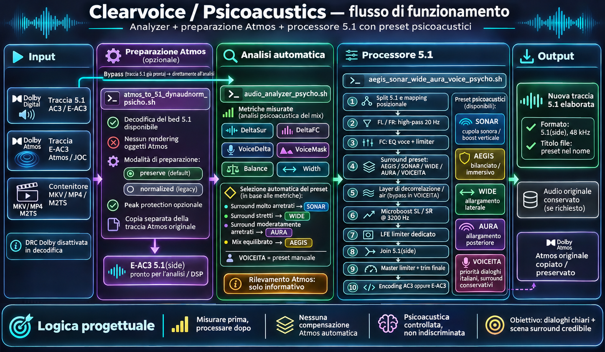
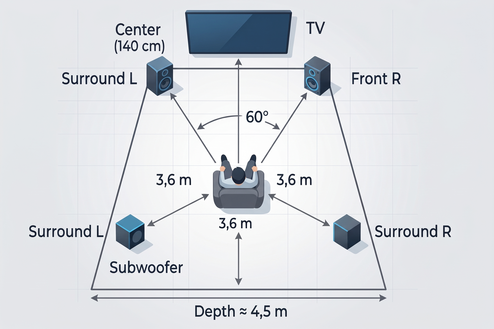
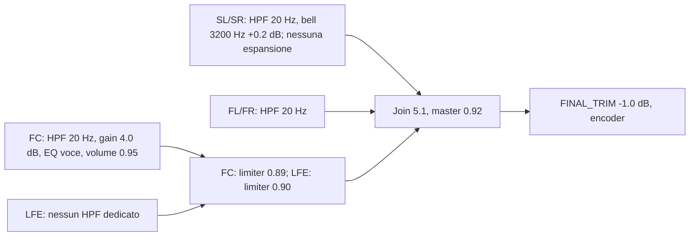

<p align="left">
  
</p>

[**Italiano**](README.md) | [English](README.en.md)

# 🎧 Psychoacoustic Suite - Novembre 2026 (Stabile)

Suite di script **Bash AWK + FFmpeg** per analizzare, correggere e trasformare tracce audio stereo, 5.1 ed EAC3 Atmos/JOC in modo offline, ripetibile e controllato.

>Non tutti gli eroi indossano un mantello. Alcuni impugnano `ffmpeg` e riscrivono le leggi del suono. **Perché nel multiverso del caos sonoro, ogni voce merita di essere ascoltata**.

## Indice degli argomenti

- [Pipeline di funzionamento](#pipeline-di-funzionamento)
- [Schema di riferimento](#schema-di-riferimento)
- [Requisiti](#requisiti)
- [Installazione](#installazione)
- [Script inclusi](#script-inclusi)
- [Controlli dopo l'elaborazione](#controlli-dopo-lelaborazione)
- [Quick Start](#quick-start-comandi-manuali)
- [1. Analyzer: analisi e classificazione 5.1](#1-audio_analyzer_psychosh)
- [2. Aegis / Sonar / Wide / Aura / Voiceita: processing 5.1](#2-aegis_sonar_wide_aura_voice_psychosh)
- [3. Upmix stereo → 5.1](#3-stereo251_upmix_psychosh)
- [4. ASMR / VR: processing per cuffie](#4-asmr_vr_intimate_psychosh)
- [5. Atmos: preparazione EAC3 5.1](#5-atmos_to_51_dynaudnorm_psichosh)
- [Workflow consigliati](#workflow-consigliati)
- [Benchmark orientativo](#benchmark-orientativo)
- [Troubleshooting](#troubleshooting)
- [Cosa la suite non fa](#cosa-la-suite-non-fa)
- [Licenza](#licenza)
- [Autore](#autore)

La filosofia è semplice: **misurare prima, processare dopo**. Il classificatore dell'analyzer misura scena full-band, prominenza della voce, mascheramento, width e comportamento temporale dei surround; sceglie quindi il preset per-file più adatto e può generare un batch riproducibile. Gli altri script coprono upmix stereo, preparazione Atmos/EAC3 e processing binaurale per cuffie.

La taratura 5.1 è pensata per un impianto domestico con frontali, centrale e surround compatti, tutti configurati **Small** con crossover AVR unico intorno a **110 Hz**, uno o due subwoofer attivi gestiti dall'AVR, ascolto medio/basso e priorità all'intelligibilità della voce in generale ed italiana in particolare.

La pipeline 5.1 (preparatore Atmos, analyzer e processore Aegis/Sonar/Wide/Aura/Voiceita) disattiva la **DRC dei metadati Dolby** nella decodifica AC3/EAC3 con l'opzione di input `-drc_scale:<indice_stream> 0`, posta prima di `-i` nel comando FFmpeg. L'opzione è applicata allo stream selezionato; gli altri codec mantengono la propria decodifica. Il DRC dell'AVR è indipendente e non può annullare una compressione già incorporata nei campioni di un render precedente. Le tracce originali conservate con stream copy mantengono dati e metadati originali.

Setup di riferimento: **Yamaha RX-V4A**, frontali **Harman Kardon 3 vie**, centrale/surround **JBL SCS200**, 2x subwoofer **Kenwood ST40**, bass management AVR a **110 Hz**.

I frontali a torre vengono comunque utilizzati come diffusori **Small**: il loro vantaggio è principalmente nella maggiore capacità dinamica e nella migliore riproduzione della gamma medio-alta, mentre il contenuto sotto il crossover resta affidato al bass management dell'AVR.

## Pipeline di funzionamento

Lo schema illustra il percorso dalla sorgente alla traccia elaborata: preparazione Atmos opzionale, analisi automatica e processore 5.1 con preset psicoacustici.

<p align="center">
  <a href="psicoacustics_workflow.png">
    
  </a>
</p>

[Apri lo schema a risoluzione completa](psicoacustics_workflow.png).

La selezione dei preset è riassunta nello schema. Per i criteri completi, compresa la candidatura SONAR per espansione immersiva quando la relativa preferenza è attiva, consulta il [capitolo dell’analyzer](#1-audio_analyzer_psychosh). La provenienza Atmos rimane esclusivamente informativa.

## Schema di riferimento

<p align="left">
  
</p>

Obiettivi principali:

- dialoghi intelligibili senza effetto megafono;
- surround presenti ma non invadenti;
- basso controllato, con gestione principale demandata ad AVR e subwoofer;
- processing selettivo: SONAR non viene applicato indiscriminatamente;
- nessuna normalizzazione automatica del loudness nel percorso analyzer/processore 5.1;
- volume d’ascolto gestito dall’AVR;
- batch ripetibili su film, episodi e cartelle intere;
- conservazione separata del percorso Atmos originale quando richiesta.

---

## Requisiti

### Software

- **FFmpeg 8.x** richiesto e supportato;
- **ffprobe**;
- **Bash 4.x+**;
- **awk** per analisi e controlli audio;
- **mktemp** per i temporanei di tutti e cinque gli script;
- **GNU coreutils** per l’analyzer (`sha256sum`, `stat -c`, `realpath`, `mv -T`), oltre alle normali utility shell;
- build FFmpeg con **libsoxr** per `stereo251_upmix...`;
- build FFmpeg con **libbs2b** per `asmr_vr_intimate...`.

Gli script audio non richiedono Python.

La suite è sviluppata e verificata con **FFmpeg/ffprobe 8.1.2**. Non usare release con major superiore a 8 (`9.x` o successive) finché la suite non viene nuovamente validata: output testuale di `astats`/`ebur128`, opzioni dei filtri e semantica dei channel layout possono cambiare. Anche FFmpeg 7.x e precedenti sono fuori dal perimetro supportato. È consigliato usare `ffmpeg` e `ffprobe` provenienti dalla stessa build.

L’upmix richiede `resampler=soxr` e controlla SOXR all’avvio, senza fallback automatico. Lo script ASMR verifica invece `bs2b` all'avvio e termina con un errore esplicito se il filtro non è disponibile.

Verifiche utili:

```bash
ffmpeg -version
ffprobe -version
ffmpeg -hide_banner -filters 2>/dev/null | grep -w bs2b
ffmpeg -hide_banner -h filter=aresample 2>&1 | grep -i soxr
```

### Sistemi operativi

- Linux;
- macOS con Bash 4+ e GNU coreutils nel `PATH` (la dotazione di sistema non basta per l’analyzer);
- Windows tramite MSYS2, Git Bash o WSL2.

AC3/EAC3 vengono codificati via CPU. L'accelerazione hardware, quando disponibile, riguarda normalmente il video, che in questa suite viene copiato senza ricodifica.

---

## Installazione

```bash
git clone https://github.com/Damocle77/Psicoacustics.git
cd Psicoacustics
chmod +x *.sh
```

Se si scarica lo ZIP, estrarlo completamente prima di eseguire gli script.
La suite comprende i cinque script principali `.sh` e i README nella cartella principale. Il processore 5.1 e il preparatore Atmos usano la configurazione descritta sotto, con DRC Dolby disattivata in decodifica. Gli archivi `.rar` rimasti sono copie precedenti: non vengono aggiornati insieme ai file attivi e non vanno estratti sopra questi ultimi senza un confronto.

I comandi di questa guida vanno eseguiti in Bash (su Windows: Git Bash, MSYS2
o WSL). Per esempio, in Git Bash `cd /e/Download` apre `E:\Download`.
Usare `bash nome_script.sh` oppure `./nome_script.sh`; racchiudere tra virgolette
i percorsi dei file che contengono spazi.

Controllo sintattico rapido:

```bash
for f in *.sh; do
  bash -n "$f" || exit 1
done
```

---

## Script inclusi

| Script | Scopo |
|---|---|
|  | Classifier 5.1 basato su metriche audio, loudness e misure LFE/bassi solo diagnostiche, batch opzionale |
|  | Processore 5.1 con preset `aegis`, `sonar`, `wide`, `aura`, `voiceita`, EQ voce e psicoacustica preservate; nessun gain comune automatico né compensazione Atmos |
|  | Upmix stereo → 5.1: matrice L-R, centro assist, rear bed adattivo in `to51`, LFE minimo, output atomico/verificato e preset `quad` dedicato alla musica |
|  | Processing stereo per cuffie/ASMR/VR con BS2B, ITD opzionale, loudnorm post-DSP, LFO e output atomico/verificato |
|  | Preparatore opzionale: EAC3 5.1 `preserve` predefinita, limiter opzionale e originale copiata; `normalized` conserva il DSP legacy |

> Nota naming: il file Atmos mantiene il nome storico `psicho`. Il README usa il nome reale del file.

---

## Controlli dopo l'elaborazione

| Processore | Controllo mantenuto | Possibile correzione automatica |
|---|---|---|
| Aegis / Sonar / Wide / Aura / Voiceita | Formato della traccia primaria con ffprobe | Nessuna |
| Preparatore Atmos | Formato della traccia primaria con ffprobe | Nessuna |
| Upmix TO51 / QUAD | True Peak integrale post-codec, soglia −0,1 dBTP | Un retry con attenuazione fino a 3 dB |
| ASMR | True Peak integrale post-codec, soglia del preset | Un retry con attenuazione fino a 3 dB |

Nei quattro processori sono state rimosse le scansioni comparative integrali della sorgente e dell'output per RMS, sample peak e numero di campioni. Restano gli errori FFmpeg, i controlli preventivi e la pubblicazione tramite file temporaneo. L'analyzer conserva le misure necessarie alle proprie decisioni.

I messaggi finali specificano **«formato traccia verificato»** oppure **«True Peak verificato»**: nessuno dei due indica un confronto completo con il segnale sorgente. Le caratteristiche dell'upmix sono documentate nella sezione dedicata sotto.

## Quick Start: comandi manuali

Analizzare un file senza generare il batch:

```bash
./audio_analyzer_psycho.sh eac3 no 768k no "film.mkv"
```

Elaborare un file scegliendo il preset (qui SONAR):

```bash
./aegis_sonar_wide_aura_voice_psycho.sh eac3 si 768k sonar "film.mkv"
```

Elaborare tutti i file compatibili nella cartella corrente:

```bash
./aegis_sonar_wide_aura_voice_psycho.sh eac3 si 768k sonar ""
```

Il contributo verticale aumentato è predefinito per SONAR e AEGIS. Il rilevamento Atmos è solo informativo. Le misure LFE/bassi restano diagnostiche sia nei comandi diretti sia nel batch generato.

---

<a name="1-audio_analyzer_psychosh"></a>

# 1. 

Analyzer per tracce **5.1**. Non modifica i file audio.

Il classificatore separa la scena full-band dalla banda utile alla voce:

```text
DeltaSur   = RMS(SL/SR) - RMS(FL/FR/FC)
DeltaFC    = RMS(FC) - RMS(FL/FR)
VoiceDelta = RMS 250-5000 Hz(FC) - RMS 250-5000 Hz(FL/FR)
VoiceMask  = RMS 250-5000 Hz(SL/SR) - RMS 250-5000 Hz(FC)
```

`VoiceDelta` misura la prominenza del centrale nella banda del parlato;
`VoiceMask` aumenta quando effetti e ambienza posteriori possono mascherarlo.
Le metriche full-band restano dedicate alla scelta del trattamento spaziale.

**Limite VoiceBand:** queste metriche misurano energia fra 250 e 5000 Hz, non
riconoscono il parlato. Musica, motori o altri effetti nel centrale possono far
apparire favorevoli `VoiceDelta` e `VoiceMask` anche quando coprono i dialoghi.
`CENTER_FULL_SAFETY_GATE` controlla invece il bilanciamento full-band: nessuna
di queste soglie separa voce ed effetti nello stesso canale. Le medie sull'intera
traccia possono inoltre nascondere singole scene problematiche. Il preset
suggerito resta un'indicazione di bilanciamento, non una misura certificata
dell'intelligibilità.

Il preset **VOICEITA** dà priorità ai dialoghi italiani con una taratura dedicata
del canale centrale e surround senza espansione spaziale. È una scelta manuale
da provare quando il parlato sembra impastato o poco in primo piano.
L'analyzer misura il bilanciamento dei canali, ma non determina quanto siano
comprensibili le parole: per questo non seleziona automaticamente VOICEITA.
La scelta si basa sull'ascolto del film e sulle preferenze personali.

## Caratteristiche

- selezione del 5.1 score-based: lingua italiana e flag default, senza confronto con la durata del container;
- decodifica AC3/EAC3 con DRC Dolby disattivata, coerente con il processore;
- misura in un'unica decodifica full-duration `I(full)`, `LRA`, sample peak,
  full-band, banda voce, `Width MS`, finestre LFE/bassi e analisi temporale surround;
- indicatore di avanzamento durante la scansione completa;
- cache persistente delle metriche, invalidata automaticamente quando cambia il file, lo stream o lo schema analitico;
- rilevamento Atmos esclusivamente informativo tramite profilo E-AC-3 ufficiale esposto da FFprobe, con marker stabile del pre-processore come fallback;
- loudness integrata e LRA esclusivamente informative, senza target o normalizzazione;
- fake-5.1 gate: surround virtualmente muti, centrale silenzioso o SL/SR sbilanciati bloccano la pubblicazione del batch;
- debolezza e mascheramento del centrale restano diagnostici; i preset automatici sono solo AEGIS, SONAR, WIDE e AURA;
- `sonar` per recupero dei surround molto arretrati o, con preferenza `on` e idoneità verificata, espansione immersiva; `aura` per arretramento moderato;
- `wide` quando SL/SR risultano stretti o collassati, `aegis` per mix equilibrati;
- verdetto stagionale modale con almeno **2/3 di consenso**; altrimenti `MIXED`;
- `MIXED` anche quando lo spread di `DeltaSur` supera `4 dB`;
- `run_processing.sh` opzionale tramite parametro `run=si|no`;
- colori distinti in console per il preset principale e le alternative:
  - SONAR rosso;
  - AEGIS arancione;
  - WIDE verde;
  - AURA viola/magenta;

## Sintassi

```bash
./audio_analyzer_psycho.sh <codec> <keep> <bitrate> <run> <file|directory|"">
./audio_analyzer_psycho.sh --files <codec> <keep> <bitrate> [run] <file1> [file2 ...]
```

Compatibilità: resta accettato il vecchio ordine `<file|directory|""> [codec] [keep] [bitrate] [run]`.

## Parametri

| Parametro | Valori | Default | Note |
|---|---|---:|---|
| `codec` | `eac3`, `ac3` | `eac3` | codec scritto nel batch |
| `keep` | `si`, `no` | `no` | indica al processore se conservare la traccia sorgente selezionata |
| `bitrate` | `256k–640k` AC3; `256k–768k` EAC3, step da `64k` | `640k` AC3, `768k` EAC3 | accetta anche il numero senza suffisso; valori fuori range o fuori step vengono rifiutati |
| `run` | `si`, `no` | `si` | crea/aggiorna oppure non tocca `run_processing.sh` |
| `file|directory|""` | file, directory o stringa vuota | obbligatorio | `""` usa la cartella corrente |

## Diagnostica LFE e bassi

Le misure LFE e dei bassi sono informative. L'analyzer seleziona il preset e genera i comandi del batch senza gain statico LFE o low-shelf dei bassi a 100 Hz.

La stessa decodifica integrale misura l'energia a **20–120 Hz** in finestre coincidenti da **0,5 secondi**. La diagnostica LFE comprende RMS attivo, P95, sample peak full-band, somma delle energie basse dei cinque principali, delta, durata attiva e persistenza sopra le soglie descrittive di delta −6/−2 dB.

La diagnostica dei bassi complessivi confronta l'energia bassa dei cinque principali più quella LFE pesata per 10 (+10 dB solo nella misura) con l'energia a **250–5000 Hz** dei cinque principali. Il report mostra RMS, delta, P95, persistenza sopra +6 dB e durata valida. Queste stime energetiche non simulano fase, crossover AVR, calibrazione o acustica della stanza e non modificano l'audio prodotto.

La cache conserva le metriche validate, comprese le statistiche temporali dei surround; le decisioni sui preset vengono ricalcolate a ogni esecuzione. La pulizia dei nomi interni cambia la chiave della cache: la prima analisi viene ricalcolata, poi torna a essere riutilizzabile. I file cache già presenti restano sul disco. Rigenerare i `run_processing.sh` esistenti con `run=si` prima di usare il processore aggiornato: i vecchi batch possono contenere le opzioni rimosse.

## Cache e avanzamento

La prima analisi resta full-duration. Le metriche validate vengono salvate nella
cartella `.clearvoice_analyzer_cache`; una successiva analisi dello stesso file
le riutilizza senza decodificare nuovamente l'episodio. La chiave comprende
percorso canonico, dimensione, data di modifica, indice dello stream e formato
delle metriche.

```bash
ANALYZER_CACHE=0 ./audio_analyzer_psycho.sh eac3 no 768k si ""
ANALYZER_PROGRESS_INTERVAL=5 ./audio_analyzer_psycho.sh eac3 no 768k si ""
ANALYZER_CACHE_DIR=/percorso/cache ./audio_analyzer_psycho.sh eac3 no 768k si ""
```

`ANALYZER_CACHE=0` disattiva la cache; l'intervallo di avanzamento predefinito è
10 secondi. Eliminare `.clearvoice_analyzer_cache` forza un ricalcolo completo.

Dopo questo aggiornamento rigenerare `run_processing.sh` con `run=si`: i batch precedenti usano nomi e argomenti rimossi. `run=no` lascia intatto un batch esistente. Lo schema cache corrente invalida le misure precedenti; le successive variazioni delle sole soglie decisionali riutilizzano le metriche.

Con `run=no`, un eventuale `run_processing.sh` già esistente **non viene sovrascritto né cancellato**.

Nella modalità `--files`, il token dopo il bitrate viene interpretato come `run` solo se è esattamente `si` o `no`; altrimenti è trattato come primo filename, mantenendo la compatibilità con la sintassi precedente.

## Esempi

```bash
# Singolo file, EAC3 768k, batch abilitato
./audio_analyzer_psycho.sh eac3 no 768k si "film.mkv"

# Solo analisi
./audio_analyzer_psycho.sh eac3 si 768k no "film.mkv"

# Cartella corrente + batch
./audio_analyzer_psycho.sh eac3 no 768k si ""

# Lista esplicita, nessun batch
./audio_analyzer_psycho.sh --files eac3 si 768k no \
  "ep01.mkv" "ep02.mkv" "ep03.mkv"

# Sintassi compatibile: run=si implicito
./audio_analyzer_psycho.sh --files eac3 si 768k \
  "ep01.mkv" "ep02.mkv"
```

## Temporal Surround Intelligence

L'analyzer usa un unico classificatore operativo: un'euristica basata su statistiche temporali del segnale, senza intelligenza artificiale. Una sola decodifica FFmpeg alimenta i rami storici invariati e un nuovo ramo full-band a 48 kHz. `pan` aggiunge MID/SIDE agli stessi canali; `asetnsamples=n=24000:p=0`, `astats` e `ametadata` producono finestre sincronizzate di 500 ms senza padding finale. Nessun filtro di banda introduce ritardi nel nuovo ramo. AWK conserva soltanto statistiche compatte, senza PCM in RAM o file PCM temporanei. Nessuna nuova dipendenza.

### Metriche temporali

- **SurroundActivityRatio**: durata dei periodi attivi / durata analizzata. Almeno un surround deve superare sia il gate assoluto sia quello relativo al programma. Si accettano solo sequenze contigue che raggiungono la persistenza minima, contando anche la loro parte iniziale. Il programma è la media energetica full-duration dei cinque canali escluso LFE.
- **ActiveDeltaSur**: `10 log10(sum(P_SUR*n) / sum(P_MAIN*n))`, dove SUR è la media energetica SL/SR, MAIN la media FL/FR/FC e `n` il numero effettivo di campioni. Solo finestre attive con MAIN sopra il gate numerico. Nessuna media dei dB.
- **ActiveDeltaSurP10/P50/P90**: percentili nearest-rank pesati per campioni delle stesse finestre; istogramma a 0,1 dB, arrotondato per difetto (errore inferiore a 0,1 dB).
- **ActiveWidth**: `10 log10(sum(P_SIDE*n) / sum(P_MID*n))`, soltanto quando entrambi i surround superano il gate nelle sequenze attive. `MID=(SL+SR)/2`, `SIDE=(SL-SR)/2`. I limiti esatti sono `-inf` per SIDE nullo e `+inf` per MID nullo; entrambi nulli danno `N/A`.
- **SurroundCorrelation**: Pearson normalizzato dopo la rimozione della media di ciascuna finestra. `E[SL*SR]=P_MID-P_SIDE`; covarianza e varianze intra-finestra vengono sommate pesando per campioni, quindi normalizzate. Non è una semplice differenza Mid/Side, né una media dei coefficienti. Finestre silenziose, costanti o numericamente inaffidabili sono escluse.
- **HighCorrelationPersistence**: frazione della durata delle finestre con correlazione valida sopra la soglia positiva. Le finestre parziali pesano per i campioni effettivi.
- Il report distingue finestre totali, valide per DeltaSur, bilaterali per Width e valide per Pearson; mostra percentuale valida per numero, durata totale e durate utili. Le frazioni nella cache sono 0–1; la console le mostra in percentuale.

`ametadata` stampa gli offset DC con sei decimali: varianze non superiori a `2e-6*abs(DC)+1e-12` sono escluse dal Pearson. Questa protezione evita di presentare come correlazione affidabile il rumore numerico vicino a segnali costanti. Valori mancanti sono `N/A`, senza livelli fittizi. La correlazione negativa non prova una buona spazialità: una forte opposizione di fase abbassa la confidenza e richiede ascolto.

### Soglie configurabili

Le soglie si impostano come variabili d'ambiente. Le opzioni generali del classificatore usano il prefisso descrittivo `CLASSIFIER_`; i valori predefiniti restano invariati. Sono **empiriche e sperimentali**, senza validazione scientifica o percettiva su film reali.

| Variabile | Default | Significato |
|---|---:|---|
| `SUR_ACTIVITY_ABS_DB` | −60 dBFS | Esclude rumore/silenzio |
| `SUR_ACTIVITY_REL_DB` | 35 dB | Margine sotto l'energia media del programma |
| `SUR_ACTIVITY_MIN_SECONDS` | 1 s | Durata minima della sequenza attiva |
| `SUR_MAIN_MIN_DB` | −80 dBFS | MAIN minimo per i rapporti energetici |
| `SUR_CORRELATION_GATE` | 0,8 | Correlazione positiva elevata |
| `CLASSIFIER_SONAR_ACTIVE_DB` | −13 dB | Deficit attivo severo |
| `CLASSIFIER_AURA_ACTIVE_DB` | −7 dB | Deficit attivo moderato |
| `CLASSIFIER_WIDTH_ACTIVE_DB` | −7 dB | Width attiva ridotta |
| `CLASSIFIER_HIGH_CORR_PERSISTENCE` | 0,75 | Persistenza minima per WIDE |
| `CLASSIFIER_MIN_VALID_WINDOWS` / `CLASSIFIER_MIN_VALID_SECONDS` | 4 / 2 s | Evidenza attiva minima per decidere |
| `CLASSIFIER_HIGH_VALID_WINDOWS` / `CLASSIFIER_HIGH_VALID_SECONDS` | 20 / 10 s | Evidenza minima per confidenza ALTA |
| `CLASSIFIER_VARIABILITY_DB` | 10 dB | Identifica variabilità ampia; non è un veto autonomo |
| `CLASSIFIER_MEDIAN_AGREEMENT_DB` | 6 dB | Massima divergenza ActiveDeltaSur/P50 per un riferimento energetico centrale coerente |
| `CLASSIFIER_GLOBAL_AGREEMENT_DB` | 6 dB | Divergenza globale/attivo che limita la confidenza |
| `CLASSIFIER_RARE_ACTIVITY_RATIO` | 0,2 | Eventi rari: permette una divergenza attesa senza penalizzare oltre MEDIA |
| `CLASSIFIER_HIGH_VALID_RATIO` | 0,2 | Copertura minima per confidence ALTA |
| `CLASSIFIER_CORRELATION_MARGIN` / `CLASSIFIER_PERSISTENCE_MARGIN` | 0,05 / 0,1 | Margini borderline per WIDE |

Le soglie storiche `SONAR_DELTA_GATE=-13`, `AURA_DELTA_GATE=-7`, `WIDTH_WIDE_GATE=-7` restano riferimenti globali nel codice. Le nuove soglie attive sono separate: i valori iniziali simili sono un punto di partenza sperimentale, non un'assunzione di equivalenza statistica. `WIDTH_WIDE_GATE` viene ancora incrociato con Width attiva per WIDE. Il margine borderline resta 0,7 dB.

### Priorità deterministica e confidence

| Priorità | Evidenza | Risultato |
|---:|---|---|
| 0 | Silenzio, fake 5.1, centrale silenzioso, SL/SR ≥10 dB | Blocco di sicurezza |
| 1 | Campione attivo insufficiente o rapporti non disponibili | `INCONCLUSIVE` |
| 2 | ActiveDeltaSur e P50 sotto la soglia severa | SONAR |
| 3 | Width globale e attiva ridotte, Pearson positivo elevato e persistente, campione bilaterale/correlazione sufficiente | WIDE |
| 4 | ActiveDeltaSur e P50 sotto la soglia moderata | AURA |
| 5 | ActiveDeltaSur e P50 almeno alla soglia moderata | AEGIS; con preferenza `on` e tutti i controlli di idoneità superati, SONAR immersivo |
| 6 | Aggregato e P50 a cavallo della soglia moderata, entrambi entro il margine di 0,7 dB e distanti tra loro al massimo dello stesso margine | AURA se aggregato < −7 dB, altrimenti AEGIS; BASSA, alternativa esplicita |
| 7 | Disaccordo moderato AURA/AEGIS in entrambi i versi, misure ALTA e limiti di accordo/conferma globale rispettati (vedi sotto) | AURA se aggregato ≤ soglia AURA + margine, altrimenti AEGIS; BASSA, MIXED, alternativa reciproca |
| 8 | Altri disaccordi tra aggregato e P50 su lati opposti oltre il margine ammesso | `INCONCLUSIVE` |

SONAR di recupero ha precedenza se anche WIDE è vero: alternativa WIDE e confidence BASSA. WIDE precede AURA. Un DeltaSur globale basso da solo non seleziona SONAR/AURA. La voce resta diagnostica per la classe energetica e può escludere la candidatura immersiva; VOICEITA rimane esclusivamente manuale. Atmos, rilevato dal profilo EAC3 FFprobe o dai marker esatti `EAC3 Atmos Original` / `EAC3 Atmos (Original)`, resta informativo.

`Measurement Confidence`, per le tracce ammesse dai controlli di sicurezza, descrive affidabilità e disponibilità del campione statistico: almeno 4 finestre DeltaSur / 2 s e statistiche bilaterali/Pearson disponibili per MEDIA; almeno 20 finestre / 10 s per DeltaSur, bilaterale e Pearson, più copertura DeltaSur almeno 20%, per ALTA. Quantità di dati, varianze valide e disponibilità delle misure sono distinte dall'energia rilevata: P10 basso, spread ampio, correlazione negativa o uno sbilanciamento borderline realmente misurato non rendono automaticamente inaffidabile il campione. Questa confidence resta euristica, non un intervallo di errore metrologico.

`Confidence` riguarda invece la stabilità della classificazione e della scelta. Restano i controlli su divergenza globale/attivo, vicinanza alle soglie, campione spaziale insufficiente, opposizione di fase, width contraddittoria e balance borderline. Una divergenza ActiveDeltaSur/P50 superiore a `CLASSIFIER_MEDIAN_AGREEMENT_DB` segnala un riferimento energetico non concorde nei preset energetici; WIDE conserva la valutazione della separazione persistente senza una penalità energetica autonoma. Lo spread sopra 10 dB riduce la confidence energetica se attraversa i confini decisivi per SONAR di recupero/AURA; per AEGIS la coda P10 debole la riduce soltanto se anche la mediana è vicina al confine AURA oppure discordante dal rapporto aggregato. P10 basso da solo non penalizza più una scena con energia aggregata e mediana adeguate e concordi.

`Temporal Assessment` separa **STABLE**, **VARIABLE_COHERENT**, **VARIABLE**, **BORDERLINE**, **MIXED**, **INSUFFICIENT** e **BLOCKED**. `VARIABLE` indica una distribuzione ampia che attraversa le fasce decisionali, con aggregato e mediana concordi; `MIXED` indica riferimenti energetici discordanti (aggregato/mediana o globale/attivo). Le etichette descrivono le misure e non giudicano la qualita del mix. Una distribuzione ampia ma con riferimento centrale adeguato e coerente può quindi avere Measurement Confidence ALTA e classificazione affidabile. Non viene riconosciuto il contenuto narrativo: la variabilità può essere compatibile con alternanza di dialoghi, effetti e ambienza, senza costituire un difetto dimostrato del mix. Nessuna di queste etichette misura intelligibilità, altezza percepita o superiorità d'ascolto di un preset.

Il margine `PRESET_BORDERLINE_MARGIN` già esistente gestisce anche piccoli disaccordi AURA/AEGIS. Se ActiveDeltaSur e P50 sono entrambi entro 0,7 dB dalla soglia −7 dB e differiscono al massimo di 0,7 dB, la classe segue il rapporto energetico aggregato: sotto soglia AURA, sulla soglia o sopra AEGIS. Vale anche quando P50 quantizzato cade esattamente sul confine. La scelta resta `CONSERVATIVE`, con `Confidence: BASSA`, alternativa reciproca e `Temporal Assessment: BORDERLINE`; Measurement Confidence resta determinata dal campione. Una tolleranza numerica di 0,000001 dB tiene conto dei sei decimali della serializzazione, senza cambiare il margine decisionale empirico.

Per esempio, ActiveDeltaSur −7,17 dB e P50 −7,0 dB producono AURA con alternativa AEGIS: lo scarto di 0,17 dB è un confine decisionale incerto, non una carenza di misure.

Queste decisioni borderline possono entrare nel batch con preset e diagnostica espliciti. La preferenza immersiva non le trasforma in SONAR. Campioni insufficienti e disaccordi su lati opposti oltre il margine, salvo i disaccordi moderati risolti con la regola controllata descritta sotto, restano `INCONCLUSIVE`, senza comandi; SONAR di recupero e WIDE mantengono precedenza. Le motivazioni distinguono l'incertezza vicino al confine dalla distribuzione ampia: per AURA, code in altre fasce energetiche non vengono descritte come assenza di un centro stabile quando aggregato e mediana concordano. Quando AEGIS non diventa SONAR, i veto su ActiveWidth e P90 sono riportati con i relativi valori e soglie.

### SONAR: recupero o preferenza immersiva

SONAR resta raggiungibile come **recupero immersivo** quando ActiveDeltaSur e P50 indicano deficit severo: `Selection Mode: IMMERSIVE_RECOVERY`. Con questa priorità, un deficit severo e una scena contemporaneamente stretta continuano a riportare WIDE come alternativa.

Per scene già equilibrate, AEGIS rimane il riferimento. AEGIS e SONAR condividono parte della struttura spaziale: le sole misure della sorgente non possono dimostrare quale suoni meglio. `SONAR_IMMERSIVE_PREFERENCE` accetta esclusivamente `off` e `on`, con **`on` predefinito nel file**. Il comando ordinario non richiede prefissi:

```bash
# Preferenza immersiva già attiva: SONAR solo quando la scena è idonea
./audio_analyzer_psycho.sh eac3 no 768k si "film.mkv"

# Override facoltativo per una singola analisi conservativa
SONAR_IMMERSIVE_PREFERENCE=off ./audio_analyzer_psycho.sh eac3 no 768k si "film.mkv"
```

Per salvare la scelta conservativa direttamente nello script, cambia `:-on` in `:-off` nella riga di configurazione `SONAR_IMMERSIVE_PREFERENCE`. Un valore già esportato nell'ambiente prevale sul default del file. L'opzione è un interruttore decisionale: non assegna punti e non modifica guadagni o parametri DSP.

`on` valuta la candidatura **soltanto nel ramo già classificato AEGIS**, con confidence delle caratteristiche e della classificazione almeno MEDIA. Non scavalca WIDE, AURA, SONAR di recupero, `INCONCLUSIVE` o i blocchi di sicurezza. Tutti i seguenti gate devono essere superati insieme; le nuove soglie sono empiriche e configurabili, quelle esistenti rimangono invariate:

| Variabile nuova | Default | Scopo |
|---|---:|---|
| `SONAR_IMMERSIVE_MIN_DELTA_DB` / `SONAR_IMMERSIVE_MAX_DELTA_DB` | −6 / 0 dB | Energia attiva presente senza dominanza posteriore |
| `SONAR_IMMERSIVE_MIN_ACTIVITY_RATIO` | 0,5 | Attività in almeno metà della durata |
| `SONAR_IMMERSIVE_MIN_WIDTH_DB` | −3 dB | Separazione attiva sufficiente; niente valori non finiti |
| `SONAR_IMMERSIVE_MAX_ABS_CORRELATION` | 0,5 | Esclude forte somiglianza e opposizione di fase |
| `SONAR_IMMERSIVE_MAX_HIGH_CORR_PERSISTENCE` | 0,25 | Contenuto comune elevato non persistente |
| `SONAR_IMMERSIVE_MIN_VALID_RATIO` | 0,5 | Copertura minima per finestre DeltaSur, bilaterali e Pearson |

Si riutilizzano inoltre `CLASSIFIER_HIGH_VALID_WINDOWS` / `CLASSIFIER_HIGH_VALID_SECONDS` (20 finestre DeltaSur e 10 s utili, compresi almeno 10 s bilaterali e Pearson), P50 ≥ `CLASSIFIER_AURA_ACTIVE_DB` + margine (−6,3 dB), differenza assoluta ActiveDeltaSur/P50 ≤ `CLASSIFIER_MEDIAN_AGREEMENT_DB` (6 dB) e P90 ≤ `SUR_DOMINANT_GATE` (+1 dB). P10 rimane descrittivo e non è più un veto autonomo: le scene quiete nella coda inferiore non escludono da sole la candidatura. Il gate P90 rimane una protezione contro dominanza surround nella coda superiore. Il balance deve essere inferiore a 10−0,7 dB; centro full-band, VoiceDelta e VoiceMask non devono evidenziare le anomalie diagnostiche esistenti (quando la banda voce è disponibile). I gate restrittivi lasciano quindi molte scene equilibrate ad AEGIS anche con `on`.

Quando la preferenza prevale, il report riporta `Preset: SONAR`, `Selection Mode: IMMERSIVE_PREFERENCE`, `Alternative: AEGIS` e `Confidence: MEDIA`. `Measurement Confidence` può restare ALTA: l'idoneità del segnale e la preferenza psicoacustica sono distinte. La motivazione specifica che la preferenza è configurata, che la superiorità percettiva non è misurata e che non vengono ricostruiti oggetti Atmos o canali fisici di altezza. Quando la scena è idonea ma la preferenza è `off`, AEGIS mantiene priorità e SONAR compare come alternativa. `Temporal Assessment: VARIABLE_COHERENT` resta visibile anche nel batch. Le altre selezioni ordinarie usano `CONSERVATIVE`; i blocchi usano `SAFETY_OVERRIDE`.

La provenienza Atmos non entra nei gate e non abilita SONAR. Una sorgente derivata da Atmos segue gli stessi criteri. Le metriche non misurano altezza percepita e non dimostrano che SONAR sia migliore di AEGIS. La preferenza cambia soltanto il preset salvato nel batch: nessun parametro DSP viene aggiunto o modificato. I commenti del batch conservano preferenza, modalità, confidence delle caratteristiche, confidence della scelta e alternativa. `MeasuredPreset=AEGIS` conserva la classe di partenza quando il preset operativo diventa SONAR per preferenza. Per cambiare la scelta di un batch esistente occorre rigenerarlo; la cache delle sole metriche resta valida in entrambe le modalità, senza nuova decodifica.

Disaccordi moderati AURA/AEGIS: dopo i piccoli casi borderline, una sola regola gestisce entrambi i versi del disaccordo. Richiede Measurement Confidence ALTA, ActiveDeltaSur e P50 non sotto la soglia SONAR (default -13 dB), scarto aggregato/P50 non oltre `CLASSIFIER_MEDIAN_AGREEMENT_DB` (6 dB), rapporto globale disponibile e scarto globale/attivo sotto `CLASSIFIER_GLOBAL_AGREEMENT_DB` (6 dB). Il globale deve confermare il lato dell'aggregato rispetto alla soglia AURA (-7 dB). Si conserva la scelta empirica precedente nel margine superiore: se l'aggregato e tra la soglia AURA e la soglia piu il margine (da -7 a -6,3 dB), basta il limite di accordo globale/attivo, anche quando il globale e sull'altro lato.

Con questi requisiti, si sceglie AURA se l'aggregato e al massimo alla soglia AURA piu il margine; oltre quel limite si sceglie AEGIS. La stessa tolleranza di serializzazione di 0,000001 dB si applica al confine. La scelta resta empirica: CONSERVATIVE, Confidence BASSA, Temporal Assessment MIXED e alternativa reciproca, anche con spread ridotto. SONAR di recupero e WIDE mantengono precedenza; la preferenza immersiva non puo promuovere queste scelte a SONAR. Nei casi esclusi, il motivo completo specifica il requisito non superato.

Gli scarti tra rapporti sono confrontati alla precisione di sei decimali delle metriche salvate: esattamente 6 dB resta ammesso tra aggregato e mediana, ed escluso tra globale e attivo. Questo evita decisioni diverse dovute alla rappresentazione numerica, senza introdurre nuove soglie.

Ghosted (ActiveDeltaSur -6,775598 dB, P50 -10,8 dB) resta AURA; Visionquest (-5,401268 dB, globale -5,5 dB, P50 -8,5 dB) resta AEGIS. I casi -6,5/-7,4 e -6,3/-7,7 dB diventano AURA senza spazi tra le regole; anche il caso inverso -8/-6 dB diventa AURA quando il globale conferma la fascia dell'aggregato. Campioni insufficienti, un riferimento sotto la soglia SONAR, scarti oltre i limiti o conferma globale mancante restano inconclusivi in questo ramo. Le soglie sono quelle gia configurate; misure, cache e parametri DSP restano invariati. Basta rigenerare il batch: le metriche in cache vengono riclassificate senza nuova decodifica.

Verifiche riproducibili: `bash tests/test_classifier_mixed.sh` per il replay e i confini, `python tests/audit_classifier_grid.py` per la griglia decisionale, `python tests/test_classifier_audio.py` per analyzer, batch, cache, `run=no` e blocchi di sicurezza su segnali sintetici temporanei. Il processore DSP non viene eseguito. Risultati e limiti della verifica sono nelle [note dell'audit](tests/CLASSIFIER_AUDIT.md).

`INCONCLUSIVE` resta nel report e nel riepilogo stagionale, con motivo e confidence BASSA; non viene trasformato in AEGIS. In un batch misto gli altri file affidabili ricevono i propri comandi, mentre quelli inconclusivi compaiono soltanto come commenti `ESCLUSO INCONCLUSIVE`. Se tutti sono inconclusivi viene pubblicato un batch senza comandi. Gli errori e i blocchi gravi conservano il comportamento precedente: nessuna pubblicazione, uscita 1. `run=no` lascia intatto il batch esistente.

Il verdetto stagionale conta anche gli inconclusivi nel denominatore del consenso 2/3; tutti inconclusivi danno `INCONCLUSIVE`. Parità, consenso insufficiente o spread globale >4 dB danno `MIXED`. La distribuzione e i conteggi ALTA/MEDIA/BASSA sono riportati; il verdetto non sostituisce le scelte per-file.

### Verifiche locali e costo

```bash
bash tests/test_analyzer.sh
bash tests/test_sonar_batch.sh
bash tests/test_upmix_naming.sh
```

I test generano segnali FLAC sintetici in una directory temporanea e non eseguono il processore DSP. Coprono deficit costante/eventi rari, correlazione +1/0/−1, DC, silenzio, fake 5.1, centrale, balance, percentili, finestre parziali, cache, batch, singola decodifica, DRC Dolby, CLI e regressione dei 32 campi storici contro un filtergraph di riferimento indipendente. Nessun download o servizio esterno.

Il costo aggiunto è un ramo full-band con otto statistiche di livello/DC per finestra e aggregazione AWK O(numero di finestre). I percentili usano un istogramma compatto. Rimane una sola decodifica; i log di metadati crescono linearmente con la durata. Le prove sintetiche verificano i calcoli, non dimostrano superiorità percettiva sul materiale cinematografico.

Misura locale su FLAC sintetico da 100 s, media di tre prove senza cache: riferimento storico 2,81 s / analyzer 4,01 s in UCRT64 (+42%); 2,79 s / 4,23 s con Git Bash e FFmpeg UCRT64 (+52%). Non è un benchmark cinematografico. La verifica iniziale comprendeva 23 gruppi. Gli affinamenti successivi, il replay delle metriche del log Frankenstein e le prove di esecuzione batch su una scena sintetica variabile sono documentati in [tests/RESULTS.md](tests/RESULTS.md).

## Width MS

```text
Width MS = RMS(SIDE) - RMS(MID)
```

| Width MS | Diagnosi |
|---:|---|
| `< -12 dB` | collassato |
| `-12 / -7 dB` | stretto |
| `-7 / -3 dB` | medio |
| `>= -3 dB` | largo |

## Livello d’ascolto

Nessun VOLAMP applicato al segnale e nessuna normalizzazione automatica del loudness nel percorso analyzer/processore 5.1. `I(full)` e LRA restano misure diagnostiche. Il volume d’ascolto si regola sull’AVR; EQ voce, psicoacustica e limiter mantengono le rispettive funzioni.

## `run_processing.sh`

Quando `run=si`, il batch contiene righe simili a:

```bash
"$PROC" "$CODEC" "$KEEP" "$BITRATE" sonar -- film.mkv || BATCH_FAILURES=$((BATCH_FAILURES + 1))  # DeltaSur=-14.2 dB | DeltaFC=1.0 dB | VoiceDelta=2.3 dB | VoiceMask=-12.0 dB | Width=-4.1 dB | I=-21.9 LUFS
```

Dopo il preset seguono `--` e il percorso del file. Non è previsto un argomento di guadagno comune. Il batch conta i fallimenti in `BATCH_FAILURES`; i commenti includono layout, provenienza Atmos e metriche. Il processore predefinito è:

```bash
# DEFAULT_PROCESSOR contiene il percorso assoluto del processore accanto all'analyzer.
PROC="${PROC:-$DEFAULT_PROCESSOR}"
```

Il processore rileva profilo e marker Atmos a ogni file esclusivamente per il log, senza aggiungere offset al filtergraph.

I messaggi Atmos e di mapping visualizzati durante `run_processing.sh` provengono dal processore indicato da `PROC`. Per aggiornare queste descrizioni basta aggiornare lo script del processore usato dal batch; non serve rigenerare il batch.

Il batch usa sempre il preset per-file, derivato esclusivamente dal classificatore e dalle sue metriche temporali e globali, con diagnostica `DeltaFC`, `VoiceDelta`, `VoiceMask` e controllo di sicurezza balance. Il P25 di `DeltaSur` è soltanto diagnostico; il verdetto stagionale richiede almeno 2/3 di consenso e non sostituisce mai il preset scritto nelle singole righe del batch.

---

<a name="2-aegis_sonar_wide_aura_voice_psychosh"></a>

# 2. 

Motore principale per tracce **5.1 esistenti**.

## Caratteristiche

- input 5.1, output AC3/EAC3 5.1(side);
- DRC Dolby disattivata nel decoder AC3/EAC3 prima dei filtri; nessuna opzione Dolby sugli altri codec;
- preset `aegis`, `sonar`, `wide`, `aura`, `voiceita`; `voiceita` è solo manuale, escluso dalla selezione dell'analyzer;
- selezione stream score-based: entrano solo tracce a 6 canali; lingua italiana `+300`, flag default `+200`; la durata del container non entra nel punteggio;
- layout gestiti: `5.1`, `5.1(back)`, `5.1(side)`;
- con sei canali e layout assente o `unknown`, il log mostra `5.1(side)`, indicando il mapping posizionale adottato (`FC=c2`, `SL=c4`, `SR=c5`); questa descrizione non modifica i metadati della sorgente. La stessa convenzione è usata dall'analyzer e dal preparatore Atmos;
- EQ voce dedicato per ogni preset;
- limiter sul centrale dopo EQ, senza auto-level;
- processing surround differenziato per preset;
- air/decorrelation layer controllato;
- microboost finale sui soli SL/SR: bell a 3200 Hz, Q 1,2, +0,1 dB nei preset spaziali e +0,2 dB in VOICEITA;
- trattamento LFE: limiter dedicato; filtraggio dedicato affidato all’hardware;
- nessuna compensazione Atmos; rilevamento solo informativo;
- diffusori mantenuti `Small`, con bass management e crossover a circa `110 Hz` affidati all'AVR; lo script applica ai canali principali solo un high-pass di sicurezza a `20 Hz`;
- FL/FR senza EQ timbrica aggiuntiva: highpass 20 Hz; limitazione finale affidata al master;
- nessun guadagno comune automatico; volume d’ascolto sull’AVR;
- video, sottotitoli, capitoli e allegati copiati;
- keep opzionale della traccia 5.1 selezionata;
- DSP, codifica audio e mux in un unico processo FFmpeg, verso un MKV temporaneo;
- nessuna scansione comparativa integrale sorgente/output dopo il DSP;
- controllo della traccia primaria: codec richiesto, 6 canali, `5.1(side)`, 48 kHz e flag default;
- pubblicazione del file finale soltanto dopo encode/mux e controllo di formato riusciti;
- nessuna misura True Peak post-codec o retry;
- contatori finali ed exit code non zero se almeno un file fallisce.

## Definizione del surround diretto

| Preset | Canali | Filtro | Frequenza | Gain | Q |
|---|---|---|---:|---:|---:|
| AEGIS, SONAR, WIDE, AURA | SL e SR | Bell (peaking EQ) | 3200 Hz | +0,1 dB | 1,2 |
| VOICEITA | SL e SR | Bell (peaking EQ) | 3200 Hz | +0,2 dB | 1,2 |

AEGIS, SONAR, WIDE e AURA mantengono il passa-alto a **20 Hz, Q 0,707** sui rami diretti `SLd_in` e `SRd_in`. Il microboost di presenza è un filtro a campana a **3200 Hz, Q 1,2** (valore storico), applicato una sola volta ai soli `SL_final` e `SR_final`: **+0,1 dB** nei quattro preset psicoacustici e **+0,2 dB** in VOICEITA.

Ordine effettivo: blocco surround del preset → decorrelazione/ambienza finale (bypass in VOICEITA) → microboost SL/SR → join 5.1, limiter master e trim finale. Il filtro interviene sul segnale già elaborato senza modificare gli ingressi o i parametri degli algoritmi spaziali. Non introduce aumenti del guadagno generale dei surround; la riduzione manuale di circa 1 dB sull'impianto resta un dato del contesto di ascolto. Il beneficio percettivo di incrementi così piccoli non è garantito e richiede un confronto d'ascolto controllato.

In WIDE resta il **highshelf a 3500 Hz, +0,1 dB, Q 0,8** dopo gli `amix` SL/SR: è indipendente dal microboost finale. La verticalità continua a dipendere dai rami HEIGHT e la larghezza dai delay, dagli allpass e dai rami decorrelati dei preset.

Restano invariati i delay diretti (**0 ms** in AEGIS/SONAR, **1 ms** in WIDE/AURA), tutti i valori di volume e i rami di presenza, HEIGHT, riflessione tardiva, decorrelazione e ambienza. La decorrelazione finale mantiene la catena e i parametri esistenti. Nessuna modifica a FL/FR, FC, LFE, limiter o controlli di pubblicazione.

Guadagno nominale FC uniforme a **+3,0 dB** per AEGIS, SONAR, WIDE e AURA; VOICEITA passa da **+4,2 a +4,0 dB**. La modifica rende più coerente la presenza vocale tra i preset cinematografici, mantenendo VOICEITA dedicato ai dialoghi. Equalizzazione e limiter restano invariati.

### VOICEITA — priorità ai dialoghi italiani



**VOICEITA è un preset manuale pensato per favorire la leggibilità del parlato italiano.**
Sul centrale riduce parte delle medio-basse e aggiunge una presenza moderata
nella gamma vocale, con l'obiettivo di rendere le parole più distinguibili
mantenendo il corpo della voce. I surround ricevono il passa-alto a 20 Hz
e il microboost finale a 3200 Hz di +0,2 dB, senza espansione spaziale aggiunta.

È una variante da confrontare con gli altri preset quando i dialoghi risultano
impastati o poco in primo piano, soprattutto nell'ascolto domestico a volume
medio/basso. AEGIS, SONAR, WIDE e AURA combinano l'EQ del centrale con diverse
elaborazioni spaziali dei surround; VOICEITA concentra la propria taratura sul
parlato e mantiene invariato il guadagno generale dei surround, aggiungendo
solo la lieve enfasi di presenza descritta sopra.

La taratura è fissa e agisce su **tutto il canale centrale**, inclusi musica ed
effetti presenti: non separa la voce. Il nome indica la destinazione della
taratura, non un riconoscimento della lingua o del doppiaggio. Il risultato
va valutato su dialoghi reali, confrontando i preset a volume percepito
pareggiato; un miglioramento non è garantito su ogni mix.

**Livello del centrale.** Il gain dedicato è `volume=4.0dB`, seguito da
`volume=0.95`: circa **+3,55 dB netti esclusa l'EQ, prima dei guadagni condivisi**.
La taratura del centrale è preservata, incluso il bell a 150 Hz di +0,2 dB. È una correzione statica:
non recupera selettivamente le battute deboli e il beneficio va verificato
nei passaggi critici; sui picchi può aumentare l'intervento del limiter.
Restano attivi i limiter e il trim finale condiviso, senza offset Atmos.

**EQ del centrale (FC).** Catena autonoma, senza sommare `VOICE_EQ_BASE`:

| Filtro | Frequenza | Gain | Q |
|---|---:|---:|---:|
| Passa-alto | 20 Hz | — | 0,707 |
| Bell | 150 Hz | +0,2 dB | 1,1 |
| Bell | 300 Hz | −1,0 dB | 1,0 |
| Bell | 450 Hz | −0,6 dB | 1,2 |
| Bell | 1650 Hz | +0,7 dB | 1,6 |
| Bell | 2450 Hz | +1,4 dB | 1,3 |
| Bell | 3800 Hz | +0,9 dB | 2,0 |

I tagli a **300 e 450 Hz** mirano a mitigare il parlato gonfio e impastato
(effetto "patata"); i rialzi a **1650, 2450 e 3800 Hz** favoriscono
l'articolazione e la presenza delle consonanti. La catena dedicata non
aggiunge filtri a 1100, 5200, 6800 o 7200 Hz.

**Surround (SL/SR).** Passa-alto a 20 Hz Q 0,707 e microboost finale
a campana a 3200 Hz, +0,2 dB, Q 1,2, senza aumento del guadagno generale
(senza `volume=0.88`). `DECORR_GAIN_VOICEITA="0"`: nessuna espansione, delay,
allpass o decorrelazione aggiuntiva.
Resta applicato il processing finale condiviso.

**Selezione manuale.** Scegliere `voiceita` nel processore oppure sostituire
solo il nome del preset in una riga del batch generato dall'analyzer.
L'analyzer continua a selezionare esclusivamente AEGIS, SONAR, WIDE o AURA:
le sue metriche non misurano direttamente la comprensibilità delle parole.

`voiceita` usa la propria taratura FC e il processing finale condiviso. Gli output `_AC3_Voiceita.mkv` e `_EAC3_Voiceita.mkv` vengono riconosciuti per lo skip automatico.

## Contributo verticale SONAR / AEGIS

Il processore usa **`HEIGHT_MODE=increased` per impostazione predefinita**: moltiplica per **1,15** il livello dei soli rami verticali `SLh` e `SRh`, prima della somma con gli altri rami surround. Il valore vale per l'intera elaborazione, su sorgenti Atmos e non Atmos; l'analyzer non lo seleziona in base alle misure.

| Variabile di ambiente | Moltiplicatore del ramo verticale |
|---|---|
| `HEIGHT_MODE=reduced` | 0,75 |
| `HEIGHT_MODE=normal` | 1,00; nessun filtro aggiunto, livello precedente |
| `HEIGHT_MODE=increased` | **1,15; default** |

Il controllo riguarda solo **SONAR e AEGIS**. WIDE, AURA e VOICEITA mantengono il proprio processing. Ritardi, EQ e ramo di ambienza non vengono regolati da questa variabile. L'output resta 5.1: il fattore non indica una percentuale di altezza percepita né un aumento del volume dell'intero surround.

```bash
# Usa increased automaticamente, salvo una variabile HEIGHT_MODE già esportata
./aegis_sonar_wide_aura_voice_psycho.sh eac3 si 768k sonar "film.mkv"

# Ripristina il contributo verticale precedente per questa esecuzione
HEIGHT_MODE=normal ./aegis_sonar_wide_aura_voice_psycho.sh eac3 si 768k sonar "film.mkv"

# Applica la scelta ai processi avviati dal batch
HEIGHT_MODE=reduced ./run_processing.sh
```

Il batch non registra una scelta HEIGHT_MODE per file: eredita la variabile di ambiente o usa il default del processore. Rigenerare i vecchi batch per adottare la CLI corrente. Il nome del file prodotto non include HEIGHT_MODE: conservare le varianti con nomi distinti durante i confronti.

## Sintassi

```bash
./aegis_sonar_wide_aura_voice_psycho.sh \
  <ac3|eac3> <si|no> <bitrate> <preset> <file|"">
./aegis_sonar_wide_aura_voice_psycho.sh --files \
  <ac3|eac3> <si|no> <bitrate> <preset> <file1> [file2 ...]
```

Compatibilità: resta accettato l’ordine `<codec> <keep> <file|""> [bitrate] [preset]`, senza argomento di gain. La vecchia CLI con gain comune viene rifiutata: rigenerare i batch con il nuovo analyzer.

## Parametri

| Parametro | Valori | Default | Note |
|---|---|---:|---|
| `codec` | `ac3`, `eac3` | obbligatorio | codec in uscita |
| `keep` | `si`, `no` | obbligatorio | conserva la traccia sorgente selezionata |
| `bitrate` | `256k–640k` AC3; `256k–768k` EAC3, step da `64k` | `640k` AC3, `768k` EAC3 | valori fuori range vengono rifiutati prima dell'encoding |
| `preset` | `aegis`, `sonar`, `wide`, `aura`, `voiceita` | `sonar` | modalità DSP; `voiceita` solo manuale |
| `file` | file o stringa vuota | cartella corrente | `""` usa la cartella corrente |

## Configurazione del processore 5.1

Il processore 5.1 usa DRC Dolby disattivata in decodifica, nessun VOLAMP, nessuna normalizzazione del loudness e nessuna compensazione Atmos. EQ voce, preset, decorrelazione, filtri e relativi parametri sono preservati. Limiter FC **0.89**, LFE **0.90**, master **0.92**; FINAL_TRIM predefinito **−1,0 dB**. FL/FR mantengono il passa-alto a 20 Hz; lo shelf condiviso a 12 kHz resta disattivato.

I tempi dei limiter del processore sono: **FC 1,5 / 80 ms**, **LFE 2 / 120 ms** e **master 2,5 / 80 ms** (attack / release). Processore e preparatore Atmos verificano il formato della traccia primaria, senza scansioni True Peak post-codec o retry. Gli output mantengono i nomi consueti, per esempio `film_EAC3_Sonar.mkv` e `film-0.mkv`; il batch dell'analyzer richiama il processore principale.

I controlli True Peak e gli eventuali retry dell'upmix e dell'ASMR sono descritti nelle rispettive sezioni.

## Catena finale

```text
input → DRC Dolby off (AC3/EAC3) → mapping posizionale 5.1 → split
→ EQ voce e preset surround → decorrelazione → microboost surround
→ FC: limiter 0.89 (attack 1.5 / release 80 ms)
→ LFE: limiter 0.90 (attack 2.0 / release 120 ms)
→ join 5.1(side) → master 0.92 (attack 2.5 / release 80 ms)
→ FINAL_TRIM −1,0 dB → encoder AC3/EAC3 → controllo formato
```

Tutti i limiter mantengono `level=0:latency=1`, senza auto-level. Le soglie sono ampiezze lineari. Non sono presenti gain comuni prima dei limiter né offset Atmos. Il master opera sul flusso 5.1 ricomposto. La verifica di formato non misura il True Peak post-codec.

## Margine finale prima della codifica

Il processore applica per default **−1,0 dB su tutti e sei i canali dopo il master limiter**, prima della codifica AC3/EAC3. È un trim statico per aumentare il margine disponibile al codec. Non aggiunge scansioni o retry e non garantisce un ceiling True Peak su tutte le sorgenti. Il controllo rapido del formato non misura il True Peak.

```text
DSP → limiter FC/LFE → join
    → limiter master → trim finale −1 dB → encoder
```

Il trim conserva i rapporti nominali fra i canali, abbassa il livello complessivo e non riduce la limitazione già applicata dagli stadi precedenti. Non recupera automaticamente loudness: il volume d’ascolto è affidato all’AVR.

La variabile d'ambiente `FINAL_TRIM_DB` accetta valori da **−3 a 0 dB**, con punto o virgola decimale. Il default è `-1.0`; zero elimina completamente il filtro aggiuntivo:

```bash
# Default: −1 dB dopo il master; vale per i batch rigenerati con la nuova CLI.
./run_processing.sh

# Ripristina il percorso precedente senza trim finale.
FINAL_TRIM_DB=0 ./run_processing.sh

# Prova manuale con −0,7 dB.
FINAL_TRIM_DB=-0.7 ./run_processing.sh
```

Il batch eredita la variabile: non serve rigenerarlo per cambiare solo il trim. Occorre però usare la copia aggiornata del processore. Nomi degli output invariati: conservare le varianti con nomi distinti per il confronto A/B. Il trim non modifica l'audio originale eventualmente conservato in copia. Una verifica True Peak successiva alla codifica resta necessaria se si richiede un ceiling verificato per ogni file.

Il margine sui campioni riduce il rischio di overshoot, ma non garantisce un tetto True Peak dopo AC3/EAC3: la ricodifica lossy può generare nuovi picchi. Il passa-alto a 20 Hz riduce l’intervento vicino al crossover rispetto a 40 Hz, ma non elimina ogni rotazione di fase né garantisce l’allineamento con subwoofer e AVR. Occorrono misure e ascolto sul sistema reale.

## Rilevamento Atmos informativo

Il profilo EAC3 Atmos ha priorità sui marker esatti `EAC3 Atmos Original` e `EAC3 Atmos (Original)`, cercati nelle tracce audio del contenitore completo. Il nome del file o un titolo generico non costituiscono prova. La verifica viene ripetuta a ogni file e gestisce CRLF. Il log indica la provenienza senza modificare preset, FC, LFE o filtergraph. La compensazione Atmos è completamente rimossa.

## Codifica e pubblicazione

Il DSP, la codifica AC3/EAC3 e il mux avvengono in un unico processo FFmpeg, verso `mux.mkv` nella directory univoca `.<nome_output>.partial.<casuale>/`, riservata con `mktemp` accanto all'output. Vengono copiati il primo stream video non allegato, sottotitoli, allegati, metadati e capitoli, oltre alla traccia originale selezionata se `keep=si`.

Sono state rimosse le due scansioni comparative integrali, una della sorgente e una dell'output, con RMS, sample peak e conteggio campioni. Rimane il controllo strutturale della prima traccia: **codec richiesto (`ac3` o `eac3`), 6 canali, `5.1(side)`, 48 kHz e flag default**. Il probe usa fino a 20 MB / 20 secondi di analisi iniziale; non percorre tutta la traccia.

Il candidato sostituisce il file finale solo dopo encode/mux e controllo di formato riusciti. Gli errori FFmpeg sono fatali (`-xerror`). Errori o interruzioni conservano `mux.mkv` e `filter_complex.txt` per il debug; dopo la pubblicazione i temporanei vengono rimossi. `INT` e `TERM` terminano con codice `130` e `143`.

I limiter FC, LFE e master restano invariati. Il True Peak post-codec non viene misurato e non sono previsti retry. Senza confronto audio integrale, un contenitore formalmente corretto con segnale muto, canali persi o durata anomala potrebbe superare il controllo di formato.

## Decorrelazione

**Downmix stereo:** i ritardi e i rami decorrelati possono cambiare il timbro
quando i surround vengono sommati ai frontali. Nelle prove sintetiche con
segnali coerenti, `wide` e `aura` mostrano un'attenuazione marcata a 500 Hz,
alla quale contribuisce il ritardo di 1 ms sul ramo surround diretto. Questo
risultato non descrive tutti i mix reali e non indica un errore di decodifica,
ma richiede un controllo dedicato se l'output sarà ascoltato soprattutto in
stereo. `voiceita` non aggiunge questi ritardi né decorrelazione.
Il microboost a 3200 Hz viene applicato dopo questo blocco, sui segnali
`SL_final` e `SR_final`, e non modifica i parametri di decorrelazione.

Per valutare la decorrelazione restano necessari confronti su estratti reali con volume pareggiato, anche in downmix stereo.

| Preset | `DECORR_GAIN` |
|---|---:|
| `sonar` | `0.055` |
| `aura` | `0.048` |
| `wide` | `0.042` |
| `aegis` | `0.034` |
| `voiceita` | `0` |

## Esempi

```bash
./aegis_sonar_wide_aura_voice_psycho.sh \
  eac3 no 768k sonar "film.mkv"

./aegis_sonar_wide_aura_voice_psycho.sh \
  eac3 no 768k wide "film.mkv"

./aegis_sonar_wide_aura_voice_psycho.sh \
  ac3 si 640k voiceita "film.mkv"

# Batch nella cartella corrente
./aegis_sonar_wide_aura_voice_psycho.sh eac3 no 768k sonar ""
```

## Output

```text
<nome>_EAC3_Sonar.mkv
<nome>_EAC3_Aegis.mkv
<nome>_EAC3_Wide.mkv
<nome>_EAC3_Aura.mkv
<nome>_EAC3_Voiceita.mkv
<nome>_AC3_Voiceita.mkv
```

---

<a name="3-stereo251_upmix_psychosh"></a>

# 3. 

Upmix offline da **stereo 2.0 a 5.1**, progettato per ottenere una scena multicanale plausibile senza simulare informazioni discrete che non esistono nella sorgente.

Il preset principale è `to51`:

- FL/FR restano full-band e mantengono il ruolo principale, con `FRONT_VOL=0.96` per creare headroom;
- il centrale è un assist ricavato da `L+R`, non sostituisce completamente il phantom center;
- i surround derivano soprattutto dalla componente laterale `L-R`;
- il rear bed mono è fortemente attenuato e filtrato nella banda vocale; il controllo adattivo ne riduce ulteriormente il livello quando L/R sono correlati;
- il LFE sintetico è quasi nullo, perché il bass management resta affidato all'AVR;
- delay asimmetrici e all-pass producono una decorrelazione leggera senza attività posteriore artificiale costante.

Su una traccia stereo con L/R identici (mono duplicato sui due canali) o molto simili, surround quasi silenziosi sono un risultato previsto: la matrice `L-R` si annulla o si riduce e il bed adattivo viene attenuato. Una vera traccia a un solo canale viene invece saltata, perché lo script elabora soltanto ingressi a due canali.

Il preset `quad` replica invece FL verso SL e FR verso SR con banda limitata e delay Haas. È destinato soprattutto a **musica e concerti**; non è consigliato come default per film, serie, anime o cartoon perché può trascinare dialoghi nei posteriori.

## Sintassi

```bash
./stereo251_upmix_psycho.sh \
  <ac3|eac3> <si|no> [file|""] [bitrate] [to51|quad]
```

## Parametri

| Parametro | Valori | Default | Note |
|---|---|---:|---|
| `codec` | `ac3`, `eac3` | obbligatorio | codec in uscita; la disponibilità dell'encoder viene verificata prima del processing |
| `keep` | `si`, `no` | obbligatorio | conserva la traccia stereo originale come secondaria |
| `file` | file o `""` | cartella corrente | batch se omesso o vuoto |
| `bitrate` | step da `256k` a `640k` per AC3; fino a `768k` per EAC3 | `448k` | incrementi di `64k` |
| `preset` | `to51`, `quad` | `to51` | tipo di upmix |

Il parser accetta anche `448`, `448K` o valori con suffisso `M`, poi normalizza in kbps. Gli zeri iniziali vengono interpretati in base decimale: `0448K` equivale a `448k`. Valori fuori range o non allineati agli step previsti vengono rifiutati prima dell'encoding.

La selezione della traccia è score-based:

```text
stereo:   +1000
italiano: +300
default:  +200
```

Il parsing di `ffprobe` usa coppie chiave/valore e non dipende dall'ordine posizionale dei campi. Un errore di lettura viene contato come fallimento e produce exit code `1`; un contenitore valido senza audio stereo viene saltato.

Per ingressi AC3/EAC3, il decoder usa `drc_scale=0` per preservare la dinamica senza applicare la compressione dei metadata Dolby. Anche la misura True Peak del candidato usa `drc_scale=0`. Per gli altri codec non viene passata questa opzione privata del decoder.

## Preset

| Preset | Filosofia | Uso indicativo |
|---|---|---|
| `to51` | side matrix `L-R`, centro assist e rear bed mono appena percettibile | film, serie, anime, cartoon e fiction stereo |
| `quad` | FL→SL e FR→SR con Haas delay e banda limitata | musica e concerti stereo |

Valori principali:

```text
COMUNE:
  FRONT_VOL=0.96

TO51:
  FC_MIX=0.28
  FC_VOL=0.86
  FC_HP=60 Hz
  FC_LP=6500 Hz
  LFE_VOL=0.035

  SUR_PAN=0.50
  SUR_VOL=0.86
  SUR_BED_VOL=0.06
  SUR_ADAPTIVE=1

  delay side L/R=14/20 ms
  delay bed  L/R=24/33 ms

  banda side=170–8500 Hz
  banda bed=320–5600 Hz
  attenuazione marcata del bed nella banda vocale

QUAD:
  FC_MIX=0.28
  FC_VOL=0.78
  FC_HP=60 Hz
  FC_LP=5200 Hz
  LFE_VOL=0.03

  QUAD_VOL=0.58
  delay L/R=16/19 ms
  banda rear=250–8000 Hz
  air layer=0.035
```

Il filtro del centrale parte da `60 Hz`, invece dei precedenti `102 Hz`, per evitare una doppia attenuazione quando l'AVR applica già il crossover globale intorno a `110 Hz`.

Il centrale `to51` usa `FC_MIX=0.28` e `FC_VOL=0.86`. Il preset `quad` mantiene la propria taratura.

Con `SUR_ADAPTIVE=1`, il bed usa la correlazione full-band `r = E[L·R] / sqrt(E[L²]·E[R²])`, con medie esponenziali da circa 80 ms e protezione dalla divisione per zero. Il gain aggiuntivo è `0.35 + 0.65·clip(1-r, 0, 1)`: con L/R identici il bed scende di circa 9,1 dB, con correlazione nulla o negativa resta al livello impostato da `SUR_BED_VOL`. Calcolo e applicazione avvengono nello stesso filtro, senza una scansione preliminare o ritardi aggiuntivi. La side matrix resta invariata. Non è un riconoscitore di dialoghi e non crea canali posteriori indipendenti. `SUR_ADAPTIVE=0` ripristina il bed fisso; l'opzione riguarda solo `to51`.

## Catena finale

```text
selezione stereo score-based
→ SOXR 48 kHz / precision 28 (se serve ricampionare l'ingresso)
→ split FL/FR
→ centro assist L+R
→ LFE sintetico minimo
→ surround matrix/decorrelati
→ join 5.1(side)
→ SOXR 192 kHz / precision 28
→ alimiter limit=0.97, attack=3 ms, release=60 ms, level=0, latency=1
→ SOXR 48 kHz / precision 28 / cutoff 0.91
→ AC3/EAC3 con dialnorm -31
```

Il limiter è una protezione finale dei picchi, non un auto-level: `level=0`.

Prima del processing vengono verificati SOXR, l'encoder scelto e i filtri richiesti dal percorso selezionato. Sono state rimosse le scansioni comparative integrali stereo/5.1 della sorgente e del candidato.

Rimane la misura **True Peak post-codec integrale**, con soglia `-0.1 dBTP`. Se viene superata, viene eseguito un solo retry dalla sorgente: l'attenuazione finale vale `min(TP - (-0.1) + 0.2, 3.0) dB`, applicata dopo il ritorno a 48 kHz. Il secondo candidato deve superare nuovamente il controllo True Peak; misure non conclusive e altri errori bloccano la pubblicazione senza attivare retry. Il limiter 4x e la soglia True Peak restano invariati.

I temporanei `audio.mka`, eventuale `audio.retry.mka` e `mux.mkv` sono riservati con `mktemp` nella directory nascosta `.<nome_output>.partial.<casuale>/`. Dopo il controllo True Peak viene eseguito un unico mux completo con audio in copia e timestamp sorgente conservati. Il file finale viene sostituito solo a mux riuscito. Errori o interruzioni conservano i temporanei; `INT` e `TERM` terminano con codice `130` e `143`.

Il controllo True Peak comprende la decodifica completa del candidato e ne intercetta gli errori, ma non confronta durata, RMS o presenza dei canali con la sorgente.

## Output

```text
<nome>_UPMIX_5.1_TO51.mkv
<nome>_UPMIX_5.1_QUAD.mkv
```

La lingua viene propagata sia alla traccia processata sia, quando `keep=si`, alla traccia stereo originale. I nomi degli output indicano il preset applicato. I file già upmixati, anche con suffissi precedenti, vengono riconosciuti ed esclusi dal batch. Lo script mantiene i contatori `OK/FALLITI/SALTATI` e restituisce exit code `1` se almeno un file fallisce durante probe, encoding, verifica, mux o pubblicazione. Se tutti i file vengono saltati senza errori, termina con codice `0` e il messaggio «Nessun file elaborato».

## Esempi

```bash
# Film, serie, anime o cartoon: preset raccomandato
./stereo251_upmix_psycho.sh eac3 si "episodio.mkv" 448k to51

# Musica o concerto
./stereo251_upmix_psycho.sh eac3 si "concerto.mkv" 640k quad

# Batch nella cartella corrente
./stereo251_upmix_psycho.sh ac3 no "" 448k to51

# Default: EAC3, 448k, TO51
./stereo251_upmix_psycho.sh eac3 no
```

## Limiti della matrice e downmix stereo

Il preset `to51` usa una matrice `L+R` per il centrale, `L-R` e `R-L` per i surround, più un bed mono con livello adattivo. Non riconosce i dialoghi e non isola soltanto il contenuto comune ai due canali. Un suono presente solo a sinistra contribuisce quindi anche al centrale e a entrambi i surround. In dual-mono la componente laterale si annulla e il piccolo rear bed viene ulteriormente attenuato; con `L=-R` si annullano centrale e LFE sintetici, mentre i surround restano attivi.

La somma successiva in stereo dei canali filtrati e ritardati può modificare timbro e bilanciamento rispetto alla sorgente. Per ascolto stereo conservare la traccia originale con `keep=si`. Valutare eventuali modifiche a centrale, rear bed e ritardi con confronti a volume pareggiato sia in 5.1 sia in downmix: aumentare indiscriminatamente i surround non risolve i limiti della matrice.

## Tuning tramite ambiente

Riduzione moderata del centrale assist:

```bash
FC_VOL=0.82 FC_MIX=0.26 \
  ./stereo251_upmix_psycho.sh eac3 no "film.mkv" 448k to51
```

Incremento prudente dei surround laterali, senza aumentare subito il bed mono:

```bash
SUR_VOL=0.92 \
  ./stereo251_upmix_psycho.sh eac3 no "film.mkv" 448k to51
```

Riduzione dei posteriori nel preset musicale:

```bash
QUAD_VOL=0.50 \
  ./stereo251_upmix_psycho.sh eac3 no "concerto.mkv" 448k quad
```

Confronto del solo bed di `to51` con la modalità fissa:

```bash
SUR_ADAPTIVE=0 \
  ./stereo251_upmix_psycho.sh eac3 no "film.mkv" 448k to51
```

L'opzione cambia soltanto il bed; il centrale e le altre impostazioni restano invariati. Il nome dell'output non cambia: per conservare entrambe le varianti del confronto usare copie dell'ingresso con nomi diversi.

Variabili principali:

| Variabile | Effetto |
|---|---|
| `FRONT_VOL` | livello FL/FR e headroom preventiva |
| `FC_VOL` | livello del centrale assist |
| `FC_MIX` | quantità di `L+R` inviata al centrale |
| `FC_HP`, `FC_LP` | banda del centrale |
| `SUR_PAN`, `SUR_VOL` | componente laterale `L-R` del preset `to51` |
| `SUR_BED_VOL` | livello del rear bed mono |
| `SUR_ADAPTIVE` | `1` (default): attenua il bed correlato; `0`: bed fisso, solo in `to51` |
| `SUR_DELAY_L`, `SUR_DELAY_R` | delay asimmetrici della componente side |
| `BED_DELAY_L`, `BED_DELAY_R` | delay asimmetrici del rear bed |
| `QUAD_VOL` | livello rear del preset `quad` |
| `QUAD_DELAY_L`, `QUAD_DELAY_R` | delay rear del preset `quad` |
| `QUAD_HP`, `QUAD_LP` | banda rear del preset `quad` |
| `QUAD_AIR_VOL` | livello dell'air layer del preset `quad` |
| `LFE_VOL` | quantità di LFE sintetico |

## Controlli dell'upmix

Questa distribuzione non include una suite di regressione automatizzata. Per il controllo sintattico usare `bash -n stereo251_upmix_psycho.sh`. Il controllo True Peak integrale e l'eventuale retry vengono eseguiti dallo script sui candidati prodotti, come descritto sopra; non confrontano durata o identità dei canali con la sorgente. Verificare inoltre all'ascolto routing dei canali, sincronizzazione A/V e risultato dei preset su materiale reale.

---

<a name="4-asmr_vr_intimate_psychosh"></a>

# 4. 

Processing stereo per cuffie, ASMR, VR e sorgenti ravvicinate.

## Funzioni

- selezione stream stereo score-based;
- parser `ffprobe` chiave/valore e verifica preventiva dell'encoder scelto;
- high-pass a due poli e low-pass differenziati per preset;
- loudnorm post-DSP con target per distanza;
- crossfeed **BS2B J. Meier**;
- regolazione Mid/Side e crosstalk controllato;
- ITD tramite delay in campioni;
- EQ psicoacustico di prossimità;
- LFO opzionale `tremolo + flanger`;
- ITD disattivabile indipendentemente con `-t`;
- limiter finale posizionato **dopo ITD e LFO**;
- codec `aac`, `opus` tramite `libopus`, oppure `flac`;
- keep opzionale della traccia stereo originale;
- True Peak post-codec sull'intera traccia, senza scansione comparativa stereo;
- un solo retry dalla sorgente con trim finale fino a `3.0 dB`;
- candidato solo audio, mux completo unico e pubblicazione atomica;
- contatori ed exit code reali.

Lo script verifica `bs2b` e la disponibilità dell'encoder scelto prima di iniziare. Il filtro è obbligatorio per questo workflow.

## Sintassi

```bash
./asmr_vr_intimate_psycho.sh [opzioni] <file1> [file2 ...]
```

## Opzioni

```text
-o <dir>     directory di output
-d <mode>    whisper | near | center
-k           conserva la traccia originale
-l           abilita Breathing LFO
-t           disattiva ITD; consigliato per sorgenti gia' binaurali
-c <codec>   aac | opus | flac
-b <rate>    bitrate, default 320k; ignorato con FLAC
-f           forza overwrite
-h           help
```

La directory indicata con `-o` viene creata se non esiste; un errore di creazione interrompe lo script.

## Preset

| Preset | Target | Distanza | Limiter finale |
|---|---:|---:|---|
| `whisper` | `-20 LUFS`, `TP=-2.0`, `LRA=13` | 20–30 cm | `limit=0.96`, attack `2`, release `40`, `level=0`, `latency=1` |
| `near` | `-19 LUFS`, `TP=-1.8`, `LRA=12` | 30–50 cm | `limit=0.97`, attack `2.5`, release `45`, `level=0`, `latency=1` |
| `center` | `-18 LUFS`, `TP=-1.5`, `LRA=11` | frontale | `limit=0.97`, attack `3`, release `50`, `level=0`, `latency=1` |

Sequenza:

```text
band-pass
→ 48 kHz
→ BS2B
→ Mid/Side
→ crosstalk
→ EQ
→ ITD
→ LFO opzionale
→ loudnorm sul segnale gia' processato
→ 48 kHz
→ limiter finale
→ eventuale trim del retry
→ encoding AAC/Opus/FLAC in un candidato solo audio
→ True Peak post-codec integrale
→ mux unico con audio in copia dopo il controllo True Peak
```

Nota: il processing è progettato per materiale stereo. Su una sorgente già binaurale, BS2B e crosstalk possono modificare gli indizi interaurali originali; usare `-t` per evitare anche il ritardo ITD aggiuntivo e verificare con confronto A/B.

Sono state rimosse le scansioni comparative integrali della sorgente e del candidato con RMS e numero di campioni.

Rimane la decodifica integrale del candidato con `ebur128=peak=true`. Il **ceiling post-codec coincide con il TP del preset**: `-2.0 dBTP` per `whisper`, `-1.8 dBTP` per `near`, `-1.5 dBTP` per `center`, per AAC, Opus e FLAC. Un errore di decodifica o una misura mancante/non conclusiva blocca la pubblicazione.

Solo se il True Peak supera il ceiling viene effettuato un secondo e ultimo encode dalla sorgente, con attenuazione `min(TP misurato - ceiling + 0.2, 3.0) dB`. Il trim segue `loudnorm`, ritorno a 48 kHz e limiter. Il secondo candidato deve superare nuovamente il controllo True Peak. EQ, BS2B, ITD, LFO e preset restano invariati; il trim puo' ridurre la loudness rispetto al target nominale.

I temporanei `audio.mka`, eventuale `audio.retry.mka` e `mux.mkv` vengono riservati nella directory nascosta `.<nome_output>.partial.<casuale>/`, accanto all'output anche con `-o`. Il mux completo viene eseguito una sola volta dopo il controllo True Peak, copiando l'audio e conservando i timestamp. Il file finale viene sostituito solo a mux riuscito; errori e interruzioni conservano i temporanei. `INT` e `TERM` terminano con codice `130` e `143`.

Il True Peak non confronta durata, RMS o presenza dei canali con la sorgente.

## Esempi

```bash
./asmr_vr_intimate_psycho.sh \
  -d whisper -c aac -b 320k "asmr.mkv"

./asmr_vr_intimate_psycho.sh \
  -d near -k -l -o output "clip01.mkv" "clip02.mkv"

./asmr_vr_intimate_psycho.sh \
  -d center -c flac "voce.wav"
```

## Output

```text
<nome>_INTIMATE_WHISPER.mkv
<nome>_INTIMATE_NEAR.mkv
<nome>_INTIMATE_CENTER.mkv
<nome>_INTIMATE_WHISPER_NOITD.mkv
<nome>_INTIMATE_WHISPER_LFO.mkv
<nome>_INTIMATE_WHISPER_NOITD_LFO.mkv
```

---

<a name="5-atmos_to_51_dynaudnorm_psichosh"></a>

# 5. 

Pre-stadio per materiale **EAC3 Atmos/JOC**.

Lo scopo non è sostituire Atmos, ma creare due percorsi nello stesso MKV:

1. **EAC3 5.1 in modalità `preserve`**, primaria e `default`, destinata all'analyzer e agli script psicoacustici; `normalized` resta disponibile come modalità legacy;
2. **EAC3 Atmos/EAC3 originale**, copiata bit-perfect come seconda traccia non default.

Il profilo Atmos rilevato nella sorgente indica la presenza dei relativi metadati. Il normale decoder FFmpeg decodifica la rappresentazione multicanale 5.1 disponibile e lo script produce EAC3 5.1(side): non ricostruisce necessariamente la resa spaziale di un decoder Atmos dedicato, non renderizza oggetti o diffusori di altezza e non produce Atmos nativo o 5.1.2. La traccia Atmos originale resta disponibile separatamente in copia.

## Workflow previsto

```text
EAC3 Atmos/JOC originale
├─ decode bed/core multicanale con DRC Dolby disattivata
│  → 5.1(side)
│  → preserve: limiter di sicurezza 0.92 opzionale, nessuna normalizzazione
│    oppure normalized: dynaudnorm + limiter legacy 0.89
│  → EAC3 5.1(side), traccia 1/default
└─ stream copy
   → traccia originale, traccia 2/non-default
```

Da qui si può scegliere:

```text
A. Riproduzione Atmos originale:
   selezionare la seconda traccia del file intermedio.

B. Percorso psicoacustico:
   passare il MKV intermedio completo ad analyzer/processore;
   viene elaborata la 5.1 primaria; il marker originale è soltanto informativo.
```

Lo script non tenta di reinserire automaticamente l'Atmos originale nei file prodotti da `aegis`; i due percorsi restano distinti.

La preparazione ricodifica in un formato lossy. Se Clearvoice ricodifica successivamente la traccia preparata, si effettuano **due codifiche lossy successive**, con possibile ulteriore perdita di qualità. Una sorgente 5.1 già idonea può essere passata direttamente al processore. `ATMOS_PEAK_PROTECTION=off` evita uno stadio aggiuntivo di limiting quando si prosegue con Clearvoice; non elimina la doppia codifica.

## Sintassi

```bash
./atmos_to_51_dynaudnorm_psicho.sh [bitrate] <file|directory|"">
./atmos_to_51_dynaudnorm_psicho.sh --files <bitrate> <file1> [file2 ...]
```

Resta accettato il vecchio ordine `<file|directory|""> [bitrate]`.

## Parametri

| Parametro | Valori | Default | Note |
|---|---|---:|---|
| `file|directory|""` | file, directory o stringa vuota | obbligatorio | `""` usa la cartella corrente |
| `bitrate` | `256k–768k` in step da `64k` | `640k` | bitrate della EAC3 5.1 preparata |
| `ATMOS_MODE` | `preserve`, `normalized` | `preserve` | variabile d'ambiente; altri valori sono rifiutati |
| `ATMOS_PEAK_PROTECTION` | `on`, `off` | `on` | limiter opzionale in `preserve`; non modifica `normalized`; altri valori sono rifiutati |
| `ATMOS_HIGHPASS_HZ` | `0`, `20` | `0` | passa-alto generale opzionale, LFE incluso, prima della catena selezionata |

## Selezione della traccia

Lo script:

- considera solo stream EAC3 con **esattamente 6 canali**; gli altri vengono esclusi con un avviso per evitare di scartare canali nel mapping `c0..c5`;
- riconosce Atmos tramite il profilo E-AC-3 ufficiale `Dolby Digital Plus + Dolby Atmos` esposto da FFprobe;
- usa un unico probe chiave/valore per indice, profilo, canali, layout, lingua e flag default;
- fra le tracce Atmos idonee assegna `+300` alla lingua italiana e `+200` al flag default;
- se Atmos non è rilevabile, usa il miglior EAC3 a 6 canali con lo stesso punteggio come fallback;
- invia il warning di fallback su `stderr`, senza contaminare il valore restituito dalla funzione di probe.

Il log distingue profilo Atmos verificato, EAC3 5.1 senza Atmos verificato e profilo assente/`unknown`/`N/A` con metadati non conclusivi. Sei canali da soli non dimostrano la presenza di Atmos. Mostra modalità, normalizzazione, limiter effettivo e conservazione dell'originale. Nel processore principale il messaggio negativo è `[ATMOS] Atmos non verificato`.

Se il fallback non è verificato come Atmos, il titolo della seconda traccia diventa:

```text
EAC3 Original
```

I titoli `EAC3 Original` e `EAC3 Atmos Original` documentano la provenienza. Il secondo è un marker per il rilevamento informativo: nessuno dei due abilita offset FC/LFE o preferenze di preset.

La conferma interattiva legge dal terminale dello script: premere `s` per sovrascrivere, `n` per saltare o `t` per sovrascrivere tutti gli output successivi, senza Invio. Senza input interattivo, i file esistenti vengono saltati senza attese.

## Modalità preserve (predefinita)

La vecchia pipeline applicava sempre `dynaudnorm`, modificando l'andamento del volume anche nelle scene tranquille. Il nuovo default privilegia la dinamica della sorgente: DRC Dolby disattivata, conversione a 48 kHz e mapping posizionale invariati, nessun `dynaudnorm`, `loudnorm`, compressore, gain positivo, makeup gain, EQ o elaborazione psicoacustica. Non viene aggiunto `FINAL_TRIM_DB`: appartiene al processore successivo.

Con `ATMOS_PEAK_PROTECTION=on` viene applicato soltanto:

```text
alimiter=limit=0.92:attack=10:level=0:latency=1
```

Soglia lineare 0.92 (circa −0,72 dBFS), attack/lookahead 10 ms, auto-level disattivato e latenza compensata. Gli altri parametri restano ai default FFmpeg: gain in/out 1, release 50 ms, ASC disattivato. È una protezione dei picchi, che può attenuarli, senza rialzare automaticamente il volume delle scene quiete. Non equivale alla normalizzazione dinamica e non garantisce un tetto True Peak dopo la codifica lossy.

Con `ATMOS_PEAK_PROTECTION=off` non ci sono limiter né normalizzatori: restano solo formato e mapping, più il passa-alto soltanto se richiesto esplicitamente. Il filtergraph resta valido anche con la catena DSP vuota.

## Modalità normalized (legacy)

`ATMOS_MODE=normalized` riproduce la catena precedente con gli stessi parametri, indipendentemente da `ATMOS_PEAK_PROTECTION`:

```text
dynaudnorm=
  framelen=500:
  gausssize=31:
  peak=0.92:
  maxgain=4:
  targetrms=0:
  compress=0:
  coupling=1:
  altboundary=0,
alimiter=level_in=1:level_out=1:limit=0.89:attack=10:level=0:latency=1
```

I valori legacy restano invariati. Il limiter è uno stadio successivo e distinto dal normalizzatore.

Interpretazione:

- Passa-alto disattivato di default: nessun taglio fisso del basso prima della normalizzazione. Con `ATMOS_HIGHPASS_HZ=20` viene anteposto `highpass=f=20:t=q:w=0.707`, su tutti i canali incluso LFE; attenua anche il contenuto utile vicino a 20 Hz.
- `framelen=500`: finestra da 500 ms;
- `gausssize=31`: smoothing ampio;
- `peak=0.92`: target di picco con headroom;
- `maxgain=4`: **fattore lineare massimo**, non `4 dB`; nominalmente equivale a circa `+12.04 dB` di ampiezza;
- `targetrms=0`: target RMS disabilitato;
- `compress=0`: compressione aggiuntiva disabilitata;
- `coupling=1`: stesso fattore di gain sui canali, preservando il bilanciamento surround;
- `altboundary=0`: modalità boundary standard;
- limiter finale a `0.89` (circa −1,01 dBFS), lookahead `attack=10` ms, release predefinito 50 ms, `level=0` e `latency=1`. In FFmpeg il lookahead si configura con `attack`, non con un’opzione `lookahead`.

Solo `normalized` applica questa normalizzazione dinamica. Il processore Clearvoice successivo conserva i propri parametri DSP, limiter FC/LFE/master e FINAL_TRIM; il preparatore non introduce compensazioni Atmos né correzioni automatiche del basso.

## Passa-alto: comportamento allineato della suite

| Script | Comportamento |
|---|---|
| Atmos → 5.1 | Nessun passa-alto per default; `ATMOS_HIGHPASS_HZ=20` abilita 20 Hz su tutti i canali, LFE incluso. |
| Stereo → 5.1 | Il passa-alto a 20 Hz resta sul solo LFE sintetico, sia in `to51` sia in `quad`. |
| Aegis / Sonar / Wide / Aura / Voiceita | Restano i passa-alto a 20 Hz dei canali principali. Nessun passa-alto dedicato sul LFE. |
| ASMR | Restano i passa-alto vocali dei preset a 60/70/80 Hz. |
| Analyzer | Misura il segnale; non applica un passa-alto al file da pubblicare. |

Per preservare il basso originale nel preparatore Atmos usare il default:

```bash
./atmos_to_51_dynaudnorm_psicho.sh 640k "film.mkv"
```

Per scegliere esplicitamente il filtro subsonico:

```bash
ATMOS_HIGHPASS_HZ=20 ./atmos_to_51_dynaudnorm_psicho.sh 640k "film.mkv"
```

Sono accettati solo `0` (default, disattivato) e `20`; altri valori vengono rifiutati. Se si prosegue con Aegis, il filtro opzionale si somma ai 20 Hz dei canali principali. Il bass management dell'AVR non recupera frequenze gia' attenuate nel file. La traccia Atmos originale in copia non viene filtrata.

## Verifica e pubblicazione

L'encoder EAC3 viene verificato prima di elaborare i file. Encoding e mux usano un solo processo FFmpeg con `-xerror`: sorgente, `aformat`, mapping posizionale e catena della modalità scelta, quindi candidato MKV con primo video normale, sottotitoli, allegati, audio preparato e originale. La selezione degli stream resta invariata: altri video, audio non selezionati e stream dati non vengono aggiunti. Nessun MKA intermedio e nessuna forzatura di `copyts` o `avoid_negative_ts`.

Le scansioni comparative integrali della sorgente e del candidato sono state rimosse per ridurre i tempi. Restano il controllo degli errori FFmpeg e il controllo strutturale della prima traccia: **EAC3, 6 canali, `5.1(side)`, 48 kHz e default**. Il probe usa una finestra iniziale fino a 20 MB / 20 secondi di analisi, utile anche dopo il buffering del filtro. Non viene misurato il True Peak post-codec e non sono previsti retry.

Il candidato `mux.mkv` viene creato nella directory univoca `.<nome_output>.partial.<casuale>/`. Il file finale viene sostituito solo dopo encoding/mux e controllo di formato riusciti. Errori o interruzioni conservano il candidato; `INT` e `TERM` terminano con codice `130` e `143`.

Il controllo di formato non rileva da solo audio muto, canali persi o durate anomale in un contenitore formalmente corretto.

Per misurare LUFS integrati, LRA e True Peak finali senza correggere il segnale:

```bash
ffmpeg -hide_banner -nostdin -i "output.mkv" \
  -map 0:a:0 -vn -sn -dn -af "ebur128=peak=true" -f null -
```

Un valore superiore a 0 dBTP va segnalato; non viene corretto silenziosamente con altri filtri. Questo controllo è manuale, non un nuovo sistema di normalizzazione o retry.

## Output

```text
<nome>-0.mkv
```

Con:

```text
Traccia 1: EAC3 5.1 Preserve (default) / EAC3 5.1 Normalized (legacy)
           default, dialnorm -31

Traccia 2: EAC3 Atmos Original
           oppure EAC3 Original
           stream copy, non default
```

Lingua e metadata principali vengono propagati. Lo script mantiene contatori `OK/FALLITI/SALTATI` e restituisce exit code `1` se almeno un file fallisce.

## Esempi

```bash
./atmos_to_51_dynaudnorm_psicho.sh "film.mkv"
./atmos_to_51_dynaudnorm_psicho.sh "film.mkv" 768k
./atmos_to_51_dynaudnorm_psicho.sh /path/to/folder
./atmos_to_51_dynaudnorm_psicho.sh "" 768k

# Preserve predefinito, protezione picchi attiva
./atmos_to_51_dynaudnorm_psicho.sh 640k "film.mkv"
# Preserve senza limiter, per successivo processing Clearvoice
ATMOS_PEAK_PROTECTION=off ./atmos_to_51_dynaudnorm_psicho.sh 640k "film.mkv"
# Pipeline legacy invariata
ATMOS_MODE=normalized ./atmos_to_51_dynaudnorm_psicho.sh 640k "film.mkv"
```

---

# Workflow consigliati

## Sorgente 5.1 già utilizzabile

```text
AC3/EAC3 5.1
→ audio_analyzer_psycho.sh
→ run_processing.sh
→ aegis/sonar/wide/aura (VOICEITA selezionabile solo manualmente)
```

## Sorgente Atmos/JOC

```text
Atmos/JOC
→ atmos_to_51_dynaudnorm_psicho.sh
→ file dual-track:
   - 5.1 preserve default (protezione picchi opzionale)
   - Atmos originale secondaria con titolo EAC3 Atmos Original
→ analyzer sul contenitore completo
→ processing psicoacustico opzionale con il preset scelto
   - marker: sola informazione; nessun offset FC/LFE
```

Il file dual-track resta il riferimento per la riproduzione Atmos non alterata. Il file psicoacustico è un'alternativa separata.

## Sorgente stereo destinata al 5.1

```text
Stereo
→ stereo251_upmix_psycho.sh
→ EAC3/AC3 5.1 plausibile
```

Per film, serie, anime e cartoon usare normalmente `to51`. Il risultato dell'upmix è già un prodotto finale: un successivo passaggio con Aegis non è raccomandato come default, perché rischia di amplificare nuovamente surround sintetici e decorrelazione. Analyzer e Aegis vanno usati solo dopo misure e confronto A/B, senza boost manuali aggiuntivi non giustificati.

## Sorgente stereo per cuffie

```text
Stereo
→ asmr_vr_intimate_psycho.sh
→ AAC/Opus/FLAC stereo processato
```

---

# Benchmark orientativo

| Script | Costo relativo | Motivo principale |
|---|---:|---|
|  | Medio/Alto | una sola decodifica con rami EBU R128, RMS full-band/voice-band, width, finestre LFE/bassi e statistiche temporali surround; cache per le analisi successive |
|  | Medio/Alto | upmix, SOXR, True Peak integrale e possibile retry audio; mux unico |
|  | Medio/Alto | loudnorm, BS2B, True Peak integrale e possibile retry audio; mux unico |
|  | Medio | conversione, limiter opzionale (`preserve`) o dynaudnorm (`normalized`), mux unico e controllo rapido codec/layout |
|  | Medio/Alto | DSP 5.1, codifica audio e mux in un unico processo; controllo rapido codec/layout |

Il costo effettivo dipende da durata, codec sorgente, CPU, storage e build FFmpeg.

---

# Troubleshooting

## Gestione degli errori e limiti residui

L’analyzer distingue i file senza una traccia 5.1 idonea (saltati) dai fallimenti di probe/analisi. Restituisce `1` se almeno un file fallisce oppure se non ottiene alcun risultato valido. Una lista mista con file 5.1 validi e file non idonei può completarsi; una lista con errori non pubblica un batch parziale.

Con `run=si`, il batch viene scritto in un temporaneo nella stessa directory e pubblicato solo dopo scrittura e `chmod` riusciti. In caso di errore il vecchio batch resta intatto, con un avviso esplicito: non usarlo come risultato dell’analisi appena fallita. Per concatenare analisi ed esecuzione usare `&&`:

```bash
./audio_analyzer_psycho.sh eac3 no 768k si . && ./run_processing.sh
```

Con `run=no`, il batch esistente resta sempre intatto. `INT` e `TERM` fermano il decoder dell’analyzer, rimuovono i temporanei e terminano con codice `130` e `143`. Analyzer e Aegis usano `-xerror`. Lo schema attuale della cache dell’analyzer ricalcola le vecchie metriche con il controllo degli errori attivo e la DRC Dolby disattivata; rigenerare il batch per aggiornare i preset espliciti salvati e rimuovere le opzioni obsolete.

Aegis normalizza i terminatori CRLF di FFprobe prima di assegnare i punteggi alle tracce, anche quando manca il tag lingua. Distingue i file senza una traccia 5.1 idonea (saltati) dagli errori di probe audio/codec (falliti): se almeno un file fallisce, continua sugli altri e restituisce `1` nel riepilogo finale.

Restano possibili miglioramenti di manutenzione: uniformare i parser CSV di analyzer/Aegis ai parser chiave/valore degli altri script e completare i preflight. Il batch risolve il processore con un percorso assoluto accanto all'analyzer. I percorsi degli input possono restare relativi: eseguirlo dalla directory di generazione. Un eventuale `PROC` esportato nella shell prevale sul processore predefinito.

Questa distribuzione contiene script eseguiti direttamente: non è presente una fase di compilazione né una configurazione CI GitLab. Prima della pubblicazione verificare repository e branch di destinazione. Il repository corrente è `Damocle77/Psicoacustics`.

## Lo script non parte

```bash
chmod +x *.sh
bash -n nome_script.sh
ffmpeg -version
ffprobe -version
```

Su Windows/MSYS2/Git Bash:

```bash
which bash
which ffmpeg
which ffprobe
which awk
```

## `soxr` non disponibile

Sintomo tipico: errore nel filtro `aresample`.

Verifica:

```bash
ffmpeg -hide_banner -h filter=aresample 2>&1 | grep -i soxr
```

Serve un build FFmpeg compilato con libsoxr.

## `bs2b` non disponibile

Lo script ASMR termina prima dell'encoding.

```bash
ffmpeg -hide_banner -filters 2>/dev/null | grep -w bs2b
```

Serve un build con libbs2b.

## Non voglio creare `run_processing.sh`

```bash
./audio_analyzer_psycho.sh eac3 no 768k no .
```

Il file esistente resta intatto.

## Voglio analizzare solo alcuni episodi

```bash
./audio_analyzer_psycho.sh --files eac3 no 768k si \
  "ep01.mkv" "ep04.mkv" "ep08.mkv"
```

## `run_processing.sh` punta al processore sbagliato

Controlla:

```bash
grep -nE '^(DEFAULT_PROCESSOR|PROC)=' run_processing.sh
```

Il batch risolve il processore nella cartella dell'analyzer, anche se contiene spazi:

```bash
# DEFAULT_PROCESSOR è il percorso assoluto di aegis_sonar_wide_aura_voice_psycho.sh.
PROC="${PROC:-$DEFAULT_PROCESSOR}"
```

Rigenerare i batch precedenti con `run=si`; controllare anche un eventuale override
`PROC` esportato nella shell. Con `run=no` il batch esistente resta invariato.

## Il file è stereo, non 5.1

```bash
./stereo251_upmix_psycho.sh eac3 no "film_stereo.mkv" 448k to51
```

Oppure:

```bash
./stereo251_upmix_psycho.sh eac3 no "film_stereo.mkv" 448k quad
```

## Il file è Atmos/EAC3

```bash
./atmos_to_51_dynaudnorm_psicho.sh "film_atmos.mkv" 768k
```

Il preparatore produce la 5.1 `preserve` come default e l’originale come seconda traccia. Per Atmos non alterato selezionare la seconda. `ATMOS_PEAK_PROTECTION=off` disabilita il limiter del preparatore; `ATMOS_MODE=normalized` ripristina la normalizzazione legacy. Nel processore i marker restano informativi. Il passaggio successivo in Clearvoice comporta un'altra codifica lossy.

## L'analyzer blocca il processing automatico

```text
Surround virtualmente muti: processing automatico bloccato.
```

Controllare il mix manualmente. Il batch non viene aggiornato; non eseguire un batch precedente per questa analisi.

## Il livello d’ascolto è basso

Il processore non recupera automaticamente il loudness e applica FINAL_TRIM −1,0 dB dopo il master. Regolare il volume sull’AVR. Verificare `FINAL_TRIM_DB` se il livello differisce da quello atteso; non aggiungere l’argomento di gain della vecchia CLI. Rigenerare `run_processing.sh` con il nuovo analyzer. EQ voce e psicoacustica restano attive.

## Il centrale dell'upmix ruba scena

Ridurre prima `FC_MIX`, poi eventualmente `FC_VOL`:

```bash
FC_MIX=0.26 FC_VOL=0.82 \
  ./stereo251_upmix_psycho.sh eac3 no "film.mkv" 448k to51
```

## I surround TO51 sono troppo timidi

Aumentare prima la componente laterale `L-R`, senza alzare subito il bed mono:

```bash
SUR_VOL=0.92 \
  ./stereo251_upmix_psycho.sh eac3 no "film.mkv" 448k to51
```

Solo se l'ambienza resta insufficiente:

```bash
SUR_VOL=0.92 SUR_BED_VOL=0.08 \
  ./stereo251_upmix_psycho.sh eac3 no "film.mkv" 448k to51
```

Valori molto più alti di `SUR_BED_VOL` aumentano il rischio di udire dialoghi nei posteriori. Il controllo adattivo continua ad attenuare il bed quando L/R sono correlati, anche aumentando questa variabile.

## I surround sono quasi muti su una sorgente mono

Su una traccia a due canali con contenuto identico è il comportamento previsto: la matrice `L-R` si annulla e, con `SUR_ADAPTIVE=1`, il piccolo bed viene attenuato di circa 9,1 dB rispetto alla modalità fissa. Una traccia realmente a un solo canale viene saltata. Per film o serie mono o molto stretti mantenere `to51`.

## Si sentono dialoghi nei posteriori

Verificare innanzitutto di usare `to51`, non `quad`. Per ridurre ulteriormente il rear bed:

```bash
SUR_BED_VOL=0.03 \
  ./stereo251_upmix_psycho.sh eac3 no "film.mkv" 448k to51
```

## Il QUAD è troppo presente dietro

```bash
QUAD_VOL=0.50 \
  ./stereo251_upmix_psycho.sh eac3 no "concerto.mkv" 448k quad
```

## Output già esistente

Gli script principali usano:

```text
[s/n/t]
```

- `s`: sovrascrive il singolo file;
- `n`: salta;
- `t`: sovrascrive tutti i successivi.

In sessione non interattiva, un output già esistente viene normalmente saltato.

---

# Cosa la suite non fa

- non crea Atmos reale da materiale non Atmos;
- non renderizza gli oggetti Atmos come un AVR;
- non sostituisce calibrazione, distanze, livelli e bass management dell'AVR;
- non ricostruisce informazioni assenti dalla sorgente;
- non garantisce lo stesso risultato su casse, stanza e volume differenti;
- non usa AI o DSP opachi;
- non elimina la necessità di un confronto A/B.

---

# Licenza

MIT License

---


# Autore

**Sandro (D@mocle77) Sabbioni**

> Per riportare ordine nella Forza Sonora serve solo uno script Bash. Questa è la via!
